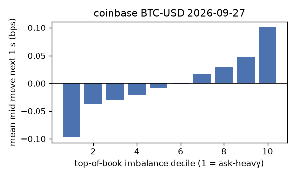
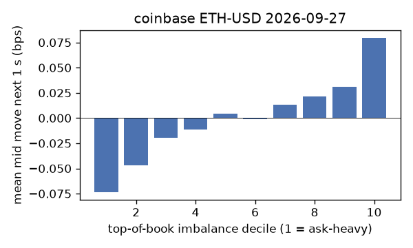
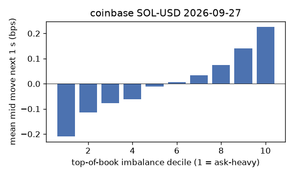
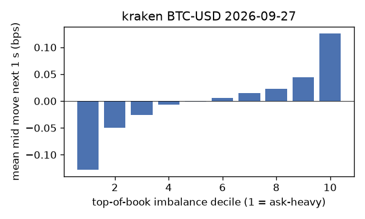
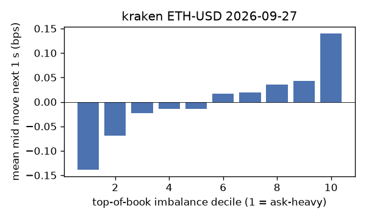
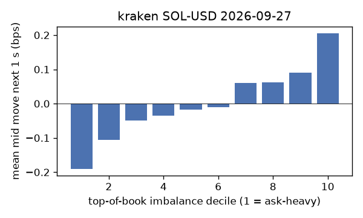

# EDA 2026-09-27

100 ms clock grid; correlations are with the future mid change; nothing measured across a reconnect.

|                       |   ('coinbase', 'BTC-USD') |   ('coinbase', 'ETH-USD') |   ('coinbase', 'SOL-USD') |   ('kraken', 'BTC-USD') |   ('kraken', 'ETH-USD') |   ('kraken', 'SOL-USD') |
|:----------------------|--------------------------:|--------------------------:|--------------------------:|------------------------:|------------------------:|------------------------:|
| hours                 |                   23.4229 |                   23.4229 |                   23.4229 |                 23.4229 |                 23.4229 |                 23.4229 |
| mid                   |                84556.5    |                 2696.18   |                  122.02   |              84551.1    |               2696.16   |                122.015  |
| tick                  |                    0.01   |                    0.01   |                    0.01   |                  0.1    |                  0.01   |                  0.01   |
| spread_med_bps        |                    0.0012 |                    0.0371 |                    0.8195 |                  0.0118 |                  0.0371 |                  0.8196 |
| spread_p90_bps        |                    0.0012 |                    0.6305 |                    1.6391 |                  0.0118 |                  0.0371 |                  1.6391 |
| at_1_tick_%           |                   95.1978 |                   53.2141 |                   51.6155 |                 99.4802 |                 93.2044 |                 86.3027 |
| taker_events/min      |                  136.257  |                   36.0262 |                   39.4813 |                 29.6668 |                 16.7343 |                 17.8886 |
| taker_usd_med         |                    0.0152 |                   52.1631 |                   50.4858 |                 45.9781 |                 49.0062 |                 57.7538 |
| inter_taker_ms_med    |                  302.523  |                 1000.36   |                  899.449  |               1043.87   |               1930.79   |               1860.78   |
| moved_100ms_%         |                    4.3487 |                   15.8378 |                    7.109  |                  1.9315 |                  6.3064 |                  7.4207 |
| corr_obi1_100ms       |                    0.0663 |                    0.0558 |                    0.0894 |                  0.1115 |                  0.0844 |                  0.0901 |
| corr_obi5_100ms       |                    0.0585 |                    0.0393 |                    0.054  |                  0.1161 |                  0.0763 |                  0.0497 |
| corr_micro_edge_100ms |                    0.0459 |                    0.0298 |                    0.0871 |                  0.091  |                  0.0654 |                  0.0919 |
| moved_1s_%            |                   18.046  |                   52.901  |                   36.3714 |                 11.85   |                 28.1558 |                 31.8425 |
| corr_obi1_1s          |                    0.1298 |                    0.0789 |                    0.1268 |                  0.1902 |                  0.1454 |                  0.1096 |
| corr_obi5_1s          |                    0.1169 |                    0.0612 |                    0.0797 |                  0.1948 |                  0.1288 |                  0.0689 |
| corr_micro_edge_1s    |                    0.0255 |                    0.0246 |                    0.1167 |                  0.0842 |                  0.0624 |                  0.1049 |
| moved_10s_%           |                   59.9247 |                   86.37   |                   82.7435 |                 56.4055 |                 76.8755 |                 76.8921 |
| corr_obi1_10s         |                    0.1371 |                    0.0641 |                    0.0874 |                  0.2136 |                  0.1431 |                  0.0797 |
| corr_obi5_10s         |                    0.1344 |                    0.0486 |                    0.0666 |                  0.2134 |                  0.1332 |                  0.064  |
| corr_micro_edge_10s   |                    0.0135 |                    0.0147 |                    0.0742 |                  0.0565 |                  0.0387 |                  0.0731 |
| ofi_R2_same_1s        |                    0.077  |                    0.1899 |                    0.44   |                  0.3885 |                  0.2903 |                  0.3792 |
| ofi_R2_next_1s        |                    0.0044 |                    0.0013 |                    0.0017 |                  0.0156 |                  0.0085 |                  0.0029 |

