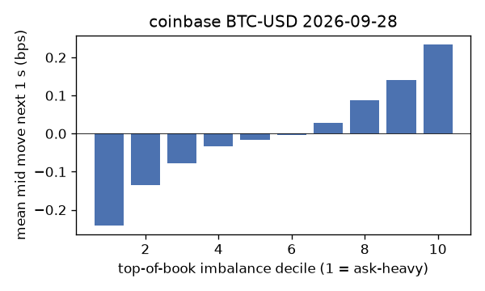
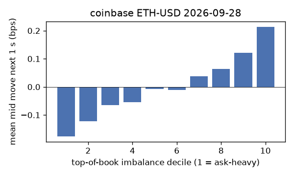
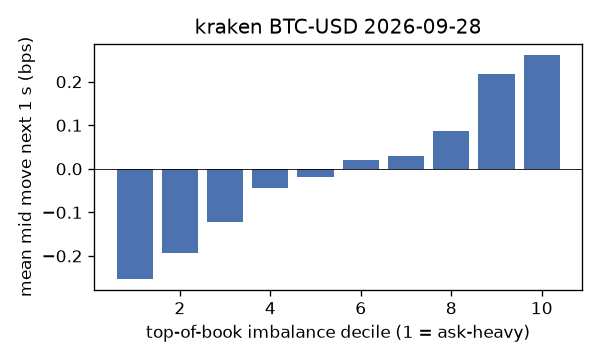
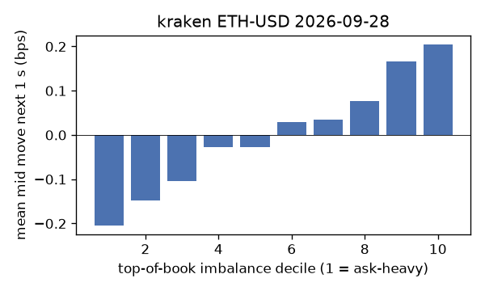
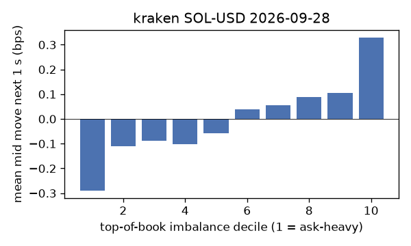

# EDA 2026-09-28

100 ms clock grid; correlations are with the future mid change; nothing measured across a reconnect.

|                       |   ('coinbase', 'BTC-USD') |   ('coinbase', 'ETH-USD') |   ('coinbase', 'SOL-USD') |   ('kraken', 'BTC-USD') |   ('kraken', 'ETH-USD') |   ('kraken', 'SOL-USD') |
|:----------------------|--------------------------:|--------------------------:|--------------------------:|------------------------:|------------------------:|------------------------:|
| hours                 |                   23.9996 |                   23.9996 |                   23.9995 |                 23.9966 |                 23.9966 |                 23.9963 |
| mid                   |                83397.3    |                 2671.24   |                  118.895  |              83396.4    |               2671.24   |                118.895  |
| tick                  |                    0.01   |                    0.01   |                    0.01   |                  0.1    |                  0.01   |                  0.01   |
| spread_med_bps        |                    0.0012 |                    0.0374 |                    0.8411 |                  0.012  |                  0.0374 |                  0.8411 |
| spread_p90_bps        |                    0.0899 |                    0.7113 |                    1.6822 |                  0.012  |                  0.9359 |                  1.6822 |
| at_1_tick_%           |                   87.9902 |                   56.6803 |                   66.3015 |                 97.9646 |                 79.2509 |                 71.6813 |
| taker_events/min      |                  176.416  |                   58.1445 |                   56.8954 |                 52.7564 |                 28.5221 |                 21.7487 |
| taker_usd_med         |                    0.031  |                  185.278  |                   58.1622 |                 54.072  |                 60.7467 |                 73.1496 |
| inter_taker_ms_med    |                  291.733  |                  599.599  |                  602.686  |                507.553  |                954.669  |               1613.69   |
| moved_100ms_%         |                   13.6009 |                   26.9856 |                   11.8669 |                  6.2557 |                 18.4595 |                 16.4734 |
| corr_obi1_100ms       |                    0.1097 |                    0.0868 |                    0.1167 |                  0.1686 |                  0.0882 |                  0.0969 |
| corr_obi5_100ms       |                    0.0925 |                    0.0563 |                    0.1036 |                  0.1702 |                  0.0878 |                  0.0596 |
| corr_micro_edge_100ms |                    0.0408 |                    0.0325 |                    0.1146 |                  0.1352 |                  0.0469 |                  0.0919 |
| moved_1s_%            |                   43.9227 |                   69.6311 |                   49.7669 |                 27.5624 |                 53.9942 |                 52.3649 |
| corr_obi1_1s          |                    0.1814 |                    0.1249 |                    0.1681 |                  0.278  |                  0.1584 |                  0.1229 |
| corr_obi5_1s          |                    0.1529 |                    0.0818 |                    0.1374 |                  0.2736 |                  0.144  |                  0.0787 |
| corr_micro_edge_1s    |                    0.0294 |                    0.0371 |                    0.1495 |                  0.1169 |                  0.0399 |                  0.1054 |
| moved_10s_%           |                   89.3971 |                   96.183  |                   89.3742 |                 80.8998 |                 92.7375 |                 87.6035 |
| corr_obi1_10s         |                    0.1064 |                    0.0688 |                    0.0948 |                  0.2263 |                  0.1197 |                  0.0711 |
| corr_obi5_10s         |                    0.1005 |                    0.0454 |                    0.0709 |                  0.2316 |                  0.1153 |                  0.0513 |
| corr_micro_edge_10s   |                    0.0088 |                    0.0225 |                    0.0824 |                  0.0545 |                  0.0248 |                  0.0599 |
| ofi_R2_same_1s        |                    0.2489 |                    0.3428 |                    0.3585 |                  0.3575 |                  0.1593 |                  0.3873 |
| ofi_R2_next_1s        |                    0.0078 |                    0.0043 |                    0.0036 |                  0.0251 |                  0.0059 |                  0.002  |

