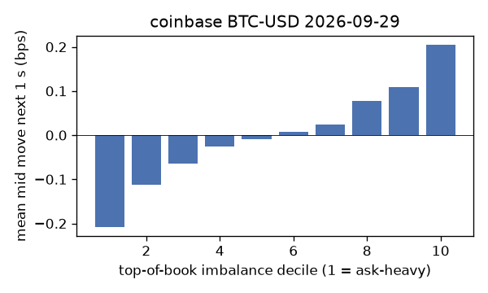
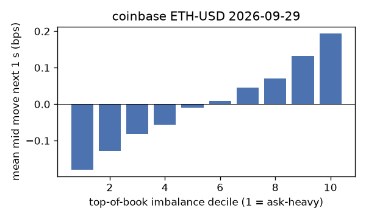
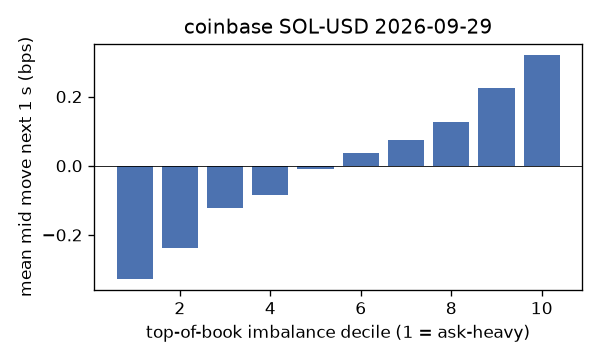
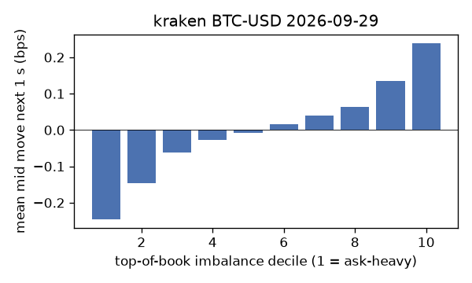
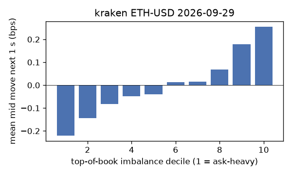
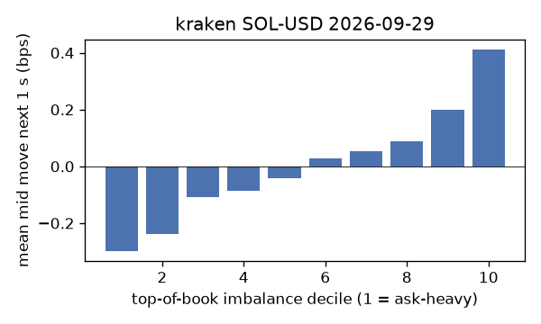

# EDA 2026-09-29

100 ms clock grid; correlations are with the future mid change; nothing measured across a reconnect.

|                       |   ('coinbase', 'BTC-USD') |   ('coinbase', 'ETH-USD') |   ('coinbase', 'SOL-USD') |   ('kraken', 'BTC-USD') |   ('kraken', 'ETH-USD') |   ('kraken', 'SOL-USD') |
|:----------------------|--------------------------:|--------------------------:|--------------------------:|------------------------:|------------------------:|------------------------:|
| hours                 |                   23.9996 |                   23.9996 |                   23.9995 |                 23.9966 |                 23.9967 |                 23.9965 |
| mid                   |                83564.4    |                 2687.7    |                  118.985  |              83565.1    |               2687.66   |                118.975  |
| tick                  |                    0.01   |                    0.01   |                    0.01   |                  0.1    |                  0.01   |                  0.01   |
| spread_med_bps        |                    0.0012 |                    0.0372 |                    0.8404 |                  0.012  |                  0.0372 |                  0.8405 |
| spread_p90_bps        |                    0.0562 |                    0.6325 |                    1.6809 |                  0.012  |                  0.186  |                  0.8405 |
| at_1_tick_%           |                   88.5592 |                   58.6048 |                   71.8435 |                 98.7232 |                 88.411  |                 90.143  |
| taker_events/min      |                  176.672  |                   62.4733 |                   52.8063 |                 52.422  |                 29.9385 |                 20.9825 |
| taker_usd_med         |                    0.0293 |                  199.5    |                   61.986  |                 46.4957 |                 57.2936 |                100      |
| inter_taker_ms_med    |                  297.697  |                  599.538  |                  700.388  |                529.794  |                937.008  |               1706.75   |
| moved_100ms_%         |                   13.5453 |                   28.7702 |                   10.5955 |                  5.8687 |                 14.8579 |                 10.4501 |
| corr_obi1_100ms       |                    0.1147 |                    0.1086 |                    0.1195 |                  0.1839 |                  0.1181 |                  0.1342 |
| corr_obi5_100ms       |                    0.0962 |                    0.0776 |                    0.0788 |                  0.1949 |                  0.1007 |                  0.0997 |
| corr_micro_edge_100ms |                    0.0466 |                    0.0374 |                    0.1158 |                  0.0948 |                  0.0615 |                  0.1386 |
| moved_1s_%            |                   40.0045 |                   68.6334 |                   46.1237 |                 29.4419 |                 48.8749 |                 40.5428 |
| corr_obi1_1s          |                    0.1872 |                    0.1385 |                    0.1714 |                  0.262  |                  0.1822 |                  0.1814 |
| corr_obi5_1s          |                    0.1554 |                    0.0997 |                    0.1083 |                  0.2664 |                  0.1548 |                  0.1414 |
| corr_micro_edge_1s    |                    0.0218 |                    0.0311 |                    0.1515 |                  0.0892 |                  0.0603 |                  0.175  |
| moved_10s_%           |                   87.5824 |                   96.6957 |                   88.3077 |                 84.4746 |                 91.8793 |                 83.7592 |
| corr_obi1_10s         |                    0.1314 |                    0.0754 |                    0.0969 |                  0.1769 |                  0.1199 |                  0.1058 |
| corr_obi5_10s         |                    0.1133 |                    0.0588 |                    0.0504 |                  0.1875 |                  0.0927 |                  0.0818 |
| corr_micro_edge_10s   |                    0.0119 |                    0.0136 |                    0.0838 |                  0.0362 |                  0.0353 |                  0.1014 |
| ofi_R2_same_1s        |                    0.1254 |                    0.2991 |                    0.4548 |                  0.442  |                  0.3086 |                  0.4039 |
| ofi_R2_next_1s        |                    0.0043 |                    0.0031 |                    0.0025 |                  0.0216 |                  0.011  |                  0.0056 |

