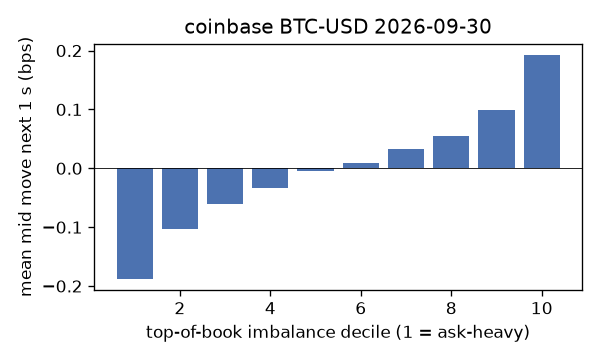
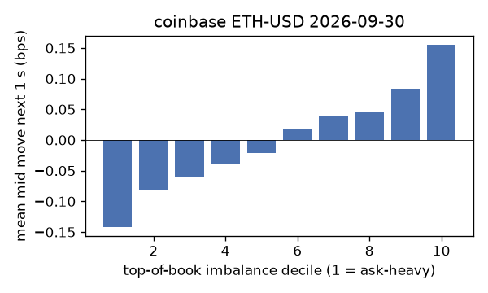
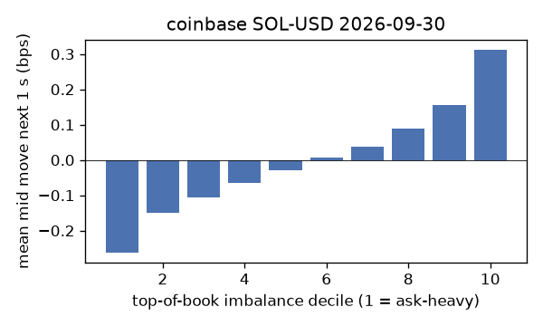
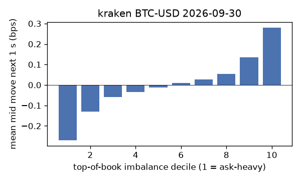
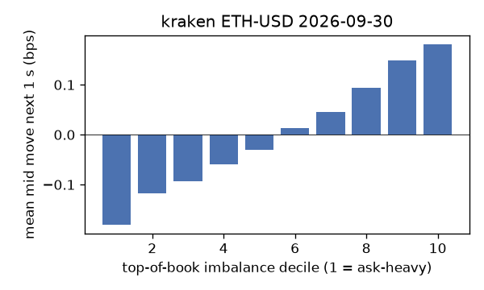
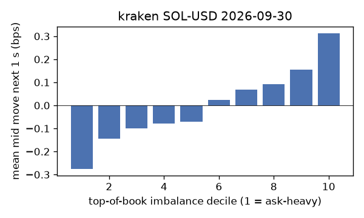

# EDA 2026-09-30

100 ms clock grid; correlations are with the future mid change; nothing measured across a reconnect.

|                       |   ('coinbase', 'BTC-USD') |   ('coinbase', 'ETH-USD') |   ('coinbase', 'SOL-USD') |   ('kraken', 'BTC-USD') |   ('kraken', 'ETH-USD') |   ('kraken', 'SOL-USD') |
|:----------------------|--------------------------:|--------------------------:|--------------------------:|------------------------:|------------------------:|------------------------:|
| hours                 |                   23.9996 |                   23.9996 |                   23.9996 |                 23.9991 |                 23.9992 |                 23.9992 |
| mid                   |                83650      |                 2678.3    |                  118.99   |              83653.1    |               2678.34   |                118.985  |
| tick                  |                    0.01   |                    0.01   |                    0.01   |                  0.1    |                  0.01   |                  0.01   |
| spread_med_bps        |                    0.0012 |                    0.0373 |                    0.8404 |                  0.012  |                  0.0373 |                  0.8404 |
| spread_p90_bps        |                    0.1303 |                    0.6721 |                    1.6808 |                  0.012  |                  0.2987 |                  1.6809 |
| at_1_tick_%           |                   85.7159 |                   52.3962 |                   59.0127 |                 97.5895 |                 88.6215 |                 77.4508 |
| taker_events/min      |                  175.036  |                   54.3936 |                   53.8448 |                 53.9001 |                 25.7941 |                 22.2683 |
| taker_usd_med         |                    0.5613 |                  141.205  |                   52.1543 |                 52.9289 |                 56.1029 |                 92.1989 |
| inter_taker_ms_med    |                  210.999  |                  602.247  |                  700.176  |                467.568  |               1091.37   |               1485.83   |
| moved_100ms_%         |                   15.6567 |                   26.9945 |                   13.4024 |                  6.4704 |                 11.558  |                 11.9109 |
| corr_obi1_100ms       |                    0.0941 |                    0.0867 |                    0.1094 |                  0.1676 |                  0.0943 |                  0.0924 |
| corr_obi5_100ms       |                    0.0722 |                    0.0558 |                    0.0492 |                  0.1727 |                  0.0921 |                  0.0746 |
| corr_micro_edge_100ms |                    0.0537 |                    0.0374 |                    0.1058 |                  0.1164 |                  0.0539 |                  0.0883 |
| moved_1s_%            |                   42.5216 |                   68.2397 |                   49.4603 |                 27.2856 |                 39.1159 |                 43.4913 |
| corr_obi1_1s          |                    0.1407 |                    0.1037 |                    0.1265 |                  0.2248 |                  0.1627 |                  0.136  |
| corr_obi5_1s          |                    0.1101 |                    0.0648 |                    0.0572 |                  0.219  |                  0.1497 |                  0.0928 |
| corr_micro_edge_1s    |                    0.034  |                    0.0284 |                    0.109  |                  0.088  |                  0.0554 |                  0.118  |
| moved_10s_%           |                   89.011  |                   96.0992 |                   88.9413 |                 80.76   |                 87.0202 |                 85.3643 |
| corr_obi1_10s         |                    0.0903 |                    0.064  |                    0.0674 |                  0.1527 |                  0.1331 |                  0.0798 |
| corr_obi5_10s         |                    0.0752 |                    0.0418 |                    0.0364 |                  0.1479 |                  0.1205 |                  0.0427 |
| corr_micro_edge_10s   |                    0.0138 |                    0.0143 |                    0.0539 |                  0.0493 |                  0.0387 |                  0.0662 |
| ofi_R2_same_1s        |                    0.1503 |                    0.3011 |                    0.3184 |                  0.3879 |                  0.1724 |                  0.3774 |
| ofi_R2_next_1s        |                    0.0042 |                    0.002  |                    0.0011 |                  0.0155 |                  0.0086 |                  0.0036 |

