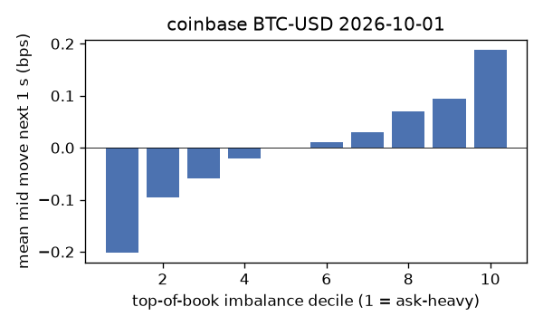
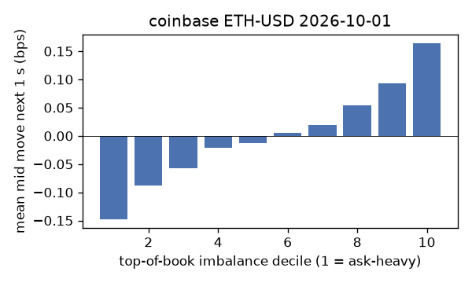
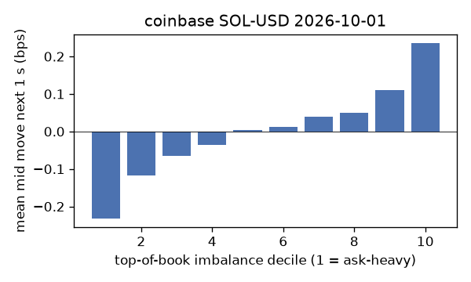
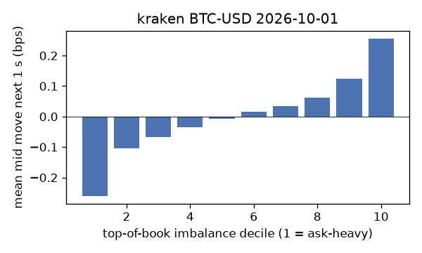
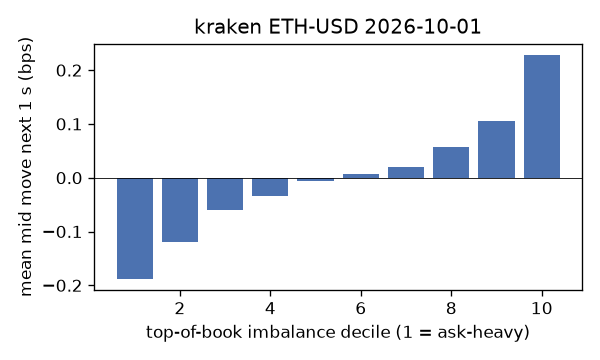
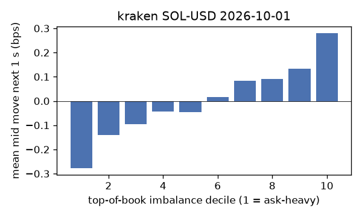

# EDA 2026-10-01

100 ms clock grid; correlations are with the future mid change; nothing measured across a reconnect.

|                       |   ('coinbase', 'BTC-USD') |   ('coinbase', 'ETH-USD') |   ('coinbase', 'SOL-USD') |   ('kraken', 'BTC-USD') |   ('kraken', 'ETH-USD') |   ('kraken', 'SOL-USD') |
|:----------------------|--------------------------:|--------------------------:|--------------------------:|------------------------:|------------------------:|------------------------:|
| hours                 |                   23.9995 |                   23.9995 |                   23.9995 |                 23.9992 |                 23.999  |                 23.9992 |
| mid                   |                83949.6    |                 2694.29   |                  117.97   |              83948.4    |               2694.24   |                117.975  |
| tick                  |                    0.01   |                    0.01   |                    0.01   |                  0.1    |                  0.01   |                  0.01   |
| spread_med_bps        |                    0.0012 |                    0.0742 |                    1.6953 |                  0.0119 |                  0.0371 |                  0.8476 |
| spread_p90_bps        |                    0.0226 |                    0.7052 |                    1.6953 |                  0.0119 |                  0.334  |                  0.8476 |
| at_1_tick_%           |                   89.4409 |                   48.2353 |                   49.1704 |                 97.5312 |                 85.0847 |                 93.2107 |
| taker_events/min      |                  175.445  |                   58.6195 |                   45.2303 |                 53.8323 |                 25.4485 |                 21.1478 |
| taker_usd_med         |                    1.8424 |                   94.8568 |                   51.5801 |                 58.7006 |                 49.0344 |                 49.0196 |
| inter_taker_ms_med    |                  205      |                  599.548  |                  800.577  |                493.627  |               1167.34   |               1651.36   |
| moved_100ms_%         |                   13.3493 |                   27.1895 |                   10.8287 |                  6.2317 |                 15.0028 |                  8.0639 |
| corr_obi1_100ms       |                    0.1014 |                    0.0854 |                    0.0914 |                  0.1736 |                  0.1019 |                  0.125  |
| corr_obi5_100ms       |                    0.0658 |                    0.0491 |                    0.0698 |                  0.1788 |                  0.0872 |                  0.0687 |
| corr_micro_edge_100ms |                    0.0511 |                    0.0347 |                    0.086  |                  0.1024 |                  0.0666 |                  0.1274 |
| moved_1s_%            |                   41.6419 |                   69.2133 |                   48.0454 |                 28.0473 |                 45.1153 |                 33.5546 |
| corr_obi1_1s          |                    0.1555 |                    0.1117 |                    0.1241 |                  0.241  |                  0.1571 |                  0.1596 |
| corr_obi5_1s          |                    0.1006 |                    0.0687 |                    0.0894 |                  0.2368 |                  0.1364 |                  0.0963 |
| corr_micro_edge_1s    |                    0.0238 |                    0.0314 |                    0.1053 |                  0.0898 |                  0.0611 |                  0.1554 |
| moved_10s_%           |                   87.9242 |                   96.5705 |                   87.4798 |                 80.5242 |                 88.2985 |                 79.1409 |
| corr_obi1_10s         |                    0.1047 |                    0.0639 |                    0.0739 |                  0.1592 |                  0.1205 |                  0.0981 |
| corr_obi5_10s         |                    0.0771 |                    0.045  |                    0.0536 |                  0.161  |                  0.11   |                  0.076  |
| corr_micro_edge_10s   |                    0.0116 |                    0.0145 |                    0.0609 |                  0.0407 |                  0.0315 |                  0.0951 |
| ofi_R2_same_1s        |                    0.1933 |                    0.2143 |                    0.3765 |                  0.4247 |                  0.2026 |                  0.4007 |
| ofi_R2_next_1s        |                    0.0044 |                    0.0024 |                    0.0011 |                  0.0236 |                  0.0064 |                  0.0043 |

