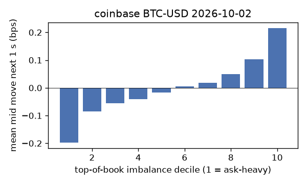
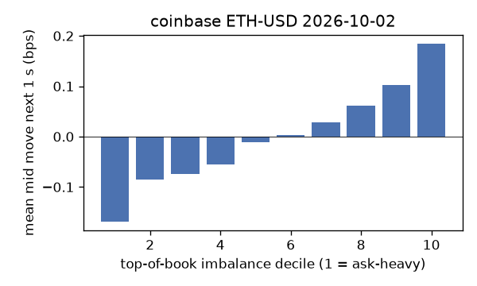
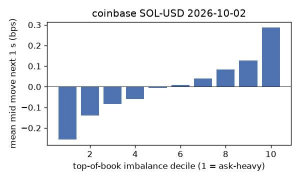
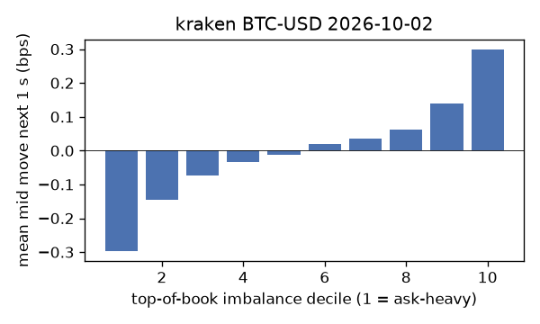
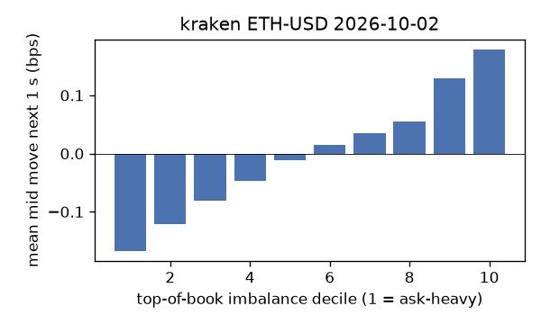
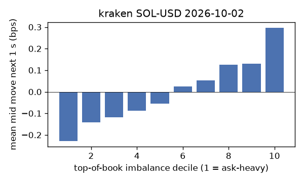

# EDA 2026-10-02

100 ms clock grid; correlations are with the future mid change; nothing measured across a reconnect.

|                       |   ('coinbase', 'BTC-USD') |   ('coinbase', 'ETH-USD') |   ('coinbase', 'SOL-USD') |   ('kraken', 'BTC-USD') |   ('kraken', 'ETH-USD') |   ('kraken', 'SOL-USD') |
|:----------------------|--------------------------:|--------------------------:|--------------------------:|------------------------:|------------------------:|------------------------:|
| hours                 |                   23.9995 |                   23.9996 |                   23.9996 |                 23.999  |                 23.9991 |                 23.9992 |
| mid                   |                85397      |                 2715.16   |                  120.1    |              85394.1    |               2715.16   |                120.1    |
| tick                  |                    0.01   |                    0.01   |                    0.01   |                  0.1    |                  0.01   |                  0.01   |
| spread_med_bps        |                    0.0012 |                    0.0368 |                    0.8326 |                  0.0117 |                  0.0368 |                  0.8326 |
| spread_p90_bps        |                    0.1464 |                    0.7366 |                    1.6653 |                  0.0117 |                  0.9208 |                  1.6653 |
| at_1_tick_%           |                   84.6388 |                   50.38   |                   54.7752 |                 97.2594 |                 80.2691 |                 80.9304 |
| taker_events/min      |                  190.096  |                   62.2546 |                   50.9454 |                 64.1096 |                 31.1889 |                 24.656  |
| taker_usd_med         |                    0.3858 |                  188.741  |                   63.0549 |                 69.059  |                 61.3877 |                 65.9179 |
| inter_taker_ms_med    |                  202      |                  504.943  |                  699.726  |                391.005  |                849.258  |               1380.51   |
| moved_100ms_%         |                   15.9283 |                   28.1779 |                   12.2985 |                  7.5652 |                 17.1421 |                 11.7149 |
| corr_obi1_100ms       |                    0.0835 |                    0.0797 |                    0.0936 |                  0.1681 |                  0.0766 |                  0.0938 |
| corr_obi5_100ms       |                    0.0617 |                    0.0622 |                    0.0834 |                  0.1779 |                  0.0782 |                  0.0586 |
| corr_micro_edge_100ms |                    0.0402 |                    0.033  |                    0.0868 |                  0.0575 |                  0.0514 |                  0.0821 |
| moved_1s_%            |                   47.0931 |                   71.2985 |                   50.6999 |                 31.9384 |                 50.5992 |                 43.0407 |
| corr_obi1_1s          |                    0.1316 |                    0.107  |                    0.1173 |                  0.2243 |                  0.1276 |                  0.1321 |
| corr_obi5_1s          |                    0.0958 |                    0.0807 |                    0.1034 |                  0.2242 |                  0.1179 |                  0.0775 |
| corr_micro_edge_1s    |                    0.02   |                    0.0328 |                    0.0962 |                  0.0104 |                  0.0403 |                  0.1148 |
| moved_10s_%           |                   88.3861 |                   96.8404 |                   88.573  |                 83.4804 |                 90.6071 |                 83.5967 |
| corr_obi1_10s         |                    0.0854 |                    0.0572 |                    0.0579 |                  0.1383 |                  0.1006 |                  0.0831 |
| corr_obi5_10s         |                    0.0656 |                    0.0427 |                    0.0559 |                  0.142  |                  0.0798 |                  0.0395 |
| corr_micro_edge_10s   |                    0.0072 |                    0.0072 |                    0.0467 |                  0.0267 |                  0.0238 |                  0.0654 |
| ofi_R2_same_1s        |                    0.0967 |                    0.3279 |                    0.2519 |                  0.3749 |                  0.1643 |                  0.2127 |
| ofi_R2_next_1s        |                    0.0027 |                    0.003  |                    0.0013 |                  0.0177 |                  0.0043 |                  0.0008 |

