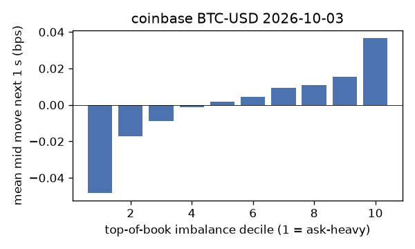
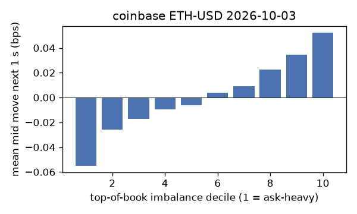
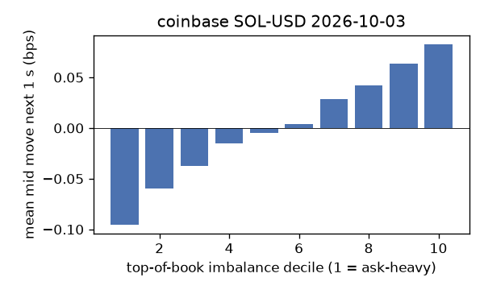
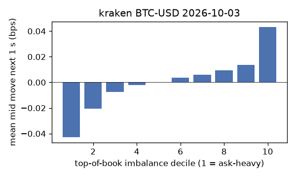
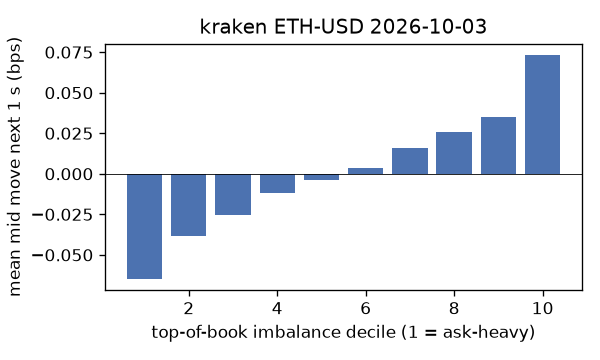
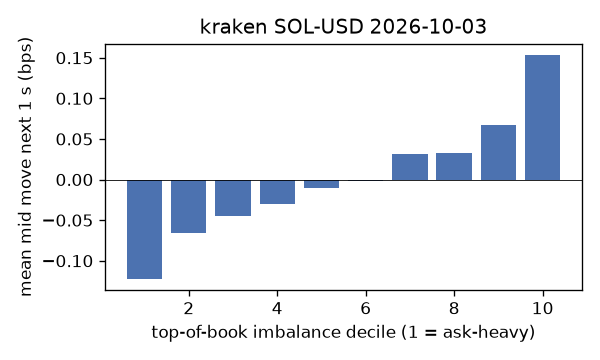

# EDA 2026-10-03

100 ms clock grid; correlations are with the future mid change; nothing measured across a reconnect.

|                       |   ('coinbase', 'BTC-USD') |   ('coinbase', 'ETH-USD') |   ('coinbase', 'SOL-USD') |   ('kraken', 'BTC-USD') |   ('kraken', 'ETH-USD') |   ('kraken', 'SOL-USD') |
|:----------------------|--------------------------:|--------------------------:|--------------------------:|------------------------:|------------------------:|------------------------:|
| hours                 |                   23.9995 |                   23.9995 |                   23.9996 |                 23.9992 |                 23.9991 |                 23.9992 |
| mid                   |                84676.2    |                 2681.39   |                  119.46   |              84672.6    |               2681.34   |                119.455  |
| tick                  |                    0.01   |                    0.01   |                    0.01   |                  0.1    |                  0.01   |                  0.01   |
| spread_med_bps        |                    0.0012 |                    0.0373 |                    0.8371 |                  0.0118 |                  0.0373 |                  0.8371 |
| spread_p90_bps        |                    0.0012 |                    0.4102 |                    1.6742 |                  0.0118 |                  0.0373 |                  0.8371 |
| at_1_tick_%           |                   97.4855 |                   62.6168 |                   56.5319 |                 99.8692 |                 99.4452 |                 97.6123 |
| taker_events/min      |                  143.342  |                   30.2444 |                   29.0588 |                 24.1827 |                 14.8416 |                 14.91   |
| taker_usd_med         |                    0.0152 |                   47.421  |                   37.9623 |                 50.2678 |                 39.2109 |                 41.6955 |
| inter_taker_ms_med    |                  301.127  |                 1200.23   |                 1298.29   |               1437.86   |               2313.83   |               2528.61   |
| moved_100ms_%         |                    1.9682 |                   10.0484 |                    3.5635 |                  0.8245 |                  1.5447 |                  1.5761 |
| corr_obi1_100ms       |                    0.045  |                    0.0653 |                    0.0654 |                  0.0753 |                  0.0753 |                  0.0947 |
| corr_obi5_100ms       |                    0.0379 |                    0.0437 |                    0.0484 |                  0.0814 |                  0.0638 |                  0.0596 |
| corr_micro_edge_100ms |                    0.0655 |                    0.0351 |                    0.0633 |                  0.1761 |                  0.1062 |                  0.0996 |
| moved_1s_%            |                    8.9543 |                   38.214  |                   22.1055 |                  5.4911 |                 10.4111 |                 10.5265 |
| corr_obi1_1s          |                    0.0958 |                    0.1052 |                    0.1181 |                  0.1203 |                  0.1502 |                  0.1698 |
| corr_obi5_1s          |                    0.0807 |                    0.0747 |                    0.0923 |                  0.1194 |                  0.1233 |                  0.1073 |
| corr_micro_edge_1s    |                    0.0519 |                    0.0321 |                    0.1079 |                  0.171  |                  0.1312 |                  0.1728 |
| moved_10s_%           |                   39.3684 |                   78.1395 |                   67.9055 |                 32.5031 |                 51.6966 |                 50.2627 |
| corr_obi1_10s         |                    0.1563 |                    0.1162 |                    0.096  |                  0.1705 |                  0.2135 |                  0.2041 |
| corr_obi5_10s         |                    0.1394 |                    0.0844 |                    0.0871 |                  0.1591 |                  0.1751 |                  0.1402 |
| corr_micro_edge_10s   |                    0.0252 |                    0.0207 |                    0.0852 |                  0.1054 |                  0.1408 |                  0.2037 |
| ofi_R2_same_1s        |                    0.091  |                    0.2549 |                    0.3109 |                  0.4531 |                  0.2558 |                  0.3872 |
| ofi_R2_next_1s        |                    0.0048 |                    0.0039 |                    0.0012 |                  0.0125 |                  0.0096 |                  0.01   |

