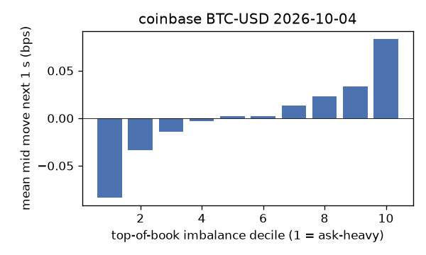
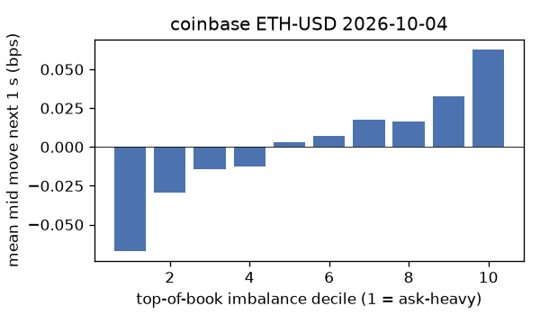
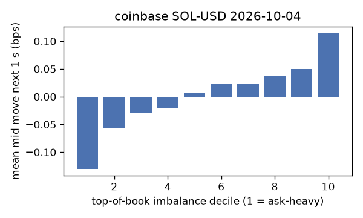
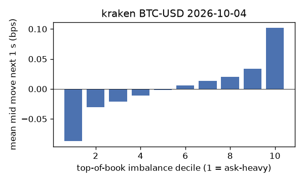
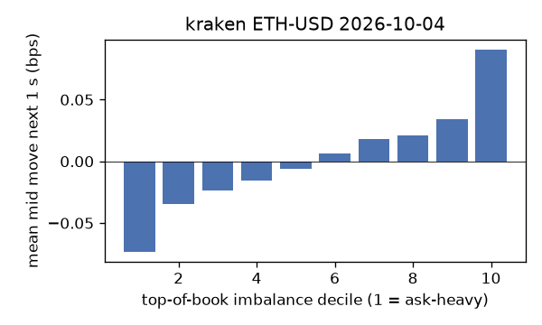
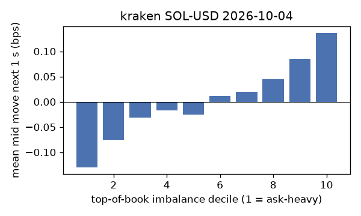

# EDA 2026-10-04

100 ms clock grid; correlations are with the future mid change; nothing measured across a reconnect.

|                       |   ('coinbase', 'BTC-USD') |   ('coinbase', 'ETH-USD') |   ('coinbase', 'SOL-USD') |   ('kraken', 'BTC-USD') |   ('kraken', 'ETH-USD') |   ('kraken', 'SOL-USD') |
|:----------------------|--------------------------:|--------------------------:|--------------------------:|------------------------:|------------------------:|------------------------:|
| hours                 |                   23.9996 |                   23.9996 |                   23.9996 |                 23.9992 |                 23.9992 |                 23.9992 |
| mid                   |                85235.6    |                 2699.43   |                  121.28   |              85235.1    |               2699.41   |                121.275  |
| tick                  |                    0.01   |                    0.01   |                    0.01   |                  0.1    |                  0.01   |                  0.01   |
| spread_med_bps        |                    0.0012 |                    0.037  |                    0.8245 |                  0.0117 |                  0.037  |                  0.8246 |
| spread_p90_bps        |                    0.0012 |                    0.5186 |                    1.6491 |                  0.0117 |                  0.037  |                  0.8246 |
| at_1_tick_%           |                   97.2184 |                   60.2226 |                   56.5727 |                 99.6819 |                 92.6345 |                 92.852  |
| taker_events/min      |                  109.46   |                   30.8456 |                   26.5005 |                 28.3373 |                 14.7907 |                 15.8367 |
| taker_usd_med         |                    0.0363 |                   48.5892 |                   36.1578 |                 50.3567 |                 47.8529 |                 46.8513 |
| inter_taker_ms_med    |                  399.774  |                 1102.8    |                 1397.5    |               1003.15   |               2195.61   |               2225.48   |
| moved_100ms_%         |                    3.01   |                   11.7855 |                    3.964  |                  1.5475 |                  4.296  |                  3.0204 |
| corr_obi1_100ms       |                    0.0552 |                    0.0554 |                    0.0579 |                  0.0989 |                  0.0632 |                  0.0799 |
| corr_obi5_100ms       |                    0.045  |                    0.039  |                    0.0379 |                  0.1041 |                  0.0577 |                  0.0448 |
| corr_micro_edge_100ms |                    0.0566 |                    0.0267 |                    0.0566 |                  0.0844 |                  0.0425 |                  0.0817 |
| moved_1s_%            |                   12.8373 |                   40.2178 |                   23.5148 |                  8.9973 |                 18.5307 |                 15.9976 |
| corr_obi1_1s          |                    0.1098 |                    0.0829 |                    0.1046 |                  0.1477 |                  0.11   |                  0.124  |
| corr_obi5_1s          |                    0.0921 |                    0.0701 |                    0.0678 |                  0.1434 |                  0.0996 |                  0.0661 |
| corr_micro_edge_1s    |                    0.0285 |                    0.0223 |                    0.0941 |                  0.0748 |                  0.0377 |                  0.122  |
| moved_10s_%           |                   47.9376 |                   77.4544 |                   67.8333 |                 40.6196 |                 57.0516 |                 57.4108 |
| corr_obi1_10s         |                    0.137  |                    0.0884 |                    0.0869 |                  0.1572 |                  0.1156 |                  0.1233 |
| corr_obi5_10s         |                    0.122  |                    0.0871 |                    0.0686 |                  0.1508 |                  0.117  |                  0.0725 |
| corr_micro_edge_10s   |                    0.0191 |                    0.0161 |                    0.0681 |                  0.0351 |                  0.0341 |                  0.1209 |
| ofi_R2_same_1s        |                    0.1455 |                    0.2855 |                    0.2248 |                  0.4443 |                  0.2227 |                  0.3419 |
| ofi_R2_next_1s        |                    0.0051 |                    0.0022 |                    0.0005 |                  0.016  |                  0.0069 |                  0.0034 |

