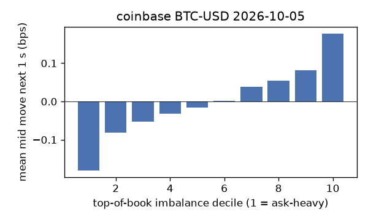
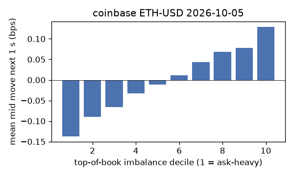
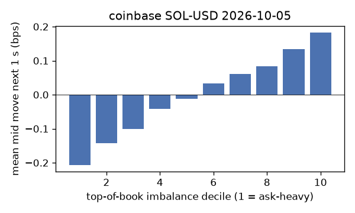
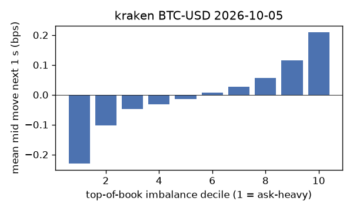
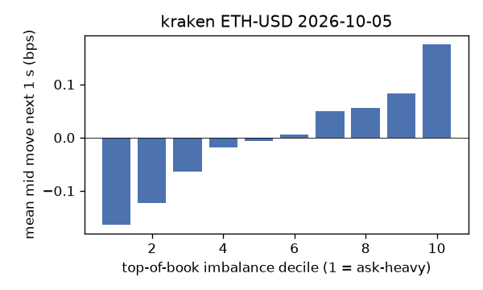
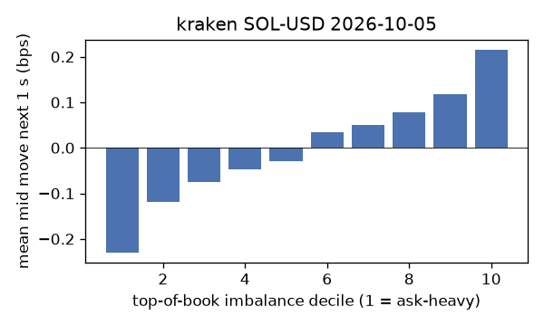

# EDA 2026-10-05

100 ms clock grid; correlations are with the future mid change; nothing measured across a reconnect.

|                       |   ('coinbase', 'BTC-USD') |   ('coinbase', 'ETH-USD') |   ('coinbase', 'SOL-USD') |   ('kraken', 'BTC-USD') |   ('kraken', 'ETH-USD') |   ('kraken', 'SOL-USD') |
|:----------------------|--------------------------:|--------------------------:|--------------------------:|------------------------:|------------------------:|------------------------:|
| hours                 |                   23.9996 |                   23.9996 |                   23.9993 |                 23.9992 |                 23.9992 |                 23.9992 |
| mid                   |                85938.5    |                 2714.95   |                  120.655  |              85932.1    |               2714.99   |                120.645  |
| tick                  |                    0.01   |                    0.01   |                    0.01   |                  0.1    |                  0.01   |                  0.01   |
| spread_med_bps        |                    0.0012 |                    0.0368 |                    0.8288 |                  0.0116 |                  0.0368 |                  0.8289 |
| spread_p90_bps        |                    0.0012 |                    0.5157 |                    1.6576 |                  0.0116 |                  0.0368 |                  0.8289 |
| at_1_tick_%           |                   90.6788 |                   63.6058 |                   51.0617 |                 98.3685 |                 92.9894 |                 91.3497 |
| taker_events/min      |                  164.584  |                   45.2222 |                   33.7179 |                 50.4114 |                 20.0371 |                 17.5913 |
| taker_usd_med         |                    0.0333 |                  144.651  |                   54.9405 |                 50.0004 |                 51.8155 |                 53.1399 |
| inter_taker_ms_med    |                  296.917  |                  795.998  |                 1098.58   |                527.569  |               1554.39   |               2018.17   |
| moved_100ms_%         |                   10.0063 |                   22.3485 |                    7.6252 |                  5.2494 |                  9.7244 |                  6.535  |
| corr_obi1_100ms       |                    0.0886 |                    0.0919 |                    0.1062 |                  0.1691 |                  0.1074 |                  0.1151 |
| corr_obi5_100ms       |                    0.0636 |                    0.0594 |                    0.0754 |                  0.1781 |                  0.0913 |                  0.0639 |
| corr_micro_edge_100ms |                    0.0428 |                    0.0359 |                    0.1079 |                  0.0892 |                  0.0783 |                  0.1162 |
| moved_1s_%            |                   34.9416 |                   58.9058 |                   38.9443 |                 25.3265 |                 36.4386 |                 29.2745 |
| corr_obi1_1s          |                    0.1523 |                    0.1247 |                    0.1625 |                  0.2216 |                  0.1611 |                  0.1619 |
| corr_obi5_1s          |                    0.1072 |                    0.09   |                    0.1108 |                  0.2209 |                  0.1347 |                  0.0969 |
| corr_micro_edge_1s    |                    0.0307 |                    0.0351 |                    0.1535 |                  0.0808 |                  0.0631 |                  0.1566 |
| moved_10s_%           |                   83.8917 |                   92.7578 |                   82.365  |                 78.5166 |                 84.4557 |                 73.6585 |
| corr_obi1_10s         |                    0.1126 |                    0.0781 |                    0.1004 |                  0.1592 |                  0.1292 |                  0.1102 |
| corr_obi5_10s         |                    0.0785 |                    0.0716 |                    0.0647 |                  0.1638 |                  0.1048 |                  0.0806 |
| corr_micro_edge_10s   |                    0.0131 |                    0.0199 |                    0.0899 |                  0.0372 |                  0.0372 |                  0.1046 |
| ofi_R2_same_1s        |                    0.1294 |                    0.3199 |                    0.4021 |                  0.4514 |                  0.2225 |                  0.3686 |
| ofi_R2_next_1s        |                    0.0034 |                    0.0036 |                    0.002  |                  0.0194 |                  0.0062 |                  0.0037 |

