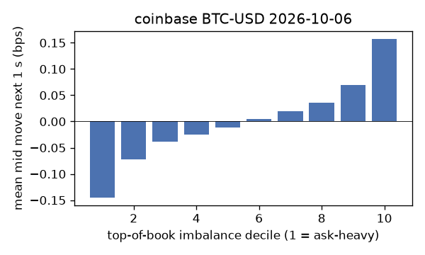
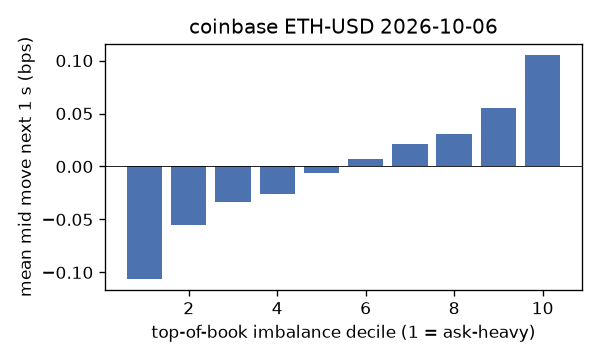
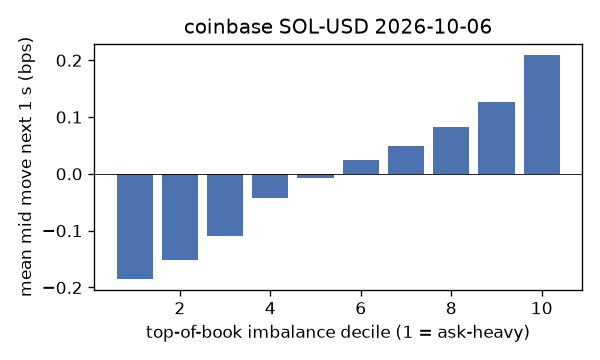
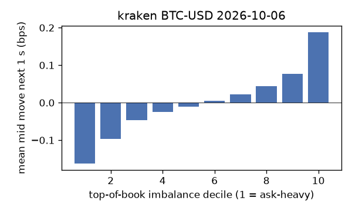
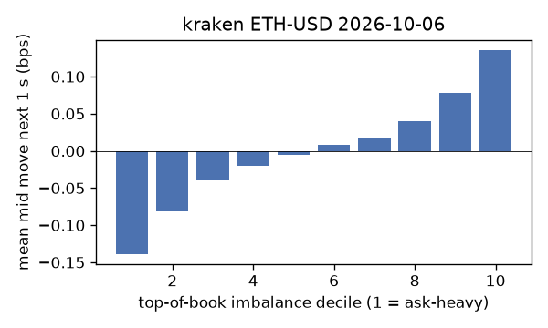
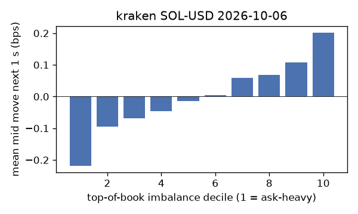

# EDA 2026-10-06

100 ms clock grid; correlations are with the future mid change; nothing measured across a reconnect.

|                       |   ('coinbase', 'BTC-USD') |   ('coinbase', 'ETH-USD') |   ('coinbase', 'SOL-USD') |   ('kraken', 'BTC-USD') |   ('kraken', 'ETH-USD') |   ('kraken', 'SOL-USD') |
|:----------------------|--------------------------:|--------------------------:|--------------------------:|------------------------:|------------------------:|------------------------:|
| hours                 |                   23.9996 |                   23.9996 |                   23.9996 |                 23.9993 |                 23.9993 |                 23.9993 |
| mid                   |                85640.8    |                 2702.59   |                  120.49   |              85639.1    |               2702.64   |                120.495  |
| tick                  |                    0.01   |                    0.01   |                    0.01   |                  0.1    |                  0.01   |                  0.01   |
| spread_med_bps        |                    0.0012 |                    0.037  |                    0.8299 |                  0.0117 |                  0.037  |                  0.8299 |
| spread_p90_bps        |                    0.0012 |                    0.37   |                    1.6599 |                  0.0117 |                  0.037  |                  0.8299 |
| at_1_tick_%           |                   93.5363 |                   70.7503 |                   57.5526 |                 99.4599 |                 95.8006 |                 92.173  |
| taker_events/min      |                  141.971  |                   43.4129 |                   32.4167 |                 37.9569 |                 17.9571 |                 17.5523 |
| taker_usd_med         |                    0.2395 |                  118.378  |                   47.421  |                 51.5653 |                 63.1317 |                 51.73   |
| inter_taker_ms_med    |                  299.679  |                  799.258  |                 1105.71   |                736.892  |               1740      |               2017.75   |
| moved_100ms_%         |                    7.3973 |                   15.7644 |                    6.1531 |                  2.9389 |                  6.4877 |                  5.0755 |
| corr_obi1_100ms       |                    0.0808 |                    0.0788 |                    0.1021 |                  0.1394 |                  0.0999 |                  0.1102 |
| corr_obi5_100ms       |                    0.0648 |                    0.046  |                    0.0782 |                  0.1466 |                  0.0817 |                  0.0538 |
| corr_micro_edge_100ms |                    0.0424 |                    0.029  |                    0.108  |                  0.1495 |                  0.0511 |                  0.1122 |
| moved_1s_%            |                   28.3363 |                   47.3154 |                   32.903  |                 15.9974 |                 27.1527 |                 24.8214 |
| corr_obi1_1s          |                    0.1473 |                    0.1115 |                    0.1636 |                  0.2197 |                  0.1603 |                  0.1533 |
| corr_obi5_1s          |                    0.1198 |                    0.0707 |                    0.1176 |                  0.2225 |                  0.1325 |                  0.0738 |
| corr_micro_edge_1s    |                    0.0275 |                    0.0334 |                    0.1572 |                  0.1244 |                  0.0567 |                  0.1482 |
| moved_10s_%           |                   76.4144 |                   88.4344 |                   79.9578 |                 64.3156 |                 75.4493 |                 70.6635 |
| corr_obi1_10s         |                    0.1299 |                    0.0885 |                    0.1158 |                  0.2164 |                  0.1646 |                  0.108  |
| corr_obi5_10s         |                    0.1216 |                    0.0553 |                    0.0912 |                  0.2142 |                  0.1333 |                  0.0569 |
| corr_micro_edge_10s   |                    0.0118 |                    0.0249 |                    0.1007 |                  0.0699 |                  0.0519 |                  0.0998 |
| ofi_R2_same_1s        |                    0.1437 |                    0.206  |                    0.3785 |                  0.4752 |                  0.2656 |                  0.1539 |
| ofi_R2_next_1s        |                    0.0052 |                    0.0033 |                    0.0041 |                  0.0222 |                  0.0088 |                  0.003  |

