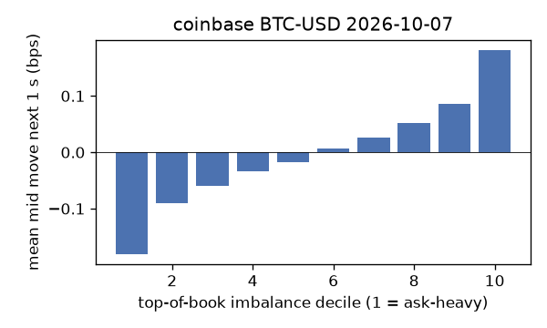
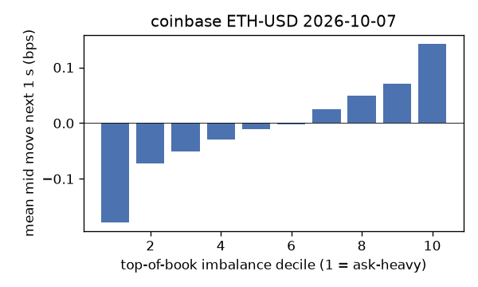
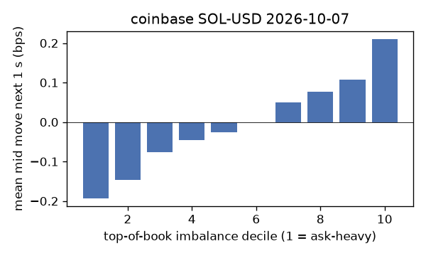
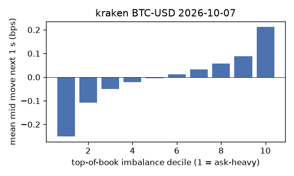
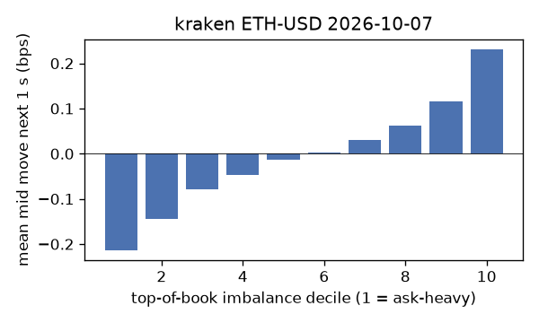
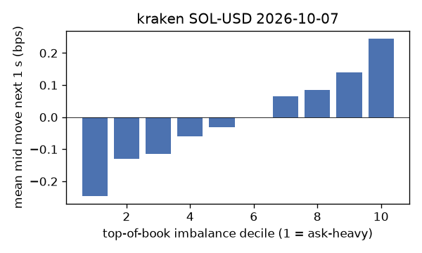

# EDA 2026-10-07

100 ms clock grid; correlations are with the future mid change; nothing measured across a reconnect.

|                       |   ('coinbase', 'BTC-USD') |   ('coinbase', 'ETH-USD') |   ('coinbase', 'SOL-USD') |   ('kraken', 'BTC-USD') |   ('kraken', 'ETH-USD') |   ('kraken', 'SOL-USD') |
|:----------------------|--------------------------:|--------------------------:|--------------------------:|------------------------:|------------------------:|------------------------:|
| hours                 |                   23.9992 |                   23.9992 |                   23.9992 |                 23.9992 |                 23.9992 |                 23.9992 |
| mid                   |                83607.9    |                 2575.86   |                  117.19   |              83609.2    |               2576.11   |                117.185  |
| tick                  |                    0.01   |                    0.01   |                    0.01   |                  0.1    |                  0.01   |                  0.01   |
| spread_med_bps        |                    0.0012 |                    0.0388 |                    1.7066 |                  0.012  |                  0.0388 |                  0.8534 |
| spread_p90_bps        |                    0.0012 |                    0.3494 |                    1.7066 |                  0.012  |                  0.0388 |                  0.8534 |
| at_1_tick_%           |                   92.7576 |                   74.3522 |                   45.0153 |                 98.8774 |                 94.5428 |                 92.865  |
| taker_events/min      |                  112.189  |                   65.2839 |                   37.973  |                 52.2637 |                 30.8531 |                 20.7351 |
| taker_usd_med         |                   28.1121 |                  399.905  |                   49.9964 |                 58.3441 |                 73.579  |                 61.516  |
| inter_taker_ms_med    |                  302.113  |                  498.723  |                  998.867  |                496      |                832.827  |               1693.72   |
| moved_100ms_%         |                    9.2118 |                   18.0747 |                    8.1994 |                  4.4696 |                  7.7343 |                  5.9747 |
| corr_obi1_100ms       |                    0.0904 |                    0.0722 |                    0.0995 |                  0.1442 |                  0.0776 |                  0.1142 |
| corr_obi5_100ms       |                    0.0692 |                    0.0423 |                    0.0582 |                  0.1484 |                  0.0695 |                  0.0788 |
| corr_micro_edge_100ms |                    0.0417 |                    0.0292 |                    0.0997 |                  0.1164 |                  0.036  |                  0.1204 |
| moved_1s_%            |                   33.0914 |                   52.0278 |                   39.6447 |                 22.4344 |                 28.8927 |                 26.511  |
| corr_obi1_1s          |                    0.1517 |                    0.0951 |                    0.1373 |                  0.2162 |                  0.1513 |                  0.1687 |
| corr_obi5_1s          |                    0.1148 |                    0.0551 |                    0.083  |                  0.2131 |                  0.1324 |                  0.1139 |
| corr_micro_edge_1s    |                    0.0221 |                    0.0131 |                    0.1253 |                  0.0973 |                  0.0078 |                  0.1559 |
| moved_10s_%           |                   81.3797 |                   91.7133 |                   83.8512 |                 73.144  |                 77.7734 |                 72.4612 |
| corr_obi1_10s         |                    0.1244 |                    0.0569 |                    0.0856 |                  0.1713 |                  0.1348 |                  0.1202 |
| corr_obi5_10s         |                    0.0932 |                    0.037  |                    0.0636 |                  0.1642 |                  0.1193 |                  0.0888 |
| corr_micro_edge_10s   |                    0.0086 |                    0.005  |                    0.0735 |                  0.0458 |                 -0.0011 |                  0.109  |
| ofi_R2_same_1s        |                    0.1864 |                    0.236  |                    0.3326 |                  0.4173 |                  0.2264 |                  0.251  |
| ofi_R2_next_1s        |                    0.0045 |                    0.0041 |                    0.0013 |                  0.0294 |                  0.0156 |                  0.0035 |

