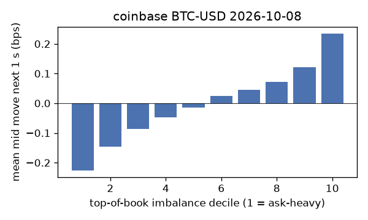
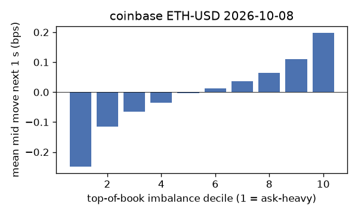
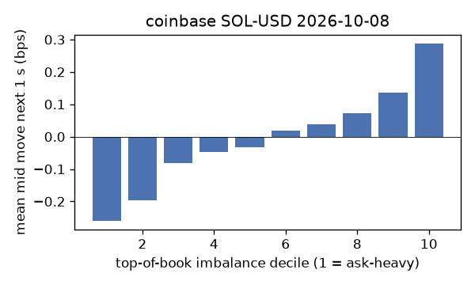
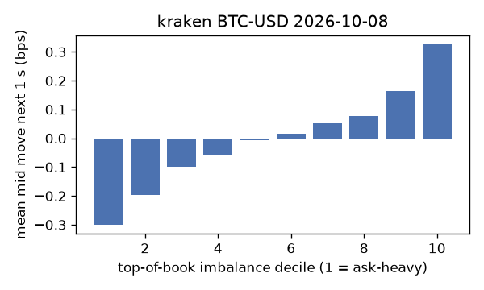
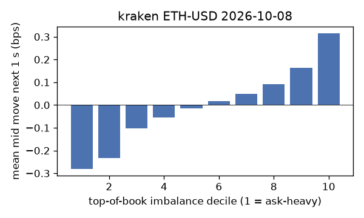
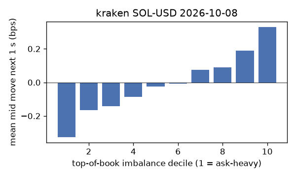

# EDA 2026-10-08

100 ms clock grid; correlations are with the future mid change; nothing measured across a reconnect.

|                       |   ('coinbase', 'BTC-USD') |   ('coinbase', 'ETH-USD') |   ('coinbase', 'SOL-USD') |   ('kraken', 'BTC-USD') |   ('kraken', 'ETH-USD') |   ('kraken', 'SOL-USD') |
|:----------------------|--------------------------:|--------------------------:|--------------------------:|------------------------:|------------------------:|------------------------:|
| hours                 |                   23.9996 |                   23.9996 |                   23.9996 |                 23.9992 |                 23.9995 |                 23.9995 |
| mid                   |                82491      |                 2535.11   |                  113.155  |              82494.6    |               2535.18   |                113.155  |
| tick                  |                    0.01   |                    0.01   |                    0.01   |                  0.1    |                  0.01   |                  0.01   |
| spread_med_bps        |                    0.0012 |                    0.0394 |                    1.7675 |                  0.0121 |                  0.0394 |                  0.8837 |
| spread_p90_bps        |                    0.0642 |                    0.6311 |                    1.7675 |                  0.0121 |                  0.2761 |                  1.7675 |
| at_1_tick_%           |                   88.3469 |                   55.9617 |                   41.9011 |                 97.094  |                 87.9433 |                 89.2554 |
| taker_events/min      |                  123.81   |                   67.168  |                   51.6257 |                 64.2406 |                 34.3581 |                 26.6972 |
| taker_usd_med         |                   39.9041 |                  256.024  |                   81.6432 |                 56.8776 |                 56.3495 |                 79.9285 |
| inter_taker_ms_med    |                  298.779  |                  494.785  |                  694.894  |                375.619  |                734.042  |               1079.32   |
| moved_100ms_%         |                   16.2081 |                   32.1095 |                   13.2803 |                  7.0327 |                 14.2061 |                 11.4094 |
| corr_obi1_100ms       |                    0.111  |                    0.091  |                    0.1117 |                  0.1736 |                  0.1076 |                  0.123  |
| corr_obi5_100ms       |                    0.0842 |                    0.0509 |                    0.0524 |                  0.177  |                  0.0895 |                  0.0898 |
| corr_micro_edge_100ms |                    0.0493 |                    0.0405 |                    0.1104 |                  0.1109 |                  0.0669 |                  0.1206 |
| moved_1s_%            |                   46.1672 |                   69.2933 |                   52.0563 |                 29.2869 |                 40.4806 |                 39.2751 |
| corr_obi1_1s          |                    0.1613 |                    0.1118 |                    0.1255 |                  0.2617 |                  0.18   |                  0.1541 |
| corr_obi5_1s          |                    0.1218 |                    0.064  |                    0.0616 |                  0.2596 |                  0.1483 |                  0.1047 |
| corr_micro_edge_1s    |                    0.0305 |                    0.0283 |                    0.1153 |                  0.0689 |                  0.0686 |                  0.1401 |
| moved_10s_%           |                   89.4178 |                   96.6229 |                   89.4728 |                 82.1627 |                 86.7502 |                 81.7451 |
| corr_obi1_10s         |                    0.0969 |                    0.0617 |                    0.0613 |                  0.1895 |                  0.1415 |                  0.0929 |
| corr_obi5_10s         |                    0.084  |                    0.0403 |                    0.0403 |                  0.1886 |                  0.1177 |                  0.0621 |
| corr_micro_edge_10s   |                    0.0086 |                    0.0083 |                    0.0526 |                  0.03   |                  0.0324 |                  0.0815 |
| ofi_R2_same_1s        |                    0.1781 |                    0.2991 |                    0.4187 |                  0.3735 |                  0.256  |                  0.35   |
| ofi_R2_next_1s        |                    0.0038 |                    0.0029 |                    0.0018 |                  0.0244 |                  0.0147 |                  0.0053 |

