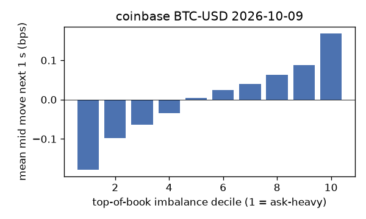
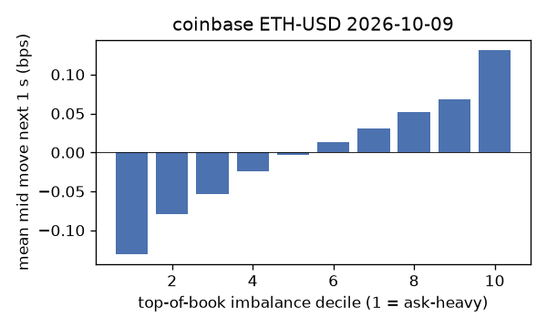
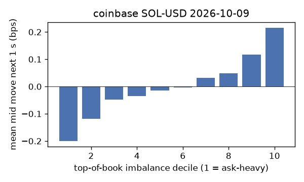
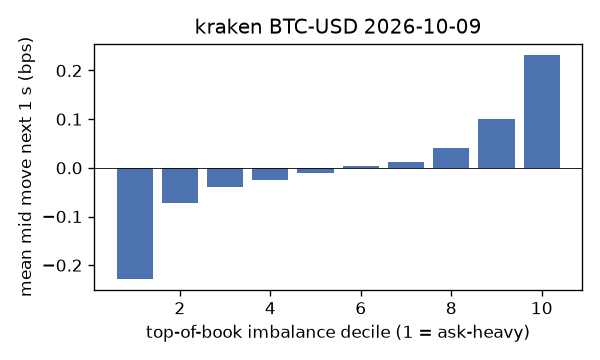
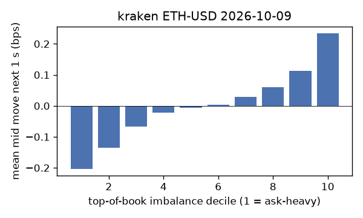
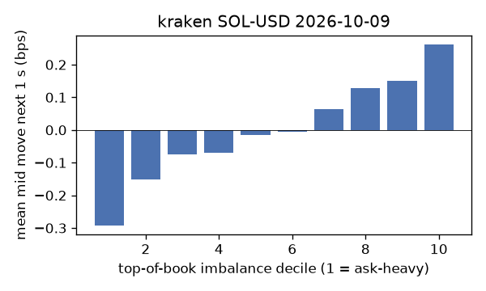

# EDA 2026-10-09

100 ms clock grid; correlations are with the future mid change; nothing measured across a reconnect.

|                       |   ('coinbase', 'BTC-USD') |   ('coinbase', 'ETH-USD') |   ('coinbase', 'SOL-USD') |   ('kraken', 'BTC-USD') |   ('kraken', 'ETH-USD') |   ('kraken', 'SOL-USD') |
|:----------------------|--------------------------:|--------------------------:|--------------------------:|------------------------:|------------------------:|------------------------:|
| hours                 |                   23.9996 |                   23.9997 |                   23.9997 |                 23.9989 |                 23.9989 |                 23.9989 |
| mid                   |                82486.3    |                 2487.64   |                  109.715  |              82488.4    |               2487.74   |                109.725  |
| tick                  |                    0.01   |                    0.01   |                    0.01   |                  0.1    |                  0.01   |                  0.01   |
| spread_med_bps        |                    0.0012 |                    0.0402 |                    0.9115 |                  0.0121 |                  0.0402 |                  0.9114 |
| spread_p90_bps        |                    0.0012 |                    0.5628 |                    1.8229 |                  0.0121 |                  0.0402 |                  0.9114 |
| at_1_tick_%           |                   93.3342 |                   61.1434 |                   55.756  |                 99.5719 |                 95.6065 |                 94.4635 |
| taker_events/min      |                  146.564  |                   45.138  |                   38.7966 |                 41.8637 |                 21.4294 |                 18.9232 |
| taker_usd_med         |                    0.0387 |                   97.1784 |                   51.3325 |                 58.3597 |                 42.3533 |                 52.4592 |
| inter_taker_ms_med    |                  298.424  |                  797.608  |                  913.332  |                727.706  |               1556.67   |               1976.95   |
| moved_100ms_%         |                    8.6383 |                   19.2941 |                    7.533  |                  2.9315 |                  6.9767 |                  6.6624 |
| corr_obi1_100ms       |                    0.1083 |                    0.0874 |                    0.0942 |                  0.1531 |                  0.1181 |                  0.1294 |
| corr_obi5_100ms       |                    0.0872 |                    0.0631 |                    0.0542 |                  0.1595 |                  0.1086 |                  0.0869 |
| corr_micro_edge_100ms |                    0.0645 |                    0.0377 |                    0.0913 |                  0.1387 |                  0.1097 |                  0.1335 |
| moved_1s_%            |                   31.3789 |                   53.7159 |                   39.8677 |                 18.0502 |                 28.6575 |                 30.2051 |
| corr_obi1_1s          |                    0.1863 |                    0.1193 |                    0.1269 |                  0.2587 |                  0.2044 |                  0.1704 |
| corr_obi5_1s          |                    0.1501 |                    0.0887 |                    0.0725 |                  0.2567 |                  0.1877 |                  0.1146 |
| corr_micro_edge_1s    |                    0.037  |                    0.0302 |                    0.116  |                  0.1177 |                  0.0862 |                  0.1667 |
| moved_10s_%           |                   81.3337 |                   90.246  |                   84.4946 |                 69.3885 |                 79.6954 |                 76.1314 |
| corr_obi1_10s         |                    0.14   |                    0.0878 |                    0.0857 |                  0.2415 |                  0.1947 |                  0.1081 |
| corr_obi5_10s         |                    0.1263 |                    0.067  |                    0.0412 |                  0.226  |                  0.1847 |                  0.0725 |
| corr_micro_edge_10s   |                    0.0162 |                    0.0129 |                    0.0763 |                  0.0591 |                  0.0545 |                  0.1061 |
| ofi_R2_same_1s        |                    0.142  |                    0.3433 |                    0.4749 |                  0.4349 |                  0.3101 |                  0.4477 |
| ofi_R2_next_1s        |                    0.0077 |                    0.0036 |                    0.0007 |                  0.0303 |                  0.0111 |                  0.0027 |

