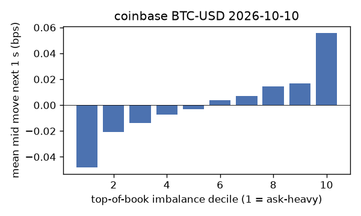
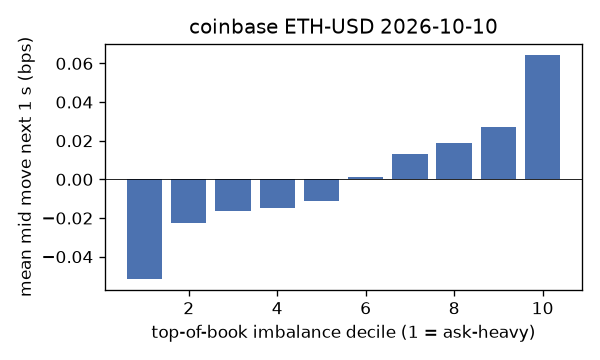
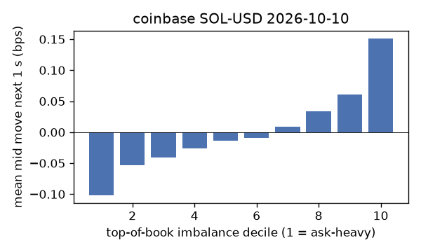
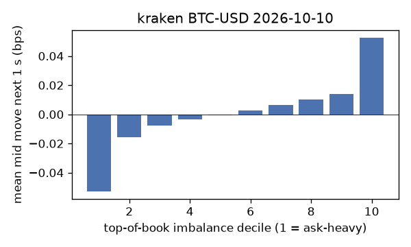
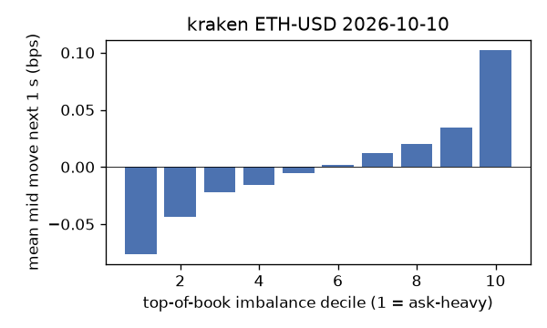
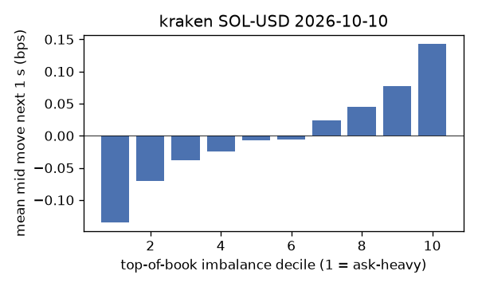

# EDA 2026-10-10

100 ms clock grid; correlations are with the future mid change; nothing measured across a reconnect.

|                       |   ('coinbase', 'BTC-USD') |   ('coinbase', 'ETH-USD') |   ('coinbase', 'SOL-USD') |   ('kraken', 'BTC-USD') |   ('kraken', 'ETH-USD') |   ('kraken', 'SOL-USD') |
|:----------------------|--------------------------:|--------------------------:|--------------------------:|------------------------:|------------------------:|------------------------:|
| hours                 |                   23.9997 |                   23.9997 |                   23.9996 |                 23.9993 |                 23.9993 |                 23.9992 |
| mid                   |                82771.9    |                 2494.88   |                  109.85   |              82770.2    |               2494.91   |                109.855  |
| tick                  |                    0.01   |                    0.01   |                    0.01   |                  0.1    |                  0.01   |                  0.01   |
| spread_med_bps        |                    0.0012 |                    0.0401 |                    0.9103 |                  0.0121 |                  0.0401 |                  0.9103 |
| spread_p90_bps        |                    0.0012 |                    0.4008 |                    1.8207 |                  0.0121 |                  0.0401 |                  0.9103 |
| at_1_tick_%           |                   93.6732 |                   64.1301 |                   53.0426 |                 99.9389 |                 99.0191 |                 96.6546 |
| taker_events/min      |                   74.6591 |                   32.7742 |                   29.988  |                 22.741  |                 13.5788 |                 14.5793 |
| taker_usd_med         |                   17.8198 |                   42.6861 |                   40.788  |                 45.8532 |                 33.2391 |                 34.1125 |
| inter_taker_ms_med    |                  404.219  |                 1101.14   |                 1204.83   |               1569.31   |               2741.51   |               2589.05   |
| moved_100ms_%         |                    3.9331 |                    9.2147 |                    3.0345 |                  0.5891 |                  1.7391 |                  2.0223 |
| corr_obi1_100ms       |                    0.0546 |                    0.0559 |                    0.0776 |                  0.0695 |                  0.0782 |                  0.0898 |
| corr_obi5_100ms       |                    0.0469 |                    0.0308 |                    0.0444 |                  0.0655 |                  0.0681 |                  0.0606 |
| corr_micro_edge_100ms |                    0.0473 |                    0.0286 |                    0.0729 |                  0.1395 |                  0.1066 |                  0.0929 |
| moved_1s_%            |                   15.4194 |                   34.121  |                   20.6681 |                  4.38   |                 10.2519 |                 12.6411 |
| corr_obi1_1s          |                    0.1102 |                    0.0923 |                    0.1359 |                  0.1393 |                  0.1487 |                  0.1504 |
| corr_obi5_1s          |                    0.0958 |                    0.0525 |                    0.08   |                  0.1235 |                  0.1282 |                  0.1037 |
| corr_micro_edge_1s    |                    0.0169 |                    0.0233 |                    0.1244 |                  0.1382 |                  0.1177 |                  0.1506 |
| moved_10s_%           |                   52.7948 |                   74.2965 |                   67.2811 |                 28.674  |                 48.7171 |                 53.076  |
| corr_obi1_10s         |                    0.1619 |                    0.1206 |                    0.1217 |                  0.2372 |                  0.208  |                  0.1706 |
| corr_obi5_10s         |                    0.1547 |                    0.0774 |                    0.0793 |                  0.1926 |                  0.1822 |                  0.125  |
| corr_micro_edge_10s   |                    0.0112 |                    0.0284 |                    0.1059 |                  0.1517 |                  0.1181 |                  0.1695 |
| ofi_R2_same_1s        |                    0.0344 |                    0.245  |                    0.516  |                  0.168  |                  0.2964 |                  0.4156 |
| ofi_R2_next_1s        |                    0.0009 |                    0.0029 |                    0.0027 |                  0.0065 |                  0.0074 |                  0.004  |

