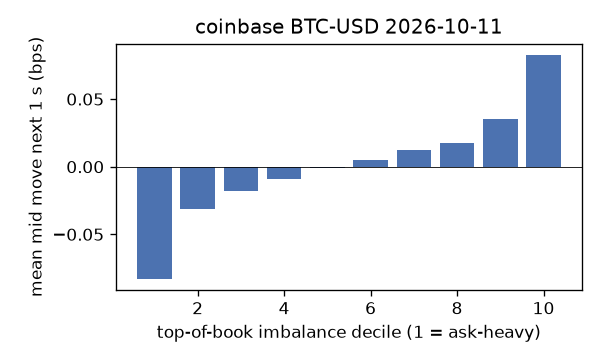
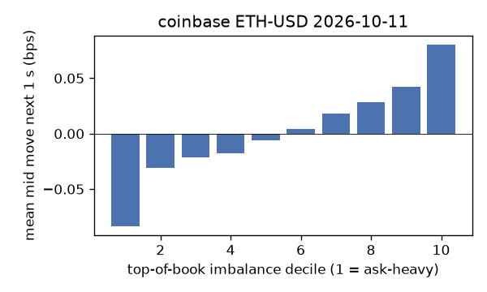
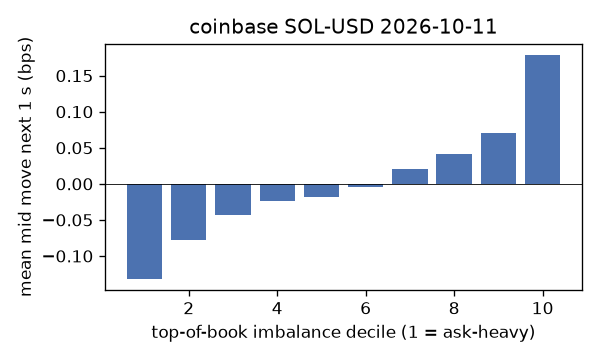
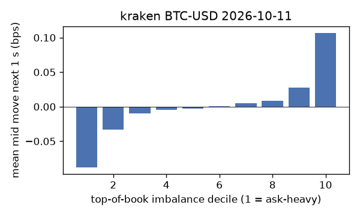
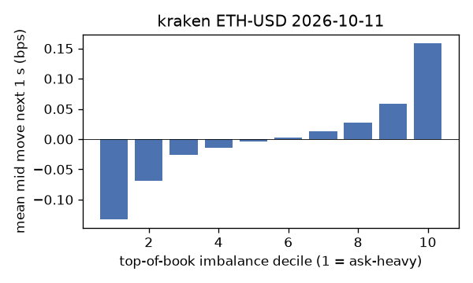
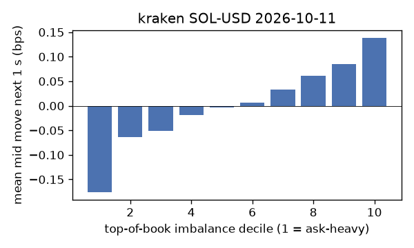

# EDA 2026-10-11

100 ms clock grid; correlations are with the future mid change; nothing measured across a reconnect.

|                       |   ('coinbase', 'BTC-USD') |   ('coinbase', 'ETH-USD') |   ('coinbase', 'SOL-USD') |   ('kraken', 'BTC-USD') |   ('kraken', 'ETH-USD') |   ('kraken', 'SOL-USD') |
|:----------------------|--------------------------:|--------------------------:|--------------------------:|------------------------:|------------------------:|------------------------:|
| hours                 |                   23.9993 |                   23.9996 |                   23.9995 |                 23.9995 |                 23.9995 |                 23.9995 |
| mid                   |                83014.6    |                 2505.07   |                  109.71   |              83017.4    |               2505.14   |                109.715  |
| tick                  |                    0.01   |                    0.01   |                    0.01   |                  0.1    |                  0.01   |                  0.01   |
| spread_med_bps        |                    0.0012 |                    0.0399 |                    0.9115 |                  0.012  |                  0.0399 |                  0.9115 |
| spread_p90_bps        |                    0.0012 |                    0.5189 |                    1.823  |                  0.012  |                  0.0399 |                  0.9115 |
| at_1_tick_%           |                   94.6522 |                   54.4022 |                   70.8375 |                 99.7832 |                 97.4189 |                 91.6733 |
| taker_events/min      |                   82.0812 |                   35.8671 |                   31.9279 |                 25.0263 |                 15.9183 |                 13.816  |
| taker_usd_med         |                   12.2543 |                   47.4193 |                   42.6943 |                 41.6391 |                 32.5786 |                 40.2062 |
| inter_taker_ms_med    |                  398.673  |                  999.499  |                 1196.66   |               1262.68   |               1857.71   |               2606.85   |
| moved_100ms_%         |                    4.5922 |                   13.2988 |                    3.5373 |                  0.8596 |                  3.2139 |                  3.7267 |
| corr_obi1_100ms       |                    0.0632 |                    0.0587 |                    0.0741 |                  0.0772 |                  0.0835 |                  0.0858 |
| corr_obi5_100ms       |                    0.0526 |                    0.0364 |                    0.0471 |                  0.0768 |                  0.0756 |                  0.0545 |
| corr_micro_edge_100ms |                    0.067  |                    0.0274 |                    0.0747 |                  0.1017 |                  0.0718 |                  0.0929 |
| moved_1s_%            |                   17.4175 |                   43.9533 |                   20.5531 |                  5.6438 |                 14.9948 |                 18.5273 |
| corr_obi1_1s          |                    0.124  |                    0.0864 |                    0.1264 |                  0.1697 |                  0.1572 |                  0.128  |
| corr_obi5_1s          |                    0.099  |                    0.0613 |                    0.0816 |                  0.1671 |                  0.1421 |                  0.0815 |
| corr_micro_edge_1s    |                    0.0371 |                    0.0231 |                    0.1182 |                  0.0981 |                  0.063  |                  0.1284 |
| moved_10s_%           |                   54.5643 |                   83.0498 |                   65.0065 |                 33.0887 |                 57.9051 |                 60.3308 |
| corr_obi1_10s         |                    0.1454 |                    0.0862 |                    0.107  |                  0.263  |                  0.1853 |                  0.1004 |
| corr_obi5_10s         |                    0.128  |                    0.065  |                    0.0787 |                  0.2554 |                  0.1676 |                  0.0718 |
| corr_micro_edge_10s   |                    0.0192 |                    0.0216 |                    0.0967 |                  0.0723 |                  0.053  |                  0.0967 |
| ofi_R2_same_1s        |                    0.1763 |                    0.2788 |                    0.3924 |                  0.2887 |                  0.2527 |                  0.4554 |
| ofi_R2_next_1s        |                    0.0084 |                    0.0037 |                    0.0061 |                  0.0179 |                  0.0124 |                  0.0041 |

