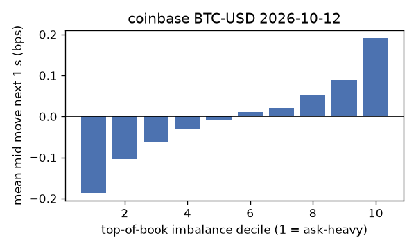
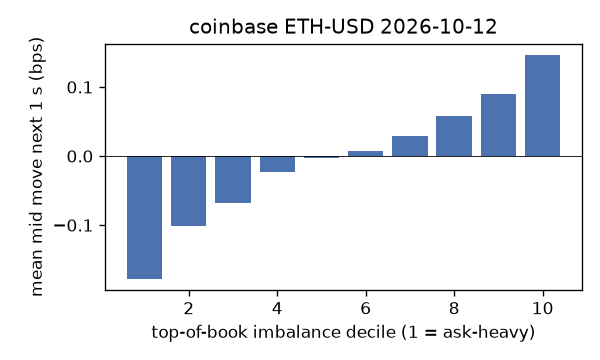
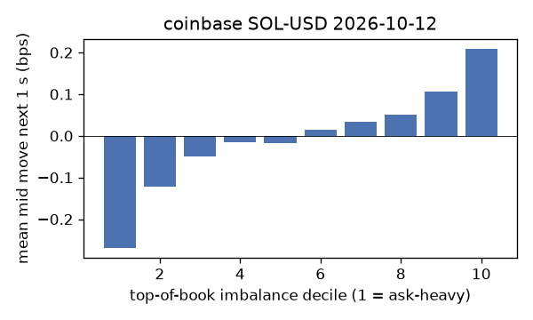
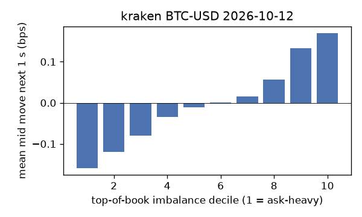
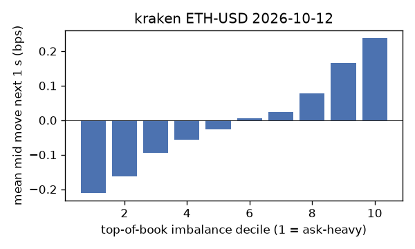
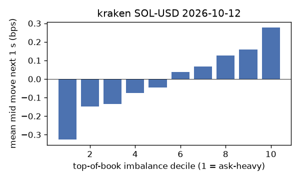

# EDA 2026-10-12

100 ms clock grid; correlations are with the future mid change; nothing measured across a reconnect.

|                       |   ('coinbase', 'BTC-USD') |   ('coinbase', 'ETH-USD') |   ('coinbase', 'SOL-USD') |   ('kraken', 'BTC-USD') |   ('kraken', 'ETH-USD') |   ('kraken', 'SOL-USD') |
|:----------------------|--------------------------:|--------------------------:|--------------------------:|------------------------:|------------------------:|------------------------:|
| hours                 |                   23.9996 |                   23.9995 |                   23.9994 |                 23.9991 |                 23.9991 |                 23.9989 |
| mid                   |                83255.5    |                 2537.05   |                  110.855  |              83261.6    |               2537.14   |                110.855  |
| tick                  |                    0.01   |                    0.01   |                    0.01   |                  0.1    |                  0.01   |                  0.01   |
| spread_med_bps        |                    0.0012 |                    0.0394 |                    0.9021 |                  0.012  |                  0.0394 |                  0.9021 |
| spread_p90_bps        |                    0.0012 |                    0.6307 |                    1.8042 |                  0.012  |                  0.0394 |                  0.9021 |
| at_1_tick_%           |                   91.284  |                   51.6686 |                   70.7857 |                 99.4322 |                 95.9569 |                 91.6716 |
| taker_events/min      |                  121.609  |                   47.9807 |                   41.9242 |                 41.8438 |                 23.3494 |                 18.3314 |
| taker_usd_med         |                    8.6894 |                  108.855  |                   74.3242 |                 49.4888 |                 40.897  |                 55.06   |
| inter_taker_ms_med    |                  299.558  |                  702.225  |                  898.741  |                579.49   |               1295.64   |               1900.55   |
| moved_100ms_%         |                   10.5736 |                   25.9814 |                    9.163  |                  2.4571 |                  6.7251 |                  7.3856 |
| corr_obi1_100ms       |                    0.0988 |                    0.0809 |                    0.0812 |                  0.1194 |                  0.1126 |                  0.1282 |
| corr_obi5_100ms       |                    0.0752 |                    0.0596 |                    0.0557 |                  0.1263 |                  0.1033 |                  0.093  |
| corr_micro_edge_100ms |                    0.0513 |                    0.0315 |                    0.0787 |                  0.1367 |                  0.0892 |                  0.1387 |
| moved_1s_%            |                   36.6413 |                   66.9511 |                   42.1605 |                 13.8174 |                 27.1251 |                 32.5052 |
| corr_obi1_1s          |                    0.1699 |                    0.1146 |                    0.1212 |                  0.2472 |                  0.1918 |                  0.1806 |
| corr_obi5_1s          |                    0.1247 |                    0.0846 |                    0.0771 |                  0.257  |                  0.1761 |                  0.1257 |
| corr_micro_edge_1s    |                    0.0287 |                    0.0351 |                    0.1079 |                  0.1164 |                  0.0681 |                  0.1784 |
| moved_10s_%           |                   85.334  |                   96.241  |                   84.6174 |                 61.6392 |                 78.5875 |                 78.6666 |
| corr_obi1_10s         |                    0.1291 |                    0.0694 |                    0.084  |                  0.3106 |                  0.1659 |                  0.1229 |
| corr_obi5_10s         |                    0.1019 |                    0.0478 |                    0.0413 |                  0.3163 |                  0.1628 |                  0.0825 |
| corr_micro_edge_10s   |                    0.0069 |                    0.0208 |                    0.0738 |                  0.0675 |                  0.0351 |                  0.1193 |
| ofi_R2_same_1s        |                    0.2018 |                    0.3573 |                    0.2025 |                  0.3053 |                  0.3113 |                  0.436  |
| ofi_R2_next_1s        |                    0.0082 |                    0.0025 |                    0.0003 |                  0.0256 |                  0.0133 |                  0.0069 |

