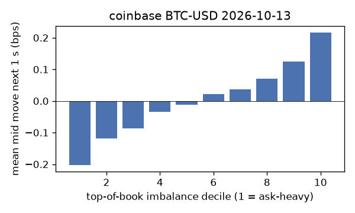
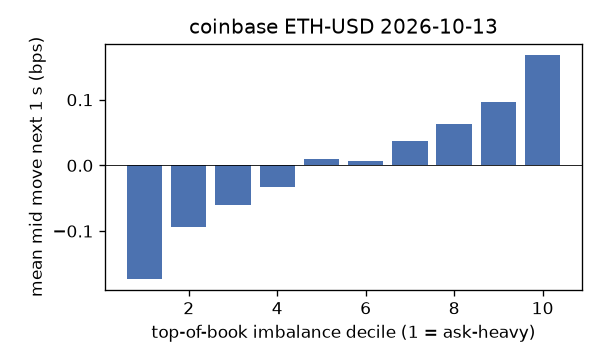
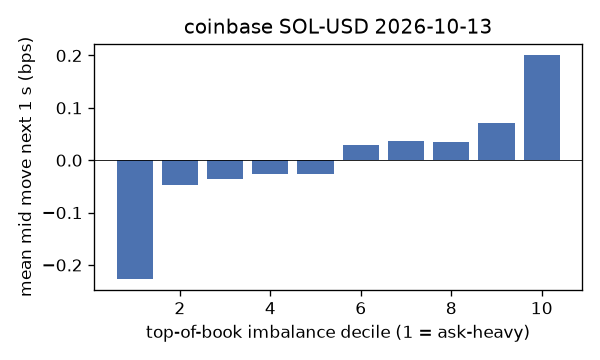
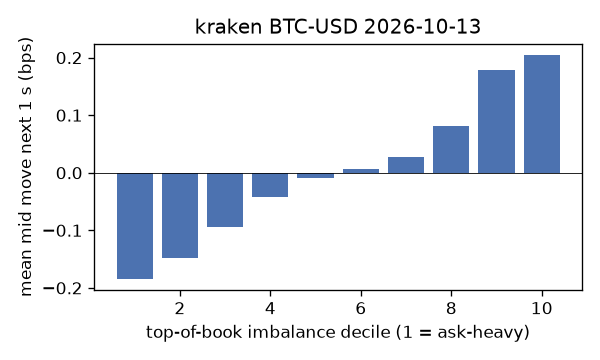
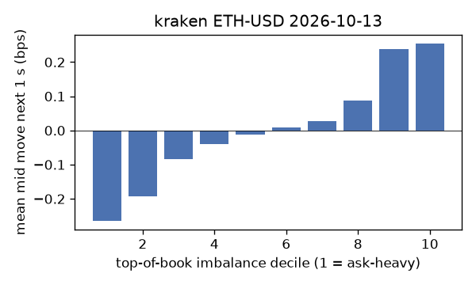
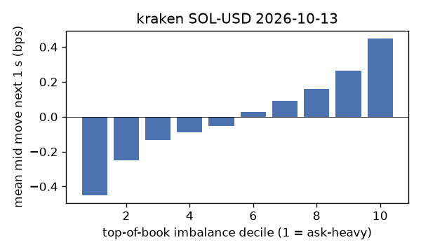

# EDA 2026-10-13

100 ms clock grid; correlations are with the future mid change; nothing measured across a reconnect.

|                       |   ('coinbase', 'BTC-USD') |   ('coinbase', 'ETH-USD') |   ('coinbase', 'SOL-USD') |   ('kraken', 'BTC-USD') |   ('kraken', 'ETH-USD') |   ('kraken', 'SOL-USD') |
|:----------------------|--------------------------:|--------------------------:|--------------------------:|------------------------:|------------------------:|------------------------:|
| hours                 |                   23.9996 |                   23.9996 |                   23.9996 |                 23.9991 |                 23.999  |                 23.9991 |
| mid                   |                83286.7    |                 2506.68   |                  107.125  |              83285.6    |               2506.72   |                107.125  |
| tick                  |                    0.01   |                    0.01   |                    0.01   |                  0.1    |                  0.01   |                  0.01   |
| spread_med_bps        |                    0.0012 |                    0.0798 |                    0.9335 |                  0.012  |                  0.0399 |                  0.9335 |
| spread_p90_bps        |                    0.024  |                    0.7181 |                    1.867  |                  0.012  |                  0.0399 |                  0.9335 |
| at_1_tick_%           |                   89.1233 |                   44.5511 |                   50.8616 |                 99.0444 |                 92.5982 |                 94.8502 |
| taker_events/min      |                  158.379  |                   50.0747 |                   39.4096 |                 42.6851 |                 25.5128 |                 23.3461 |
| taker_usd_med         |                    0.2677 |                  190.423  |                   86.6504 |                 58.3759 |                 42.6472 |                 53.0368 |
| inter_taker_ms_med    |                  293.594  |                  698.639  |                  901.336  |                596.88   |               1206.61   |               1349.65   |
| moved_100ms_%         |                   13.1425 |                   29.8229 |                   14.7825 |                  3.3688 |                 10.3851 |                  7.4445 |
| corr_obi1_100ms       |                    0.1092 |                    0.0826 |                    0.0717 |                  0.1355 |                  0.1254 |                  0.1635 |
| corr_obi5_100ms       |                    0.0809 |                    0.0647 |                    0.055  |                  0.1425 |                  0.1155 |                  0.1487 |
| corr_micro_edge_100ms |                    0.0573 |                    0.0408 |                    0.07   |                  0.1241 |                  0.1238 |                  0.17   |
| moved_1s_%            |                   43.0628 |                   71.9607 |                   55.6713 |                 17.3379 |                 35.3069 |                 32.9323 |
| corr_obi1_1s          |                    0.1801 |                    0.1046 |                    0.0771 |                  0.2627 |                  0.1966 |                  0.2072 |
| corr_obi5_1s          |                    0.1313 |                    0.0811 |                    0.0577 |                  0.2688 |                  0.1845 |                  0.1743 |
| corr_micro_edge_1s    |                    0.0363 |                    0.0364 |                    0.0666 |                  0.1004 |                  0.105  |                  0.2051 |
| moved_10s_%           |                   89.0189 |                   97.2867 |                   89.3068 |                 69.7813 |                 85.7474 |                 80.1276 |
| corr_obi1_10s         |                    0.1145 |                    0.0525 |                    0.0313 |                  0.2773 |                  0.1578 |                  0.1135 |
| corr_obi5_10s         |                    0.0903 |                    0.047  |                    0.0287 |                  0.2759 |                  0.1493 |                  0.0965 |
| corr_micro_edge_10s   |                    0.0113 |                    0.013  |                    0.0249 |                  0.0548 |                  0.0382 |                  0.1076 |
| ofi_R2_same_1s        |                    0.2214 |                    0.2436 |                    0.5148 |                  0.1586 |                  0.3301 |                  0.4617 |
| ofi_R2_next_1s        |                    0.0077 |                    0.0026 |                    0      |                  0.0133 |                  0.0138 |                  0.0131 |

