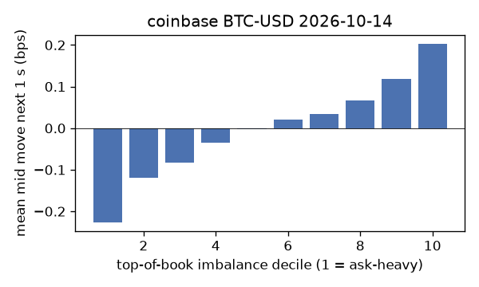
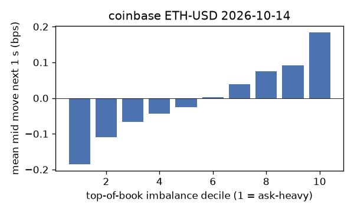
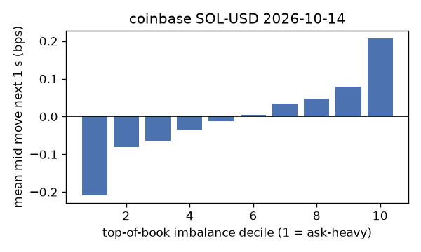
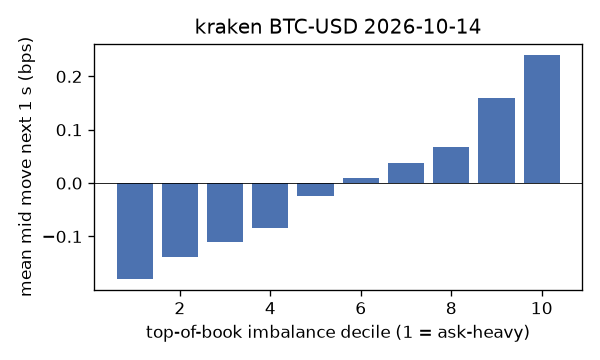
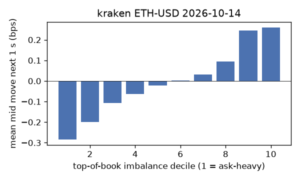
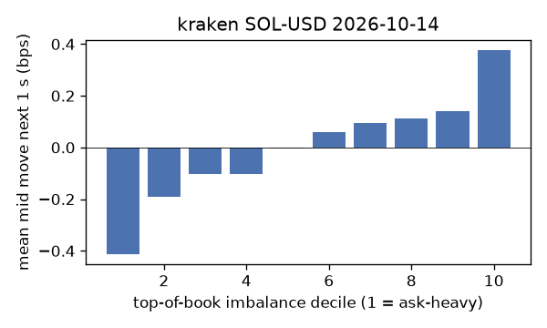

# EDA 2026-10-14

100 ms clock grid; correlations are with the future mid change; nothing measured across a reconnect.

|                       |   ('coinbase', 'BTC-USD') |   ('coinbase', 'ETH-USD') |   ('coinbase', 'SOL-USD') |   ('kraken', 'BTC-USD') |   ('kraken', 'ETH-USD') |   ('kraken', 'SOL-USD') |
|:----------------------|--------------------------:|--------------------------:|--------------------------:|------------------------:|------------------------:|------------------------:|
| hours                 |                   23.9996 |                   23.9996 |                   23.9996 |                 23.999  |                 23.9991 |                 23.9991 |
| mid                   |                83165.5    |                 2495.89   |                  106.56   |              83166.1    |               2495.97   |                106.565  |
| tick                  |                    0.01   |                    0.01   |                    0.01   |                  0.1    |                  0.01   |                  0.01   |
| spread_med_bps        |                    0.0012 |                    0.0401 |                    0.9384 |                  0.012  |                  0.0401 |                  0.9384 |
| spread_p90_bps        |                    0.0986 |                    0.6411 |                    1.8769 |                  0.012  |                  0.0401 |                  0.9384 |
| at_1_tick_%           |                   86.6595 |                   51.1372 |                   55.8783 |                 97.9266 |                 91.8144 |                 91.5379 |
| taker_events/min      |                  157.383  |                   59.6256 |                   40.9224 |                 46.2746 |                 27.5665 |                 22.6158 |
| taker_usd_med         |                    9.4313 |                  249.362  |                   94.7933 |                 65.4318 |                 44.9466 |                 52.1027 |
| inter_taker_ms_med    |                  205.097  |                  504.862  |                  899.595  |                568.977  |               1093.57   |               1481.7    |
| moved_100ms_%         |                   16.5157 |                   29.7961 |                   12.9459 |                  4.5226 |                 10.9673 |                  8.9726 |
| corr_obi1_100ms       |                    0.1026 |                    0.0836 |                    0.0763 |                  0.119  |                  0.1098 |                  0.1395 |
| corr_obi5_100ms       |                    0.0716 |                    0.0486 |                    0.0428 |                  0.1194 |                  0.0963 |                  0.115  |
| corr_micro_edge_100ms |                    0.0573 |                    0.0435 |                    0.073  |                  0.0212 |                  0.0266 |                  0.1098 |
| moved_1s_%            |                   47.6046 |                   70.7158 |                   53.5227 |                 21.4085 |                 36.9062 |                 38.0823 |
| corr_obi1_1s          |                    0.1603 |                    0.1067 |                    0.0875 |                  0.2299 |                  0.1992 |                  0.1794 |
| corr_obi5_1s          |                    0.1108 |                    0.0667 |                    0.0475 |                  0.2197 |                  0.1759 |                  0.1355 |
| corr_micro_edge_1s    |                    0.0111 |                    0.0578 |                    0.0749 |                  0.0079 |                  0.0028 |                  0.104  |
| moved_10s_%           |                   90.6186 |                   97.2853 |                   89.7269 |                 76.3169 |                 87.3054 |                 83.7776 |
| corr_obi1_10s         |                    0.1019 |                    0.0605 |                    0.0484 |                  0.2214 |                  0.1675 |                  0.0939 |
| corr_obi5_10s         |                    0.0785 |                    0.0446 |                    0.0226 |                  0.2094 |                  0.1597 |                  0.0649 |
| corr_micro_edge_10s   |                    0.0002 |                    0.0124 |                    0.0398 |                 -0.0333 |                 -0.0343 |                  0.0275 |
| ofi_R2_same_1s        |                    0.1298 |                    0.3213 |                    0.2503 |                  0.2965 |                  0.3235 |                  0.446  |
| ofi_R2_next_1s        |                    0.0035 |                    0.0029 |                    0.0001 |                  0.0194 |                  0.0117 |                  0.0057 |

