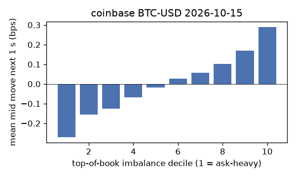
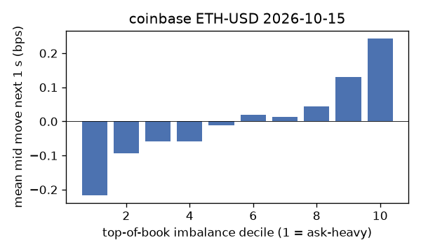
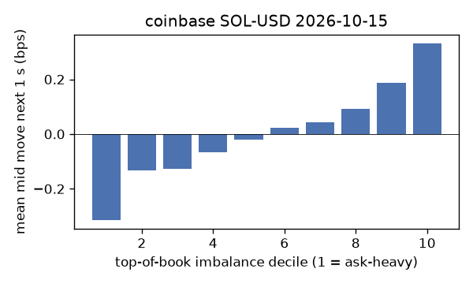
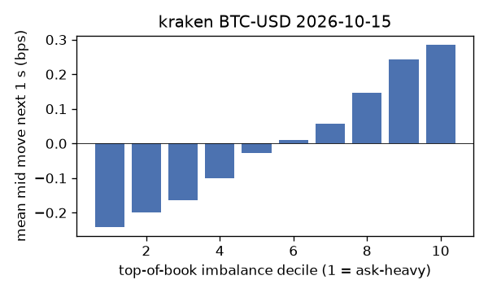
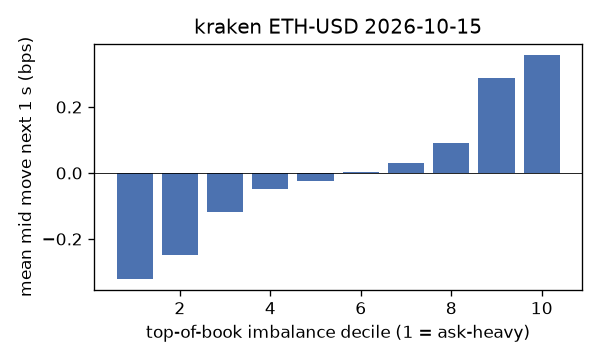
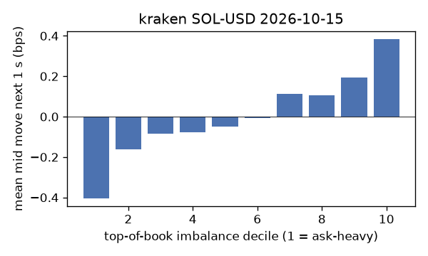

# EDA 2026-10-15

100 ms clock grid; correlations are with the future mid change; nothing measured across a reconnect.

|                       |   ('coinbase', 'BTC-USD') |   ('coinbase', 'ETH-USD') |   ('coinbase', 'SOL-USD') |   ('kraken', 'BTC-USD') |   ('kraken', 'ETH-USD') |   ('kraken', 'SOL-USD') |
|:----------------------|--------------------------:|--------------------------:|--------------------------:|------------------------:|------------------------:|------------------------:|
| hours                 |                   23.9991 |                   23.9991 |                   23.9991 |                 23.9992 |                 23.9992 |                 23.9992 |
| mid                   |                81433.5    |                 2380.59   |                  103.725  |              81435.4    |               2380.57   |                103.735  |
| tick                  |                    0.01   |                    0.01   |                    0.01   |                  0.1    |                  0.01   |                  0.01   |
| spread_med_bps        |                    0.0012 |                    0.168  |                    1.9282 |                  0.0123 |                  0.042  |                  0.964  |
| spread_p90_bps        |                    0.1719 |                    0.8401 |                    1.9282 |                  0.0123 |                  0.5041 |                  1.928  |
| at_1_tick_%           |                   84.2355 |                   42.5064 |                   47.3456 |                 96.6594 |                 83.9068 |                 82.395  |
| taker_events/min      |                  185.135  |                   69.6061 |                   41.8941 |                 55.396  |                 32.7159 |                 22.3233 |
| taker_usd_med         |                    2.7209 |                  197.949  |                   66.6945 |                 65.7587 |                 44.9092 |                 65.4104 |
| inter_taker_ms_med    |                  202.948  |                  497.605  |                  898.531  |                436.36   |                910.758  |               1453.94   |
| moved_100ms_%         |                   18.687  |                   35.0792 |                   14.3736 |                  6.0732 |                 18.1545 |                 15.0941 |
| corr_obi1_100ms       |                    0.1201 |                    0.075  |                    0.0969 |                  0.1367 |                  0.1091 |                  0.1154 |
| corr_obi5_100ms       |                    0.0861 |                    0.0408 |                    0.0635 |                  0.1348 |                  0.0993 |                  0.0981 |
| corr_micro_edge_100ms |                    0.0531 |                    0.0382 |                    0.097  |                  0.0935 |                  0.0782 |                  0.1124 |
| moved_1s_%            |                   52.1554 |                   78.9398 |                   55.2348 |                 25.0331 |                 47.1274 |                 48.6711 |
| corr_obi1_1s          |                    0.1822 |                    0.0933 |                    0.1202 |                  0.2677 |                  0.1785 |                  0.1393 |
| corr_obi5_1s          |                    0.1275 |                    0.0537 |                    0.0772 |                  0.2628 |                  0.166  |                  0.11   |
| corr_micro_edge_1s    |                    0.0342 |                    0.0261 |                    0.1059 |                  0.0818 |                  0.0608 |                  0.1176 |
| moved_10s_%           |                   92.2708 |                   98.2636 |                   90.4568 |                 79.6766 |                 90.7663 |                 86.2837 |
| corr_obi1_10s         |                    0.1028 |                    0.0492 |                    0.0708 |                  0.2483 |                  0.1301 |                  0.0799 |
| corr_obi5_10s         |                    0.0832 |                    0.0313 |                    0.0531 |                  0.24   |                  0.1291 |                  0.0617 |
| corr_micro_edge_10s   |                    0.011  |                    0.0112 |                    0.063  |                  0.039  |                  0.0012 |                  0.0682 |
| ofi_R2_same_1s        |                    0.1832 |                    0.2805 |                    0.422  |                  0.3543 |                  0.1928 |                  0.446  |
| ofi_R2_next_1s        |                    0.004  |                    0.0023 |                    0.0004 |                  0.03   |                  0.0058 |                  0.002  |

