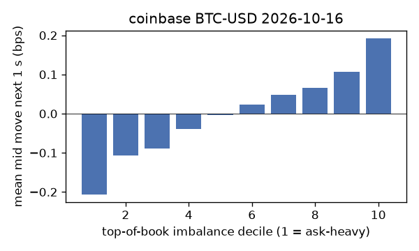
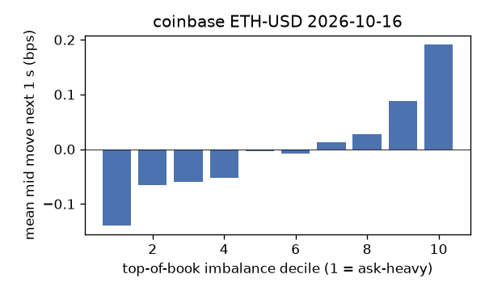
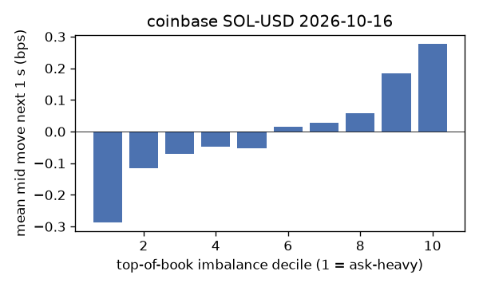
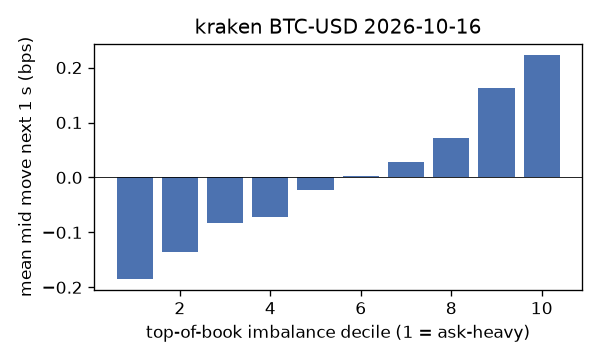
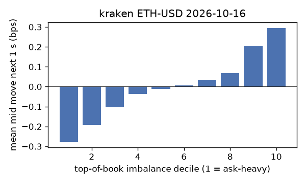
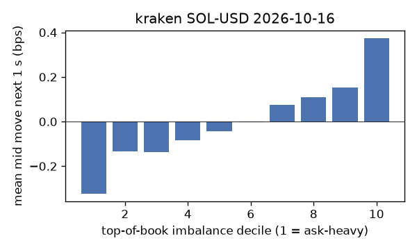

# EDA 2026-10-16

100 ms clock grid; correlations are with the future mid change; nothing measured across a reconnect.

|                       |   ('coinbase', 'BTC-USD') |   ('coinbase', 'ETH-USD') |   ('coinbase', 'SOL-USD') |   ('kraken', 'BTC-USD') |   ('kraken', 'ETH-USD') |   ('kraken', 'SOL-USD') |
|:----------------------|--------------------------:|--------------------------:|--------------------------:|------------------------:|------------------------:|------------------------:|
| hours                 |                   23.9996 |                   23.9995 |                   23.9995 |                 23.9991 |                 23.9991 |                 23.9991 |
| mid                   |                81951.1    |                 2439.59   |                  105.33   |              81952.2    |               2439.61   |                105.325  |
| tick                  |                    0.01   |                    0.01   |                    0.01   |                  0.1    |                  0.01   |                  0.01   |
| spread_med_bps        |                    0.0012 |                    0.2459 |                    0.9494 |                  0.0122 |                  0.041  |                  0.9494 |
| spread_p90_bps        |                    0.1684 |                    0.9018 |                    1.8988 |                  0.0122 |                  0.041  |                  0.9494 |
| at_1_tick_%           |                   83.5384 |                   39.6751 |                   50.1394 |                 99.1348 |                 91.5711 |                 90.1004 |
| taker_events/min      |                  177.301  |                   60.0309 |                   37.9971 |                 39.9604 |                 23.8216 |                 17.6621 |
| taker_usd_med         |                    2.3194 |                  189.851  |                   49.5094 |                 63.4216 |                 44.0208 |                 55.8146 |
| inter_taker_ms_med    |                  204      |                  501.166  |                  995.948  |                692.038  |               1301.93   |               2040.84   |
| moved_100ms_%         |                   18.0886 |                   31.7635 |                   10.0269 |                  3.27   |                 11.9643 |                  9.3541 |
| corr_obi1_100ms       |                    0.1079 |                    0.0841 |                    0.0905 |                  0.1297 |                  0.1258 |                  0.1304 |
| corr_obi5_100ms       |                    0.0703 |                    0.0354 |                    0.0575 |                  0.1353 |                  0.1095 |                  0.0988 |
| corr_micro_edge_100ms |                    0.0566 |                    0.0443 |                    0.0882 |                  0.0945 |                  0.0949 |                  0.133  |
| moved_1s_%            |                   46.8716 |                   73.4034 |                   46.7998 |                 17.7125 |                 38.8862 |                 38.2567 |
| corr_obi1_1s          |                    0.1717 |                    0.099  |                    0.1368 |                  0.2562 |                  0.2085 |                  0.1725 |
| corr_obi5_1s          |                    0.1124 |                    0.0421 |                    0.0817 |                  0.2659 |                  0.1835 |                  0.1301 |
| corr_micro_edge_1s    |                    0.0283 |                    0.0323 |                    0.12   |                  0.0653 |                  0.082  |                  0.168  |
| moved_10s_%           |                   87.4392 |                   96.3677 |                   87.5012 |                 69.2264 |                 85.8139 |                 81.9387 |
| corr_obi1_10s         |                    0.1128 |                    0.0595 |                    0.0846 |                  0.2709 |                  0.1729 |                  0.107  |
| corr_obi5_10s         |                    0.0819 |                    0.0342 |                    0.0447 |                  0.2761 |                  0.1555 |                  0.0804 |
| corr_micro_edge_10s   |                    0.0098 |                    0.0125 |                    0.0725 |                  0.0505 |                  0.0536 |                  0.1026 |
| ofi_R2_same_1s        |                    0.2048 |                    0.2782 |                    0.5905 |                  0.3811 |                  0.2904 |                  0.4517 |
| ofi_R2_next_1s        |                    0.005  |                    0.002  |                    0.0009 |                  0.0344 |                  0.0071 |                  0.0029 |

