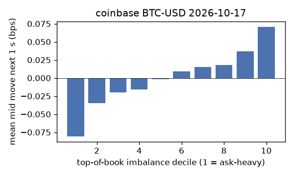
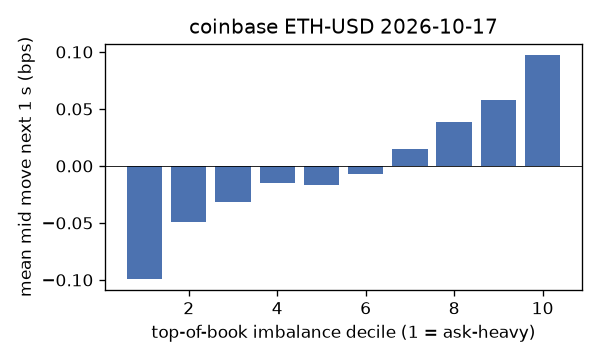
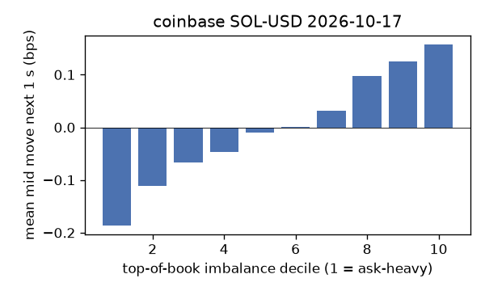
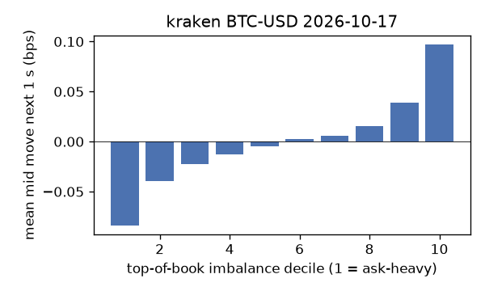
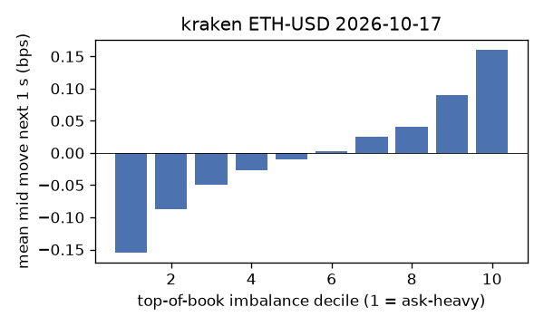
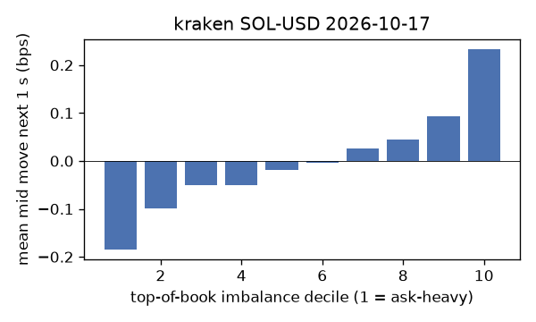

# EDA 2026-10-17

100 ms clock grid; correlations are with the future mid change; nothing measured across a reconnect.

|                       |   ('coinbase', 'BTC-USD') |   ('coinbase', 'ETH-USD') |   ('coinbase', 'SOL-USD') |   ('kraken', 'BTC-USD') |   ('kraken', 'ETH-USD') |   ('kraken', 'SOL-USD') |
|:----------------------|--------------------------:|--------------------------:|--------------------------:|------------------------:|------------------------:|------------------------:|
| hours                 |                   23.9668 |                   23.9668 |                   23.9669 |                 23.9669 |                 23.9669 |                 23.9669 |
| mid                   |                81445.3    |                 2420.19   |                  104.205  |              81448.9    |               2420.41   |                104.195  |
| tick                  |                    0.01   |                    0.01   |                    0.01   |                  0.1    |                  0.01   |                  0.01   |
| spread_med_bps        |                    0.0012 |                    0.0413 |                    0.9596 |                  0.0123 |                  0.0413 |                  0.9597 |
| spread_p90_bps        |                    0.0012 |                    0.6198 |                    1.9193 |                  0.0123 |                  0.0413 |                  0.9597 |
| at_1_tick_%           |                   96.2756 |                   54.6918 |                   66.4852 |                 99.7924 |                 97.6847 |                 92.6447 |
| taker_events/min      |                  148.263  |                   34.2388 |                   26.8662 |                 23.7962 |                 14.1346 |                 12.7304 |
| taker_usd_med         |                    0.0195 |                   61.6501 |                   43.5228 |                 52.0539 |                 40      |                 42.4469 |
| inter_taker_ms_med    |                  300.028  |                 1001.7    |                 1300.86   |               1374.57   |               2319.12   |               2860.3    |
| moved_100ms_%         |                    3.3957 |                   13.6483 |                    3.9449 |                  0.9197 |                  3.6656 |                  3.7794 |
| corr_obi1_100ms       |                    0.0653 |                    0.0652 |                    0.0791 |                  0.0767 |                  0.0896 |                  0.0923 |
| corr_obi5_100ms       |                    0.0511 |                    0.0329 |                    0.0501 |                  0.0769 |                  0.0804 |                  0.0729 |
| corr_micro_edge_100ms |                    0.0646 |                    0.046  |                    0.08   |                  0.1089 |                  0.0807 |                  0.1005 |
| moved_1s_%            |                   13.3672 |                   46.4284 |                   24.159  |                  6.5237 |                 18.0406 |                 20.0404 |
| corr_obi1_1s          |                    0.1262 |                    0.0938 |                    0.1456 |                  0.1734 |                  0.1614 |                  0.1421 |
| corr_obi5_1s          |                    0.1041 |                    0.04   |                    0.0892 |                  0.1709 |                  0.146  |                  0.1073 |
| corr_micro_edge_1s    |                    0.0294 |                    0.0345 |                    0.1335 |                  0.1057 |                  0.0638 |                  0.1417 |
| moved_10s_%           |                   48.8269 |                   84.9068 |                   72.7248 |                 38.6437 |                 66.7554 |                 65.6179 |
| corr_obi1_10s         |                    0.1694 |                    0.096  |                    0.1384 |                  0.2743 |                  0.1866 |                  0.1313 |
| corr_obi5_10s         |                    0.1441 |                    0.0389 |                    0.0855 |                  0.262  |                  0.1702 |                  0.0999 |
| corr_micro_edge_10s   |                    0.0217 |                    0.0337 |                    0.1242 |                  0.0943 |                  0.0422 |                  0.1291 |
| ofi_R2_same_1s        |                    0.1797 |                    0.3125 |                    0.5067 |                  0.3008 |                  0.1085 |                  0.4203 |
| ofi_R2_next_1s        |                    0.0051 |                    0.0024 |                    0.0021 |                  0.0181 |                  0.004  |                  0.0025 |

