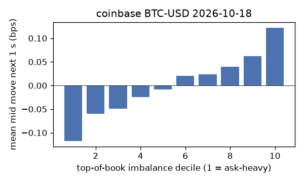
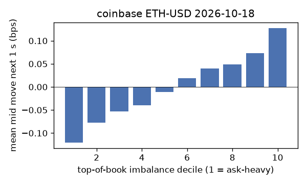
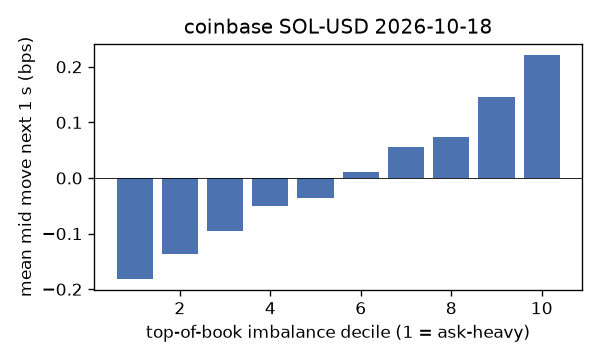
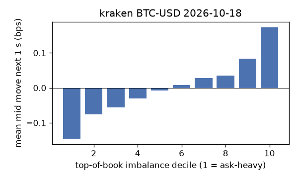
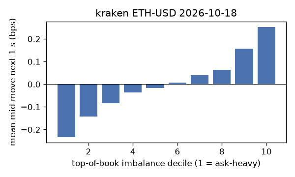
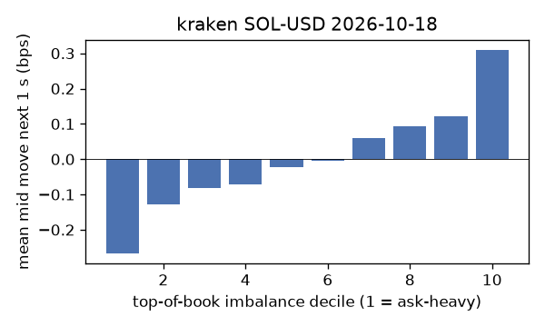

# EDA 2026-10-18

100 ms clock grid; correlations are with the future mid change; nothing measured across a reconnect.

|                       |   ('coinbase', 'BTC-USD') |   ('coinbase', 'ETH-USD') |   ('coinbase', 'SOL-USD') |   ('kraken', 'BTC-USD') |   ('kraken', 'ETH-USD') |   ('kraken', 'SOL-USD') |
|:----------------------|--------------------------:|--------------------------:|--------------------------:|------------------------:|------------------------:|------------------------:|
| hours                 |                   23.9637 |                   23.9637 |                   23.9637 |                 23.9635 |                 23.9635 |                 23.9635 |
| mid                   |                81581.7    |                 2405.02   |                  103.33   |              81588.6    |               2405.05   |                103.325  |
| tick                  |                    0.01   |                    0.01   |                    0.01   |                  0.1    |                  0.01   |                  0.01   |
| spread_med_bps        |                    0.0012 |                    0.2495 |                    1.9355 |                  0.0123 |                  0.0416 |                  0.9678 |
| spread_p90_bps        |                    0.0012 |                    0.9148 |                    1.9355 |                  0.0123 |                  0.0416 |                  0.9678 |
| at_1_tick_%           |                   91.7455 |                   41.0796 |                   44.3144 |                 99.5796 |                 95.8525 |                 90.9461 |
| taker_events/min      |                  102.487  |                   39.3781 |                   30.3934 |                 33.3972 |                 17.7797 |                 13.3852 |
| taker_usd_med         |                    3.8907 |                  109.106  |                   49.3039 |                 42.4974 |                 40      |                 47.1473 |
| inter_taker_ms_med    |                  301.019  |                  801.993  |                 1199.08   |                709.058  |               1697.93   |               2572.68   |
| moved_100ms_%         |                    8.4029 |                   22.734  |                    7.4215 |                  2.0079 |                  6.9212 |                  6.4454 |
| corr_obi1_100ms       |                    0.0866 |                    0.0788 |                    0.0886 |                  0.1132 |                  0.1098 |                  0.1112 |
| corr_obi5_100ms       |                    0.0602 |                    0.0462 |                    0.0342 |                  0.1101 |                  0.1036 |                  0.0931 |
| corr_micro_edge_100ms |                    0.0618 |                    0.0477 |                    0.0866 |                  0.1002 |                  0.0865 |                  0.1195 |
| moved_1s_%            |                   27.3385 |                   64.0607 |                   38.1259 |                 12.8677 |                 27.4975 |                 29.3899 |
| corr_obi1_1s          |                    0.1423 |                    0.0963 |                    0.1321 |                  0.2262 |                  0.1851 |                  0.158  |
| corr_obi5_1s          |                    0.1023 |                    0.052  |                    0.0496 |                  0.2098 |                  0.1781 |                  0.1212 |
| corr_micro_edge_1s    |                    0.0262 |                    0.0355 |                    0.1179 |                  0.0978 |                  0.0697 |                  0.1509 |
| moved_10s_%           |                   70.5997 |                   94.3001 |                   84.2397 |                 59.0801 |                 78.1574 |                 76.0706 |
| corr_obi1_10s         |                    0.1283 |                    0.0709 |                    0.0878 |                  0.2633 |                  0.1727 |                  0.1137 |
| corr_obi5_10s         |                    0.1074 |                    0.0429 |                    0.0293 |                  0.2377 |                  0.173  |                  0.0876 |
| corr_micro_edge_10s   |                    0.0059 |                    0.0205 |                    0.0744 |                  0.0567 |                  0.0245 |                  0.1067 |
| ofi_R2_same_1s        |                    0.1802 |                    0.3089 |                    0.3837 |                  0.3233 |                  0.2754 |                  0.4453 |
| ofi_R2_next_1s        |                    0.0048 |                    0.0017 |                    0.0011 |                  0.019  |                  0.0075 |                  0.0032 |

