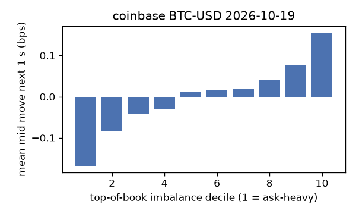
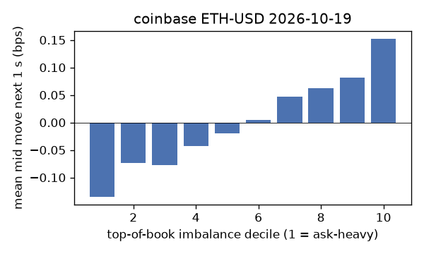
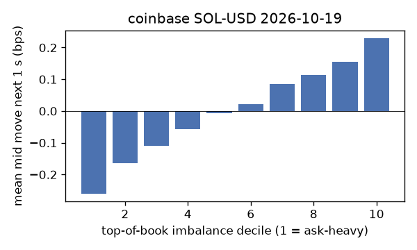
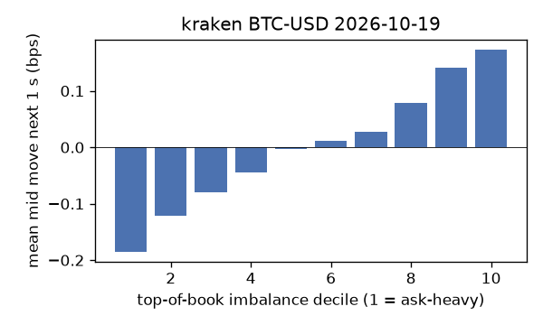
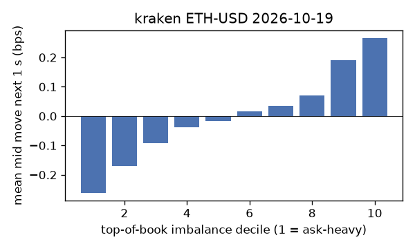
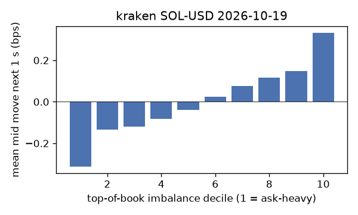

# EDA 2026-10-19

100 ms clock grid; correlations are with the future mid change; nothing measured across a reconnect.

|                       |   ('coinbase', 'BTC-USD') |   ('coinbase', 'ETH-USD') |   ('coinbase', 'SOL-USD') |   ('kraken', 'BTC-USD') |   ('kraken', 'ETH-USD') |   ('kraken', 'SOL-USD') |
|:----------------------|--------------------------:|--------------------------:|--------------------------:|------------------------:|------------------------:|------------------------:|
| hours                 |                   23.9996 |                   23.9996 |                   23.9996 |                 23.9991 |                 23.9991 |                 23.9991 |
| mid                   |                82252.1    |                 2415.57   |                  104.84   |              82253.2    |               2415.53   |                104.845  |
| tick                  |                    0.01   |                    0.01   |                    0.01   |                  0.1    |                  0.01   |                  0.01   |
| spread_med_bps        |                    0.0012 |                    0.2484 |                    1.9077 |                  0.0122 |                  0.0414 |                  0.9538 |
| spread_p90_bps        |                    0.2018 |                    0.828  |                    1.9077 |                  0.0122 |                  0.0414 |                  0.9538 |
| at_1_tick_%           |                   81.5472 |                   39.432  |                   44.2953 |                 99.1374 |                 94.438  |                 91.3475 |
| taker_events/min      |                  148.622  |                   47.3785 |                   31.5971 |                 38.7188 |                 20.9917 |                 15.9925 |
| taker_usd_med         |                    1.7549 |                  165.975  |                   33.1979 |                 58.7819 |                 40      |                 49.0196 |
| inter_taker_ms_med    |                  297.516  |                  699.742  |                 1198.75   |                696.152  |               1502.1    |               2203.82   |
| moved_100ms_%         |                   16.3835 |                   29.4564 |                    7.8635 |                  3.1525 |                  9.0668 |                  7.0527 |
| corr_obi1_100ms       |                    0.0878 |                    0.097  |                    0.1082 |                  0.1291 |                  0.1256 |                  0.1294 |
| corr_obi5_100ms       |                    0.055  |                    0.0483 |                    0.0546 |                  0.1314 |                  0.1176 |                  0.1028 |
| corr_micro_edge_100ms |                    0.0368 |                    0.0492 |                    0.1074 |                  0.1297 |                  0.0963 |                  0.1317 |
| moved_1s_%            |                   45.1016 |                   72.0343 |                   40.1693 |                 17.6562 |                 33.905  |                 31.9819 |
| corr_obi1_1s          |                    0.1405 |                    0.1087 |                    0.1634 |                  0.2474 |                  0.2124 |                  0.1879 |
| corr_obi5_1s          |                    0.0877 |                    0.0525 |                    0.0777 |                  0.2484 |                  0.2019 |                  0.1406 |
| corr_micro_edge_1s    |                    0.0077 |                    0.0344 |                    0.1504 |                  0.1102 |                  0.0863 |                  0.1835 |
| moved_10s_%           |                   87.4628 |                   96.684  |                   85.8434 |                 70.4478 |                 84.2078 |                 77.9067 |
| corr_obi1_10s         |                    0.1013 |                    0.0573 |                    0.1052 |                  0.2647 |                  0.1787 |                  0.1288 |
| corr_obi5_10s         |                    0.0658 |                    0.0331 |                    0.0572 |                  0.265  |                  0.1758 |                  0.1024 |
| corr_micro_edge_10s   |                    0.0009 |                    0.0085 |                    0.0934 |                  0.0718 |                  0.0534 |                  0.1239 |
| ofi_R2_same_1s        |                    0.1501 |                    0.4127 |                    0.4512 |                  0.3416 |                  0.3631 |                  0.4727 |
| ofi_R2_next_1s        |                    0.0039 |                    0.0028 |                    0.0019 |                  0.0221 |                  0.0128 |                  0.005  |

