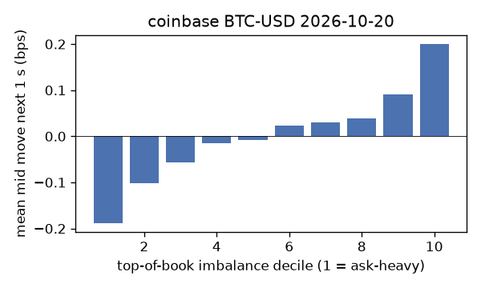
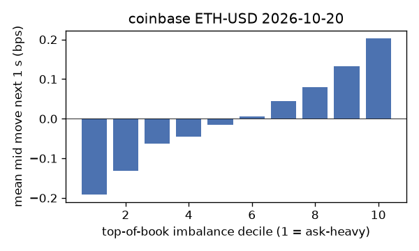
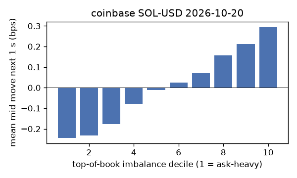
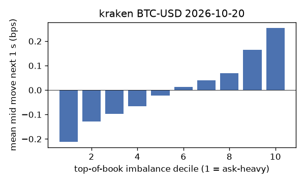
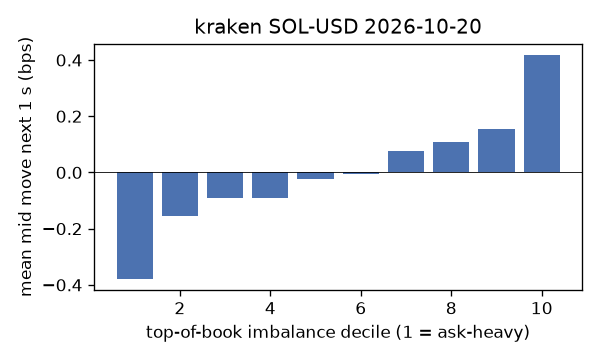

# EDA 2026-10-20

100 ms clock grid; correlations are with the future mid change; nothing measured across a reconnect.

|                       |   ('coinbase', 'BTC-USD') |   ('coinbase', 'ETH-USD') |   ('coinbase', 'SOL-USD') |   ('kraken', 'BTC-USD') |   ('kraken', 'ETH-USD') |   ('kraken', 'SOL-USD') |
|:----------------------|--------------------------:|--------------------------:|--------------------------:|------------------------:|------------------------:|------------------------:|
| hours                 |                   23.9995 |                   23.9994 |                   23.9994 |                 23.9992 |                 23.9992 |                 23.9992 |
| mid                   |                81879.1    |                 2404.49   |                  104.995  |              81882.1    |               2404.53   |                104.995  |
| tick                  |                    0.01   |                    0.01   |                    0.01   |                  0.1    |                  0.01   |                  0.01   |
| spread_med_bps        |                    0.0012 |                    0.0832 |                    0.9524 |                  0.0122 |                  0.0416 |                  0.9524 |
| spread_p90_bps        |                    0.1624 |                    0.7486 |                    1.9049 |                  0.0122 |                  0.0416 |                  1.9049 |
| at_1_tick_%           |                   83.6283 |                   48.8791 |                   65.3029 |                 98.6724 |                 90.0873 |                 89.2214 |
| taker_events/min      |                  161.221  |                   51.2577 |                   41.0888 |                 49.523  |                 23.6653 |                 17.3863 |
| taker_usd_med         |                    0.038  |                  148.49   |                   41.3641 |                 49.5271 |                 42.9939 |                 49.1353 |
| inter_taker_ms_med    |                  295      |                  608.518  |                  899.033  |                546.006  |               1270.18   |               1873.5    |
| moved_100ms_%         |                   16.5461 |                   31.6359 |                   10.1745 |                  4.1152 |                 13.2596 |                 10.7798 |
| corr_obi1_100ms       |                    0.0956 |                    0.0964 |                    0.0959 |                  0.1414 |                  0.1286 |                  0.1329 |
| corr_obi5_100ms       |                    0.0632 |                    0.0471 |                    0.0712 |                  0.1372 |                  0.1163 |                  0.1053 |
| corr_micro_edge_100ms |                    0.0455 |                    0.0437 |                    0.1019 |                  0.0947 |                  0.099  |                  0.1337 |
| moved_1s_%            |                   45.885  |                   71.9493 |                   43.6042 |                 20.4626 |                 41.6007 |                 40.4297 |
| corr_obi1_1s          |                    0.1487 |                    0.1268 |                    0.1662 |                  0.264  |                  0.2105 |                  0.1769 |
| corr_obi5_1s          |                    0.0974 |                    0.0569 |                    0.1039 |                  0.2503 |                  0.192  |                  0.1299 |
| corr_micro_edge_1s    |                    0.019  |                    0.0357 |                    0.1588 |                  0.074  |                  0.0907 |                  0.1688 |
| moved_10s_%           |                   89.1712 |                   97.0681 |                   86.6542 |                 76.1344 |                 89.0339 |                 83.2753 |
| corr_obi1_10s         |                    0.0978 |                    0.0714 |                    0.1109 |                  0.2305 |                  0.1544 |                  0.1023 |
| corr_obi5_10s         |                    0.075  |                    0.0366 |                    0.0667 |                  0.2178 |                  0.1385 |                  0.0838 |
| corr_micro_edge_10s   |                    0.0119 |                    0.0182 |                    0.1032 |                  0.0374 |                  0.0444 |                  0.0976 |
| ofi_R2_same_1s        |                    0.1935 |                    0.3697 |                    0.4638 |                  0.3869 |                  0.3343 |                  0.4514 |
| ofi_R2_next_1s        |                    0.0048 |                    0.0034 |                    0.0028 |                  0.028  |                  0.0159 |                  0.0068 |

