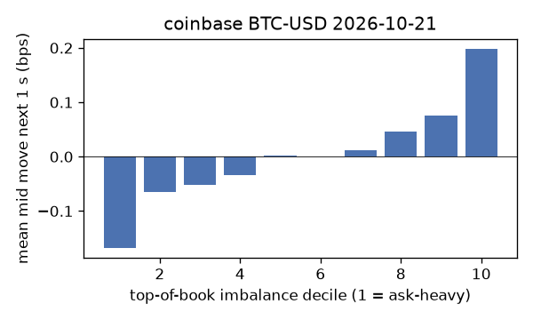
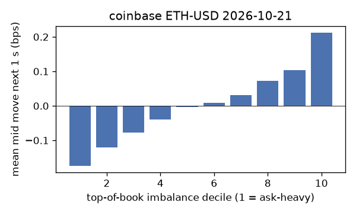
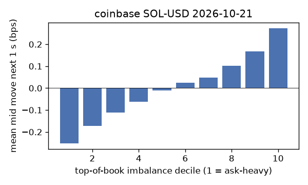
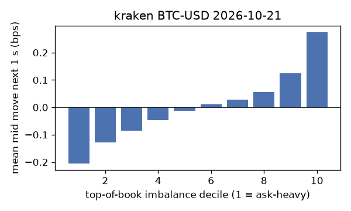
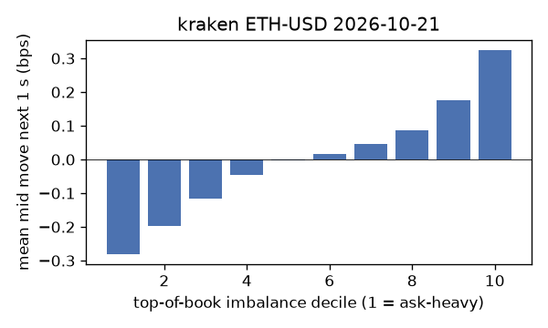
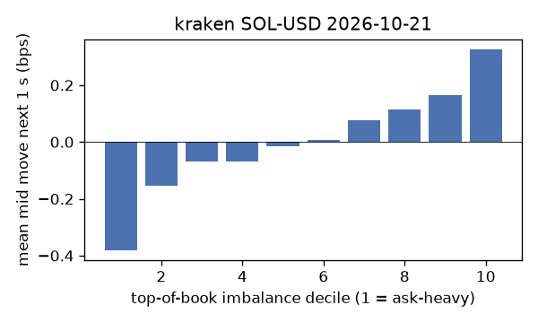

# EDA 2026-10-21

100 ms clock grid; correlations are with the future mid change; nothing measured across a reconnect.

|                       |   ('coinbase', 'BTC-USD') |   ('coinbase', 'ETH-USD') |   ('coinbase', 'SOL-USD') |   ('kraken', 'BTC-USD') |   ('kraken', 'ETH-USD') |   ('kraken', 'SOL-USD') |
|:----------------------|--------------------------:|--------------------------:|--------------------------:|------------------------:|------------------------:|------------------------:|
| hours                 |                   23.9994 |                   23.9993 |                   23.9993 |                 23.9996 |                 23.9996 |                 23.9996 |
| mid                   |                83429.7    |                 2463.97   |                  106.765  |              83429.1    |               2464.09   |                106.765  |
| tick                  |                    0.01   |                    0.01   |                    0.01   |                  0.1    |                  0.01   |                  0.01   |
| spread_med_bps        |                    0.0012 |                    0.0406 |                    0.9366 |                  0.012  |                  0.0406 |                  0.9366 |
| spread_p90_bps        |                    0.1582 |                    0.6494 |                    1.8733 |                  0.012  |                  0.0406 |                  0.9366 |
| at_1_tick_%           |                   82.3317 |                   54.9307 |                   63.6102 |                 99.2921 |                 95.1938 |                 92.711  |
| taker_events/min      |                  172.102  |                   50.9536 |                   37.6414 |                 46.3253 |                 22.9575 |                 17.1502 |
| taker_usd_med         |                    0.8131 |                  200      |                   49.2688 |                 52.4328 |                 44.0683 |                 50.021  |
| inter_taker_ms_med    |                  205.428  |                  696.571  |                  998.507  |                592.011  |               1347.98   |               1995.5    |
| moved_100ms_%         |                   16.819  |                   27.8308 |                    9.6911 |                  3.0529 |                  7.8002 |                  7.7154 |
| corr_obi1_100ms       |                    0.08   |                    0.0934 |                    0.1022 |                  0.129  |                  0.1224 |                  0.1327 |
| corr_obi5_100ms       |                    0.0551 |                    0.0693 |                    0.0796 |                  0.1334 |                  0.119  |                  0.1034 |
| corr_micro_edge_100ms |                    0.0367 |                    0.0421 |                    0.1076 |                  0.1149 |                  0.0979 |                  0.1373 |
| moved_1s_%            |                   47.1975 |                   66.7413 |                   42.7911 |                 18.2031 |                 30.7288 |                 33.3848 |
| corr_obi1_1s          |                    0.1401 |                    0.1325 |                    0.1657 |                  0.255  |                  0.2264 |                  0.1894 |
| corr_obi5_1s          |                    0.0955 |                    0.0934 |                    0.111  |                  0.2578 |                  0.2203 |                  0.1364 |
| corr_micro_edge_1s    |                    0.0151 |                    0.0404 |                    0.155  |                  0.1034 |                  0.0847 |                  0.1855 |
| moved_10s_%           |                   88.9896 |                   95.7983 |                   85.7761 |                 73.4719 |                 84.1231 |                 79.8799 |
| corr_obi1_10s         |                    0.096  |                    0.0861 |                    0.1056 |                  0.2598 |                  0.2024 |                  0.11   |
| corr_obi5_10s         |                    0.0781 |                    0.0629 |                    0.0675 |                  0.2557 |                  0.1976 |                  0.0864 |
| corr_micro_edge_10s   |                    0.0005 |                    0.0243 |                    0.0941 |                  0.0659 |                  0.0514 |                  0.1051 |
| ofi_R2_same_1s        |                    0.1688 |                    0.3051 |                    0.444  |                  0.3447 |                  0.3015 |                  0.4304 |
| ofi_R2_next_1s        |                    0.0046 |                    0.0042 |                    0.0013 |                  0.0328 |                  0.0142 |                  0.007  |

