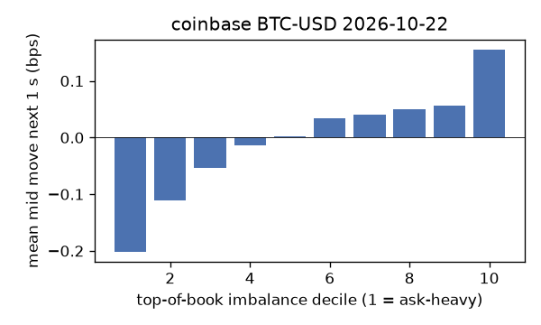
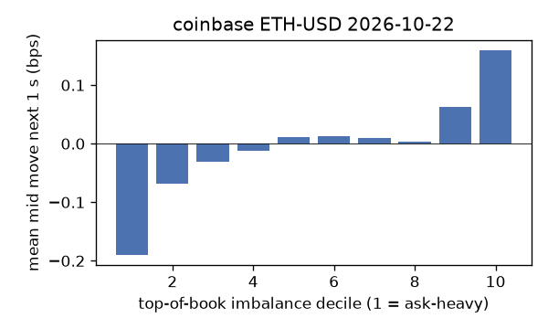
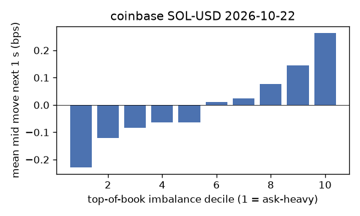
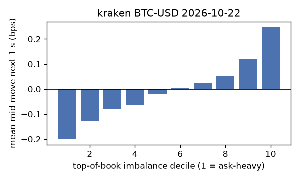
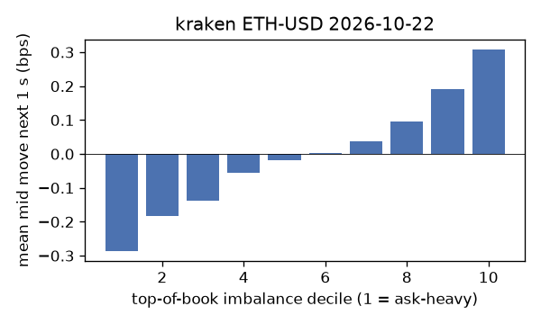
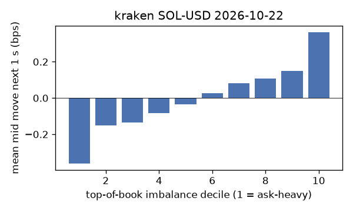

# EDA 2026-10-22

100 ms clock grid; correlations are with the future mid change; nothing measured across a reconnect.

|                       |   ('coinbase', 'BTC-USD') |   ('coinbase', 'ETH-USD') |   ('coinbase', 'SOL-USD') |   ('kraken', 'BTC-USD') |   ('kraken', 'ETH-USD') |   ('kraken', 'SOL-USD') |
|:----------------------|--------------------------:|--------------------------:|--------------------------:|------------------------:|------------------------:|------------------------:|
| hours                 |                   23.9986 |                   23.9986 |                   23.9986 |                 23.9993 |                 23.9993 |                 23.9993 |
| mid                   |                81729      |                 2402.07   |                  104.34   |              81731.4    |               2402.22   |                104.345  |
| tick                  |                    0.01   |                    0.01   |                    0.01   |                  0.1    |                  0.01   |                  0.01   |
| spread_med_bps        |                    0.0012 |                    0.0833 |                    0.9584 |                  0.0122 |                  0.0416 |                  0.9584 |
| spread_p90_bps        |                    0.1493 |                    0.7494 |                    1.9168 |                  0.0122 |                  0.0416 |                  0.9584 |
| at_1_tick_%           |                   83.3121 |                   44.2311 |                   61.0102 |                 98.8613 |                 95.321  |                 93.9141 |
| taker_events/min      |                  172.949  |                   53.965  |                   33.3344 |                 48.3932 |                 24.5748 |                 17.2408 |
| taker_usd_med         |                    1.4851 |                  189.666  |                   48.5985 |                 66.6442 |                 38.8184 |                 54.0776 |
| inter_taker_ms_med    |                  276      |                  602.065  |                 1111.52   |                475.521  |               1266.03   |               2122.44   |
| moved_100ms_%         |                   16.2778 |                   32.656  |                    8.7814 |                  3.1668 |                  8.361  |                  7.0994 |
| corr_obi1_100ms       |                    0.0873 |                    0.0722 |                    0.0949 |                  0.1227 |                  0.1334 |                  0.1426 |
| corr_obi5_100ms       |                    0.0554 |                    0.0455 |                    0.0895 |                  0.1203 |                  0.1216 |                  0.1077 |
| corr_micro_edge_100ms |                    0.036  |                    0.0297 |                    0.09   |                  0.0907 |                  0.1014 |                  0.1452 |
| moved_1s_%            |                   49.5524 |                   76.2104 |                   44.2288 |                 17.8514 |                 32.9469 |                 32.0895 |
| corr_obi1_1s          |                    0.1469 |                    0.0946 |                    0.1536 |                  0.2517 |                  0.2368 |                  0.2102 |
| corr_obi5_1s          |                    0.0912 |                    0.0589 |                    0.1303 |                  0.244  |                  0.22   |                  0.1545 |
| corr_micro_edge_1s    |                    0.0113 |                    0.0264 |                    0.1347 |                  0.0781 |                  0.1034 |                  0.2078 |
| moved_10s_%           |                   91.804  |                   97.7251 |                   85.6201 |                 71.9371 |                 85.3159 |                 77.7346 |
| corr_obi1_10s         |                    0.0876 |                    0.0563 |                    0.0903 |                  0.2676 |                  0.1969 |                  0.1404 |
| corr_obi5_10s         |                    0.0557 |                    0.0341 |                    0.0702 |                  0.258  |                  0.1833 |                  0.1138 |
| corr_micro_edge_10s   |                    0.0048 |                    0.013  |                    0.0771 |                  0.0508 |                  0.0665 |                  0.1378 |
| ofi_R2_same_1s        |                    0.1967 |                    0.322  |                    0.5248 |                  0.3039 |                  0.3181 |                  0.3755 |
| ofi_R2_next_1s        |                    0.0071 |                    0.0015 |                    0.0018 |                  0.0262 |                  0.0246 |                  0.0113 |

