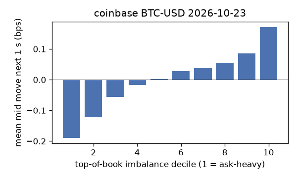
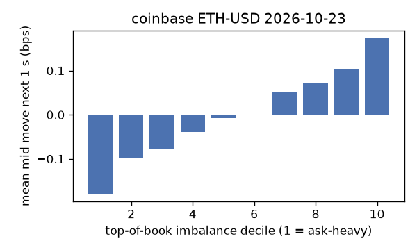
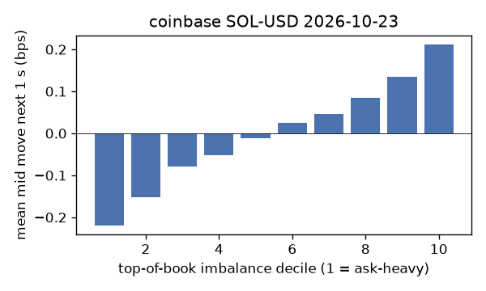
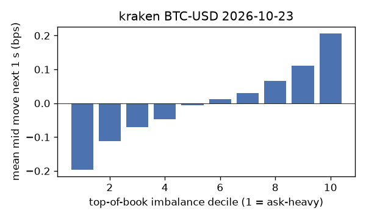
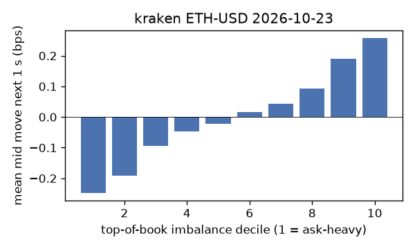
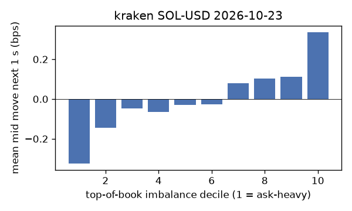

# EDA 2026-10-23

100 ms clock grid; correlations are with the future mid change; nothing measured across a reconnect.

|                       |   ('coinbase', 'BTC-USD') |   ('coinbase', 'ETH-USD') |   ('coinbase', 'SOL-USD') |   ('kraken', 'BTC-USD') |   ('kraken', 'ETH-USD') |   ('kraken', 'SOL-USD') |
|:----------------------|--------------------------:|--------------------------:|--------------------------:|------------------------:|------------------------:|------------------------:|
| hours                 |                   23.9997 |                   23.9997 |                   23.9997 |                 23.9992 |                 23.9992 |                 23.9992 |
| mid                   |                81535.8    |                 2399.18   |                  104.16   |              81538.6    |               2399.24   |                104.165  |
| tick                  |                    0.01   |                    0.01   |                    0.01   |                  0.1    |                  0.01   |                  0.01   |
| spread_med_bps        |                    0.0012 |                    0.0834 |                    0.9601 |                  0.0123 |                  0.0417 |                  0.96   |
| spread_p90_bps        |                    0.0785 |                    0.6669 |                    1.9201 |                  0.0123 |                  0.0417 |                  0.96   |
| at_1_tick_%           |                   87.6553 |                   47.9965 |                   60.1643 |                 99.4294 |                 94.3337 |                 94.8661 |
| taker_events/min      |                  166.279  |                   48.7704 |                   32.6662 |                 42.6251 |                 23.1681 |                 15.8117 |
| taker_usd_med         |                    0.0302 |                  103.97   |                   49.5048 |                 53.6058 |                 35.9986 |                 53.8564 |
| inter_taker_ms_med    |                  298.017  |                  700.607  |                 1102.67   |                479.008  |               1328.17   |               2322.92   |
| moved_100ms_%         |                   13.6923 |                   29.5621 |                    9.0986 |                  2.872  |                  9.2043 |                  6.6353 |
| corr_obi1_100ms       |                    0.096  |                    0.0943 |                    0.0968 |                  0.1169 |                  0.1253 |                  0.1262 |
| corr_obi5_100ms       |                    0.0584 |                    0.0545 |                    0.0948 |                  0.116  |                  0.1123 |                  0.0957 |
| corr_micro_edge_100ms |                    0.0329 |                    0.0388 |                    0.0991 |                  0.1083 |                  0.0882 |                  0.1281 |
| moved_1s_%            |                   43.8976 |                   71.1567 |                   42.3907 |                 16.9348 |                 34.1577 |                 29.0069 |
| corr_obi1_1s          |                    0.1634 |                    0.125  |                    0.1477 |                  0.2371 |                  0.2144 |                  0.1824 |
| corr_obi5_1s          |                    0.0958 |                    0.0681 |                    0.1343 |                  0.2343 |                  0.1923 |                  0.1413 |
| corr_micro_edge_1s    |                    0.0111 |                    0.0336 |                    0.1384 |                  0.0956 |                  0.0792 |                  0.1809 |
| moved_10s_%           |                   89.1476 |                   96.4378 |                   84.3355 |                 68.5264 |                 85.4443 |                 75.2534 |
| corr_obi1_10s         |                    0.1058 |                    0.0751 |                    0.0799 |                  0.266  |                  0.1797 |                  0.116  |
| corr_obi5_10s         |                    0.0613 |                    0.0476 |                    0.0792 |                  0.2666 |                  0.1623 |                  0.0971 |
| corr_micro_edge_10s   |                    0.0002 |                    0.0151 |                    0.073  |                  0.0759 |                  0.0375 |                  0.1136 |
| ofi_R2_same_1s        |                    0.1904 |                    0.3625 |                    0.4932 |                  0.3259 |                  0.2939 |                  0.4478 |
| ofi_R2_next_1s        |                    0.0052 |                    0.0034 |                    0.0008 |                  0.0241 |                  0.0142 |                  0.0082 |

