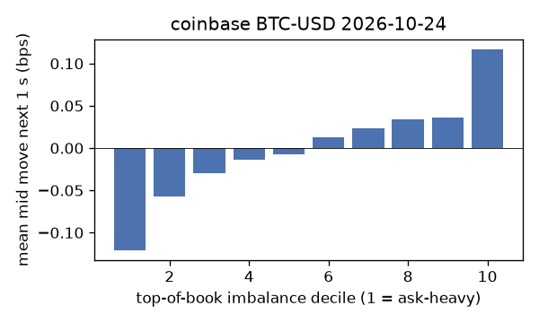
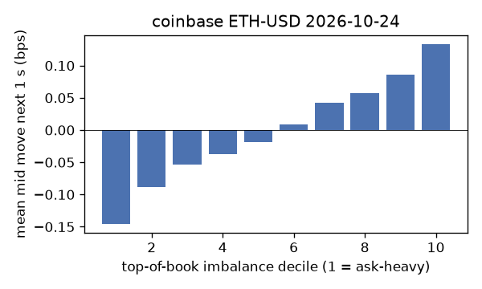
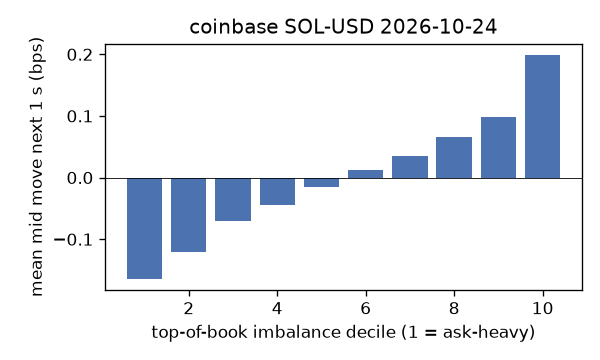
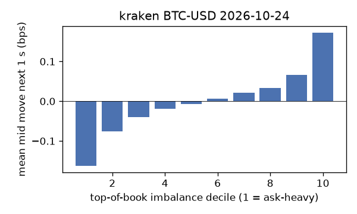
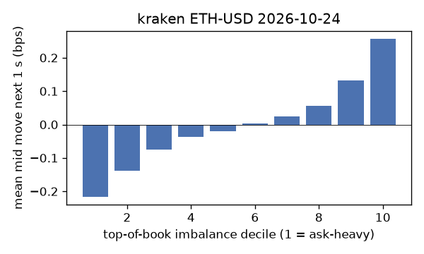
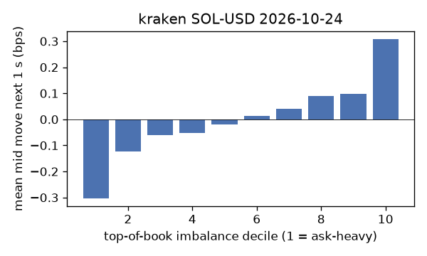

# EDA 2026-10-24

100 ms clock grid; correlations are with the future mid change; nothing measured across a reconnect.

|                       |   ('coinbase', 'BTC-USD') |   ('coinbase', 'ETH-USD') |   ('coinbase', 'SOL-USD') |   ('kraken', 'BTC-USD') |   ('kraken', 'ETH-USD') |   ('kraken', 'SOL-USD') |
|:----------------------|--------------------------:|--------------------------:|--------------------------:|------------------------:|------------------------:|------------------------:|
| hours                 |                   23.9995 |                   23.9995 |                   23.9995 |                 23.9992 |                 23.9992 |                 23.9992 |
| mid                   |                80543.7    |                 2363.72   |                  101.465  |              80547.9    |               2363.86   |                101.465  |
| tick                  |                    0.01   |                    0.01   |                    0.01   |                  0.1    |                  0.01   |                  0.01   |
| spread_med_bps        |                    0.0012 |                    0.0423 |                    0.9856 |                  0.0124 |                  0.0423 |                  0.9856 |
| spread_p90_bps        |                    0.0919 |                    0.5923 |                    1.9711 |                  0.0124 |                  0.0423 |                  0.9856 |
| at_1_tick_%           |                   87.2278 |                   50.323  |                   52.4489 |                 99.0992 |                 96.1178 |                 96.3204 |
| taker_events/min      |                  147.872  |                   42.0774 |                   31.6917 |                 37.6677 |                 19.761  |                 17.3482 |
| taker_usd_med         |                    0.0266 |                   97.1919 |                   41.9661 |                 69.0385 |                 38.5763 |                 48.2204 |
| inter_taker_ms_med    |                  299.97   |                  799.384  |                 1099.18   |                604.249  |               1448.35   |               1797.71   |
| moved_100ms_%         |                   10.5548 |                   20.342  |                    7.8892 |                  2.5648 |                  6.4094 |                  4.1405 |
| corr_obi1_100ms       |                    0.067  |                    0.0794 |                    0.0848 |                  0.0954 |                  0.1033 |                  0.1204 |
| corr_obi5_100ms       |                    0.0482 |                    0.0365 |                    0.0661 |                  0.0892 |                  0.0963 |                  0.1064 |
| corr_micro_edge_100ms |                    0.0218 |                    0.0454 |                    0.0874 |                  0.0881 |                  0.0718 |                  0.1309 |
| moved_1s_%            |                   33.114  |                   59.2025 |                   36.9783 |                 14.246  |                 25.6272 |                 20.4615 |
| corr_obi1_1s          |                    0.1103 |                    0.1009 |                    0.1195 |                  0.1912 |                  0.1724 |                  0.1731 |
| corr_obi5_1s          |                    0.0823 |                    0.049  |                    0.0961 |                  0.1791 |                  0.1606 |                  0.1439 |
| corr_micro_edge_1s    |                    0.0071 |                    0.0355 |                    0.113  |                  0.0436 |                  0.0597 |                  0.1765 |
| moved_10s_%           |                   78.4736 |                   92.4531 |                   79.9933 |                 61.8751 |                 78.2173 |                 65.8709 |
| corr_obi1_10s         |                    0.0995 |                    0.0792 |                    0.0842 |                  0.2168 |                  0.1714 |                  0.1281 |
| corr_obi5_10s         |                    0.076  |                    0.0447 |                    0.0711 |                  0.2038 |                  0.1587 |                  0.1041 |
| corr_micro_edge_10s   |                    0.0012 |                    0.0232 |                    0.0777 |                  0.0293 |                  0.0266 |                  0.1256 |
| ofi_R2_same_1s        |                    0.1243 |                    0.3643 |                    0.545  |                  0.3043 |                  0.2598 |                  0.3784 |
| ofi_R2_next_1s        |                    0.0022 |                    0.0014 |                    0.0001 |                  0.0228 |                  0.0081 |                  0.0102 |

