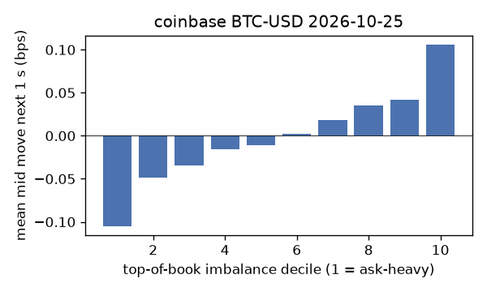
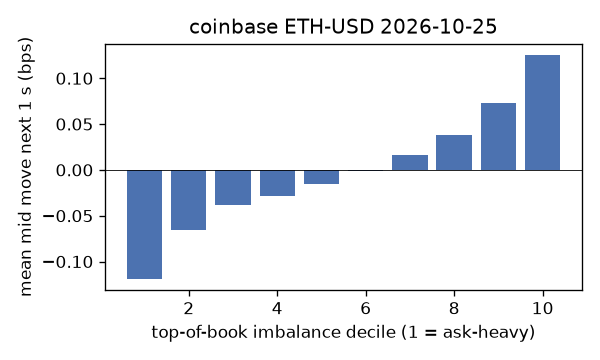
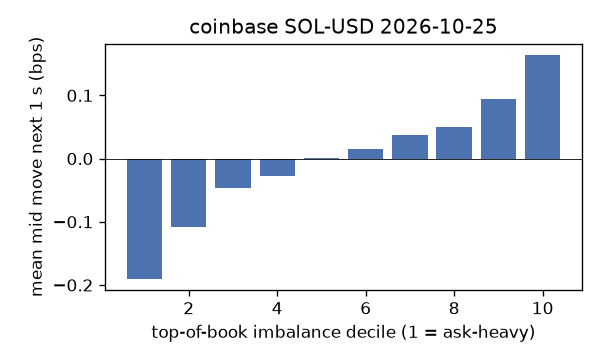
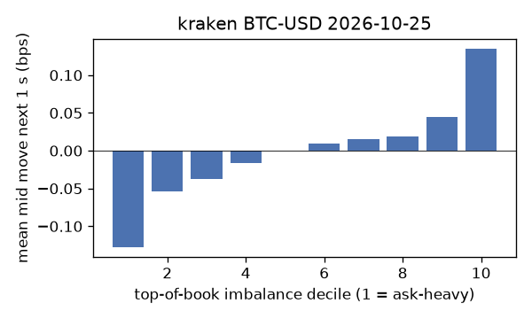
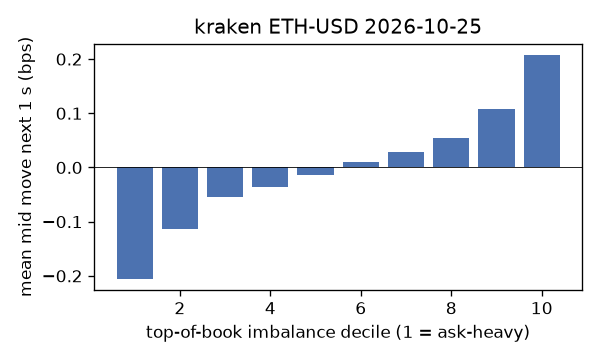
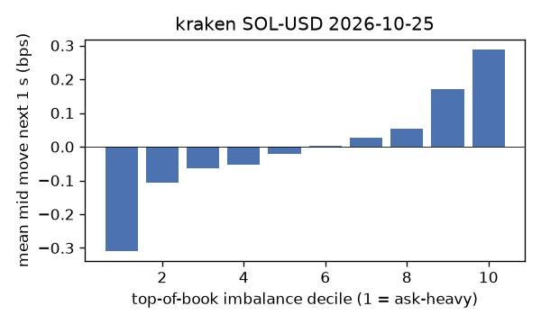

# EDA 2026-10-25

100 ms clock grid; correlations are with the future mid change; nothing measured across a reconnect.

|                       |   ('coinbase', 'BTC-USD') |   ('coinbase', 'ETH-USD') |   ('coinbase', 'SOL-USD') |   ('kraken', 'BTC-USD') |   ('kraken', 'ETH-USD') |   ('kraken', 'SOL-USD') |
|:----------------------|--------------------------:|--------------------------:|--------------------------:|------------------------:|------------------------:|------------------------:|
| hours                 |                   23.9997 |                   23.9997 |                   23.9996 |                 23.9992 |                 23.9992 |                 23.9992 |
| mid                   |                80483      |                 2343.6    |                  101.54   |              80486.2    |               2343.64   |                101.545  |
| tick                  |                    0.01   |                    0.01   |                    0.01   |                  0.1    |                  0.01   |                  0.01   |
| spread_med_bps        |                    0.0012 |                    0.0427 |                    0.9848 |                  0.0124 |                  0.0427 |                  0.9848 |
| spread_p90_bps        |                    0.0012 |                    0.64   |                    1.9697 |                  0.0124 |                  0.0427 |                  0.9848 |
| at_1_tick_%           |                   96.843  |                   55.2453 |                   65.0193 |                 99.4479 |                 94.7277 |                 98.6423 |
| taker_events/min      |                   78.5236 |                   34.7654 |                   24.1302 |                 24.6279 |                 14.785  |                 13.4686 |
| taker_usd_med         |                   17.4101 |                   71.8056 |                   37.1528 |                 51.3345 |                 35.0384 |                 37.5359 |
| inter_taker_ms_med    |                  400.522  |                 1000.62   |                 1595.47   |               1281.31   |               2201.86   |               2717.83   |
| moved_100ms_%         |                    4.6122 |                   18.5126 |                    5.0304 |                  1.8747 |                  6.9104 |                  1.9851 |
| corr_obi1_100ms       |                    0.0711 |                    0.0755 |                    0.0871 |                  0.0974 |                  0.1081 |                  0.1326 |
| corr_obi5_100ms       |                    0.0601 |                    0.0471 |                    0.0683 |                  0.0845 |                  0.0926 |                  0.129  |
| corr_micro_edge_100ms |                    0.0521 |                    0.0366 |                    0.0837 |                  0.0799 |                  0.103  |                  0.1381 |
| moved_1s_%            |                   18.8546 |                   54.2582 |                   29.1158 |                 11.6966 |                 27.724  |                 13.3495 |
| corr_obi1_1s          |                    0.1314 |                    0.1024 |                    0.1451 |                  0.1921 |                  0.183  |                  0.231  |
| corr_obi5_1s          |                    0.1107 |                    0.07   |                    0.1169 |                  0.1575 |                  0.1615 |                  0.1971 |
| corr_micro_edge_1s    |                    0.0185 |                    0.0295 |                    0.1323 |                  0.0618 |                  0.0835 |                  0.2325 |
| moved_10s_%           |                   64.0354 |                   89.0287 |                   74.7848 |                 56.0269 |                 78.0777 |                 58.4631 |
| corr_obi1_10s         |                    0.1417 |                    0.0837 |                    0.1099 |                  0.2505 |                  0.1807 |                  0.2206 |
| corr_obi5_10s         |                    0.1285 |                    0.0548 |                    0.0862 |                  0.2032 |                  0.1649 |                  0.1687 |
| corr_micro_edge_10s   |                    0.0053 |                    0.0181 |                    0.0984 |                  0.0341 |                  0.0396 |                  0.2189 |
| ofi_R2_same_1s        |                    0.2131 |                    0.3354 |                    0.5551 |                  0.2988 |                  0.2871 |                  0.3398 |
| ofi_R2_next_1s        |                    0.0062 |                    0.0021 |                    0.0015 |                  0.019  |                  0.0089 |                  0.0193 |

