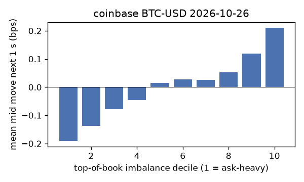
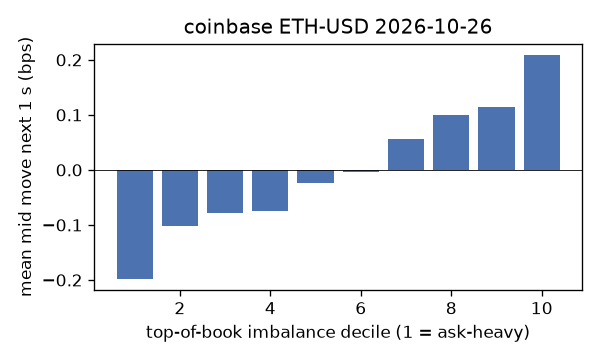
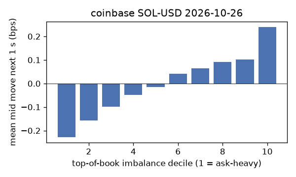
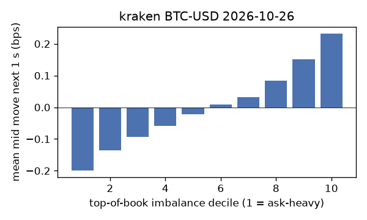
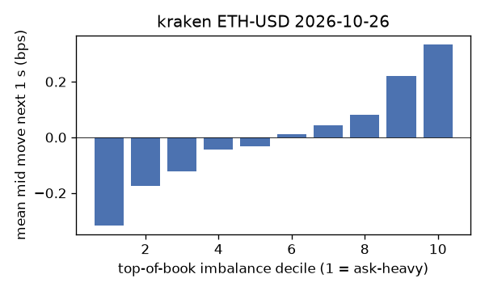
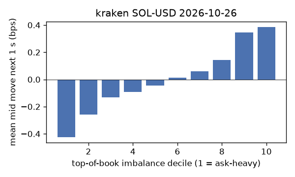

# EDA 2026-10-26

100 ms clock grid; correlations are with the future mid change; nothing measured across a reconnect.

|                       |   ('coinbase', 'BTC-USD') |   ('coinbase', 'ETH-USD') |   ('coinbase', 'SOL-USD') |   ('kraken', 'BTC-USD') |   ('kraken', 'ETH-USD') |   ('kraken', 'SOL-USD') |
|:----------------------|--------------------------:|--------------------------:|--------------------------:|------------------------:|------------------------:|------------------------:|
| hours                 |                   23.9996 |                   23.9996 |                   23.9996 |                 23.9992 |                 23.9992 |                 23.9992 |
| mid                   |                79974.2    |                 2316.57   |                  100.965  |              79976.1    |               2316.66   |                100.965  |
| tick                  |                    0.01   |                    0.01   |                    0.01   |                  0.1    |                  0.01   |                  0.01   |
| spread_med_bps        |                    0.0013 |                    0.0863 |                    1.9809 |                  0.0125 |                  0.0432 |                  0.9904 |
| spread_p90_bps        |                    0.0388 |                    0.8202 |                    1.9809 |                  0.0125 |                  0.3453 |                  0.9904 |
| at_1_tick_%           |                   89.0902 |                   48.2031 |                   48.5463 |                 96.3719 |                 85.8071 |                 96.9662 |
| taker_events/min      |                  152.577  |                   51.7334 |                   26.5593 |                 53.9903 |                 23.0572 |                 15.4358 |
| taker_usd_med         |                    8.7793 |                  168.679  |                   48.5892 |                 59.2116 |                 44.4893 |                 50.9143 |
| inter_taker_ms_med    |                  276.009  |                  696.995  |                 1396.42   |                545.732  |               1382.26   |               2310.79   |
| moved_100ms_%         |                   15.5327 |                   34.9311 |                   11.0269 |                  5.3236 |                 15.6753 |                  4.063  |
| corr_obi1_100ms       |                    0.1003 |                    0.1063 |                    0.0956 |                  0.1176 |                  0.1221 |                  0.1572 |
| corr_obi5_100ms       |                    0.0739 |                    0.069  |                    0.0826 |                  0.1196 |                  0.1167 |                  0.159  |
| corr_micro_edge_100ms |                    0.0318 |                    0.0403 |                    0.1018 |                  0.0868 |                  0.1018 |                  0.1674 |
| moved_1s_%            |                   44.697  |                   74.2897 |                   49.0507 |                 22.5378 |                 44.8209 |                 22.7507 |
| corr_obi1_1s          |                    0.1564 |                    0.1214 |                    0.1371 |                  0.2418 |                  0.2089 |                  0.2717 |
| corr_obi5_1s          |                    0.1159 |                    0.0818 |                    0.107  |                  0.2424 |                  0.1908 |                  0.2564 |
| corr_micro_edge_1s    |                    0.0061 |                    0.0314 |                    0.1324 |                  0.0683 |                  0.0841 |                  0.2733 |
| moved_10s_%           |                   89.0208 |                   97.3197 |                   87.7071 |                 73.9071 |                 88.7637 |                 73.9857 |
| corr_obi1_10s         |                    0.1007 |                    0.059  |                    0.0832 |                  0.2695 |                  0.1748 |                  0.1999 |
| corr_obi5_10s         |                    0.08   |                    0.0388 |                    0.0559 |                  0.2734 |                  0.1609 |                  0.1742 |
| corr_micro_edge_10s   |                   -0.0051 |                    0.0117 |                    0.078  |                  0.0454 |                  0.0476 |                  0.1985 |
| ofi_R2_same_1s        |                    0.1832 |                    0.3926 |                    0.5577 |                  0.2465 |                  0.2853 |                  0.3325 |
| ofi_R2_next_1s        |                    0.0039 |                    0.0019 |                    0.0003 |                  0.025  |                  0.0101 |                  0.0245 |

