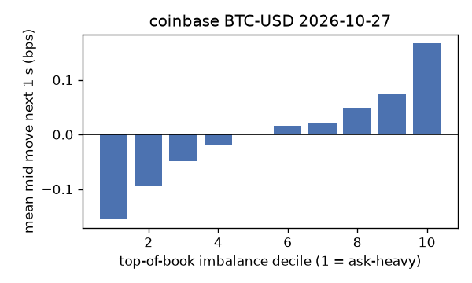
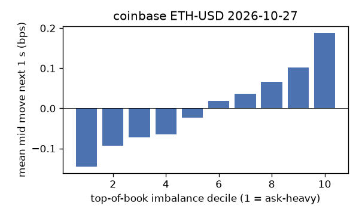
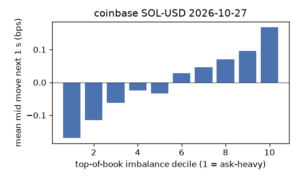
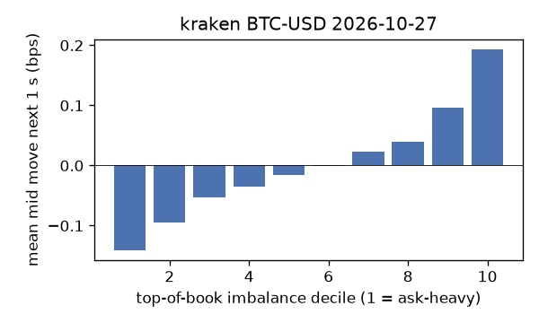
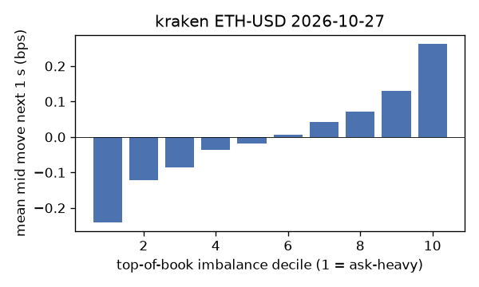
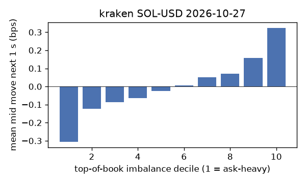

# EDA 2026-10-27

100 ms clock grid; correlations are with the future mid change; nothing measured across a reconnect.

|                       |   ('coinbase', 'BTC-USD') |   ('coinbase', 'ETH-USD') |   ('coinbase', 'SOL-USD') |   ('kraken', 'BTC-USD') |   ('kraken', 'ETH-USD') |   ('kraken', 'SOL-USD') |
|:----------------------|--------------------------:|--------------------------:|--------------------------:|------------------------:|------------------------:|------------------------:|
| hours                 |                   23.9995 |                   23.9997 |                   23.9997 |                 23.9991 |                 23.9991 |                 23.9991 |
| mid                   |                80068      |                 2322.87   |                  100.43   |              80068.9    |               2323.01   |                100.435  |
| tick                  |                    0.01   |                    0.01   |                    0.01   |                  0.1    |                  0.01   |                  0.01   |
| spread_med_bps        |                    0.0012 |                    0.0431 |                    0.9957 |                  0.0125 |                  0.043  |                  0.9957 |
| spread_p90_bps        |                    0.0012 |                    0.6888 |                    1.9914 |                  0.0125 |                  0.043  |                  0.9957 |
| at_1_tick_%           |                   91.9971 |                   53.3027 |                   57.1564 |                 99.345  |                 91.2807 |                 96.1223 |
| taker_events/min      |                  131.985  |                   43.6011 |                   24.097  |                 38.0443 |                 18.3888 |                 15.361  |
| taker_usd_med         |                    0.0597 |                  130.057  |                   45.8339 |                 55.7126 |                 37.2086 |                 43.6893 |
| inter_taker_ms_med    |                  300.309  |                  803.042  |                 1500.6    |                614.451  |               1848.58   |               2340.82   |
| moved_100ms_%         |                    9.2017 |                   26.02   |                    7.285  |                  2.4886 |                  9.949  |                  3.1234 |
| corr_obi1_100ms       |                    0.0926 |                    0.0943 |                    0.0848 |                  0.1065 |                  0.1144 |                  0.1324 |
| corr_obi5_100ms       |                    0.0687 |                    0.064  |                    0.0726 |                  0.1038 |                  0.107  |                  0.1209 |
| corr_micro_edge_100ms |                    0.0454 |                    0.0363 |                    0.0861 |                  0.1079 |                  0.0702 |                  0.1368 |
| moved_1s_%            |                   31.1238 |                   65.8032 |                   39.0057 |                 15.2661 |                 36.812  |                 18.1472 |
| corr_obi1_1s          |                    0.1586 |                    0.1312 |                    0.1254 |                  0.2266 |                  0.1978 |                  0.2254 |
| corr_obi5_1s          |                    0.1212 |                    0.0868 |                    0.1021 |                  0.2189 |                  0.1828 |                  0.1948 |
| corr_micro_edge_1s    |                    0.016  |                    0.0365 |                    0.1205 |                  0.0863 |                  0.0612 |                  0.2236 |
| moved_10s_%           |                   81.7631 |                   96.0049 |                   81.9135 |                 66.3551 |                 86.7165 |                 65.8991 |
| corr_obi1_10s         |                    0.1174 |                    0.0798 |                    0.0859 |                  0.3032 |                  0.177  |                  0.2014 |
| corr_obi5_10s         |                    0.0948 |                    0.0523 |                    0.0494 |                  0.295  |                  0.1704 |                  0.174  |
| corr_micro_edge_10s   |                    0.0032 |                    0.0228 |                    0.0765 |                  0.067  |                  0.043  |                  0.1982 |
| ofi_R2_same_1s        |                    0.1822 |                    0.39   |                    0.5608 |                  0.2775 |                  0.2825 |                  0.2166 |
| ofi_R2_next_1s        |                    0.0061 |                    0.0042 |                    0.0001 |                  0.021  |                  0.011  |                  0.0076 |

