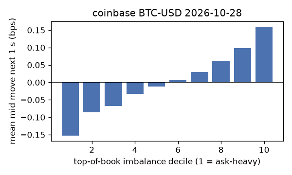
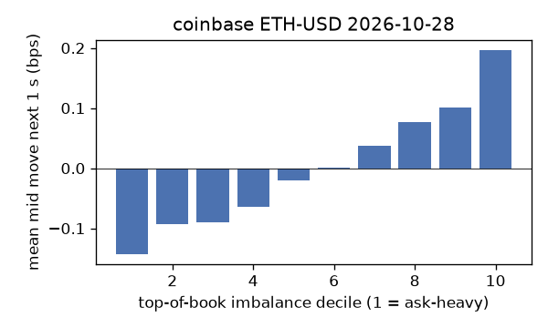
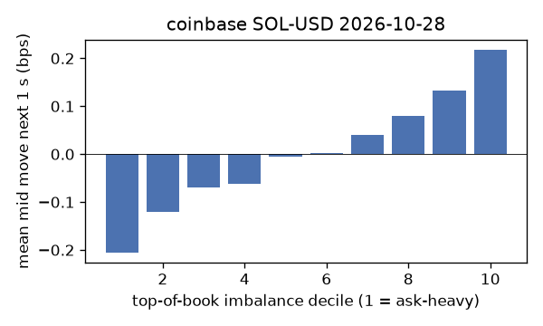
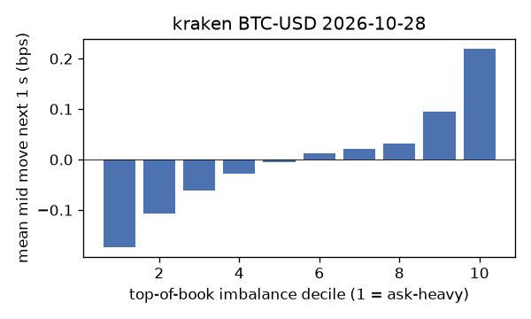
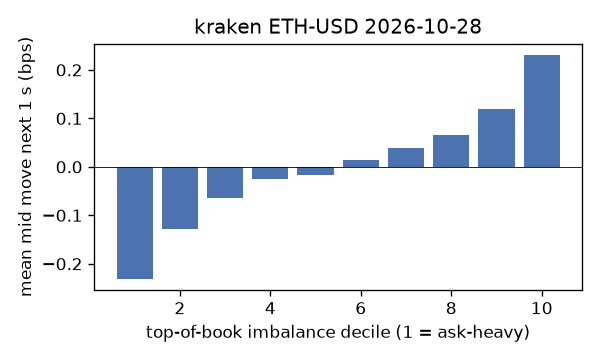
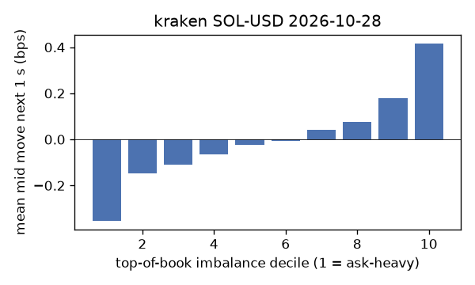

# EDA 2026-10-28

100 ms clock grid; correlations are with the future mid change; nothing measured across a reconnect.

|                       |   ('coinbase', 'BTC-USD') |   ('coinbase', 'ETH-USD') |   ('coinbase', 'SOL-USD') |   ('kraken', 'BTC-USD') |   ('kraken', 'ETH-USD') |   ('kraken', 'SOL-USD') |
|:----------------------|--------------------------:|--------------------------:|--------------------------:|------------------------:|------------------------:|------------------------:|
| hours                 |                   23.9995 |                   23.9993 |                   23.9994 |                 23.9992 |                 23.9992 |                 23.9992 |
| mid                   |                80854      |                 2352.24   |                  101.87   |              80858.4    |               2352.36   |                101.875  |
| tick                  |                    0.01   |                    0.01   |                    0.01   |                  0.1    |                  0.01   |                  0.01   |
| spread_med_bps        |                    0.0012 |                    0.0425 |                    0.9816 |                  0.0124 |                  0.0425 |                  0.9816 |
| spread_p90_bps        |                    0.0012 |                    0.5527 |                    1.9633 |                  0.0124 |                  0.3826 |                  0.9816 |
| at_1_tick_%           |                   94.8589 |                   63.7826 |                   64.3405 |                 99.3392 |                 87.6439 |                 97.6533 |
| taker_events/min      |                  119.291  |                   46.6436 |                   28.352  |                 31.3216 |                 17.8047 |                 17.4366 |
| taker_usd_med         |                    6.93   |                  162.056  |                   49.5    |                 62.4238 |                 44.175  |                 49.9564 |
| inter_taker_ms_med    |                  298.579  |                  699.547  |                 1299.28   |                967.066  |               1749.59   |               1978.46   |
| moved_100ms_%         |                    7.0733 |                   20.5809 |                    7.2992 |                  2.2751 |                 11.4254 |                  3.2106 |
| corr_obi1_100ms       |                    0.0951 |                    0.086  |                    0.0834 |                  0.0993 |                  0.0983 |                  0.1324 |
| corr_obi5_100ms       |                    0.0745 |                    0.0597 |                    0.0687 |                  0.0947 |                  0.0883 |                  0.1197 |
| corr_micro_edge_100ms |                    0.053  |                    0.0392 |                    0.0868 |                  0.0514 |                  0.0503 |                  0.1267 |
| moved_1s_%            |                   26.5243 |                   57.2986 |                   37.9065 |                 13.5294 |                 36.9731 |                 17.2558 |
| corr_obi1_1s          |                    0.1583 |                    0.1239 |                    0.1328 |                  0.2154 |                  0.1664 |                  0.2264 |
| corr_obi5_1s          |                    0.1255 |                    0.0862 |                    0.1067 |                  0.2022 |                  0.152  |                  0.1903 |
| corr_micro_edge_1s    |                    0.0129 |                    0.0473 |                    0.1252 |                  0.044  |                  0.0431 |                  0.2094 |
| moved_10s_%           |                   74.2631 |                   92.4654 |                   81.3869 |                 60.3619 |                 83.6454 |                 64.4699 |
| corr_obi1_10s         |                    0.1269 |                    0.0808 |                    0.0929 |                  0.2519 |                  0.1485 |                  0.1967 |
| corr_obi5_10s         |                    0.1157 |                    0.059  |                    0.0832 |                  0.2327 |                  0.1444 |                  0.1585 |
| corr_micro_edge_10s   |                    0.0084 |                    0.0158 |                    0.0843 |                  0.0058 |                  0.0283 |                  0.1945 |
| ofi_R2_same_1s        |                    0.1924 |                    0.3308 |                    0.5137 |                  0.2595 |                  0.1837 |                  0.337  |
| ofi_R2_next_1s        |                    0.0063 |                    0.0045 |                    0.0006 |                  0.0228 |                  0.0103 |                  0.0197 |

