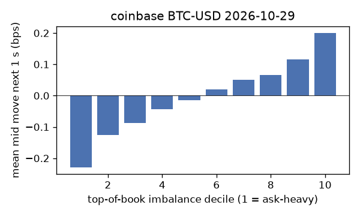
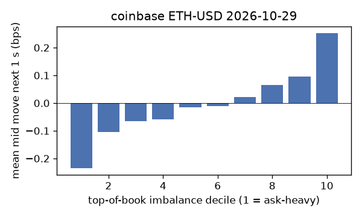
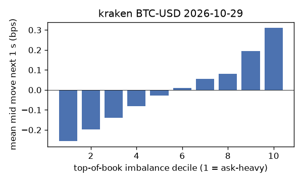
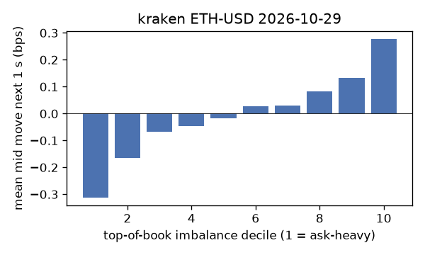
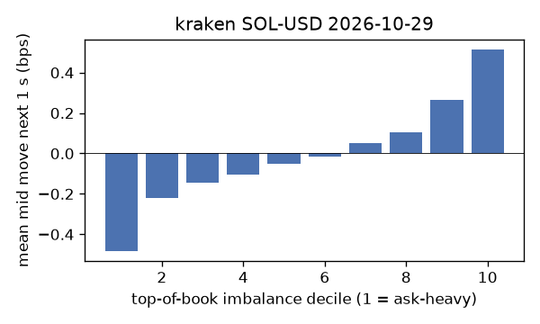

# EDA 2026-10-29

100 ms clock grid; correlations are with the future mid change; nothing measured across a reconnect.

|                       |   ('coinbase', 'BTC-USD') |   ('coinbase', 'ETH-USD') |   ('coinbase', 'SOL-USD') |   ('kraken', 'BTC-USD') |   ('kraken', 'ETH-USD') |   ('kraken', 'SOL-USD') |
|:----------------------|--------------------------:|--------------------------:|--------------------------:|------------------------:|------------------------:|------------------------:|
| hours                 |                   23.9994 |                   23.9994 |                   23.9994 |                 23.9994 |                 23.9994 |                 23.9994 |
| mid                   |                80069      |                 2319.57   |                  100.18   |              80075.6    |               2319.68   |                100.175  |
| tick                  |                    0.01   |                    0.01   |                    0.01   |                  0.1    |                  0.01   |                  0.01   |
| spread_med_bps        |                    0.0012 |                    0.0862 |                    0.9982 |                  0.0125 |                  0.0431 |                  0.9983 |
| spread_p90_bps        |                    0.0537 |                    0.8191 |                    1.9964 |                  0.0125 |                  1.1208 |                  0.9983 |
| at_1_tick_%           |                   89.0007 |                   46.8856 |                   52.4985 |                 97.6922 |                 77.9446 |                 95.1792 |
| taker_events/min      |                  148.698  |                   62.1979 |                   38.48   |                 51.3125 |                 29.2308 |                 25.3032 |
| taker_usd_med         |                   29.1552 |                  426.472  |                   99.866  |                 80.4019 |                 46.9134 |                 58.2789 |
| inter_taker_ms_med    |                  202.224  |                  496.366  |                  800.916  |                458.713  |                578.121  |               1143.12   |
| moved_100ms_%         |                   15.0114 |                   34.9146 |                   11.6646 |                  4.779  |                 20.7021 |                  6.7716 |
| corr_obi1_100ms       |                    0.0924 |                    0.0716 |                    0.0825 |                  0.1236 |                  0.0863 |                  0.1295 |
| corr_obi5_100ms       |                    0.0631 |                    0.0442 |                    0.0579 |                  0.116  |                  0.0703 |                  0.1148 |
| corr_micro_edge_100ms |                    0.041  |                    0.0368 |                    0.0779 |                  0.0951 |                  0.0337 |                  0.1322 |
| moved_1s_%            |                   41.5345 |                   76.0689 |                   50.0775 |                 21.9878 |                 54.4951 |                 26.9484 |
| corr_obi1_1s          |                    0.1312 |                    0.0917 |                    0.111  |                  0.2277 |                  0.1295 |                  0.1977 |
| corr_obi5_1s          |                    0.0916 |                    0.0602 |                    0.0749 |                  0.2127 |                  0.1101 |                  0.1707 |
| corr_micro_edge_1s    |                    0.0122 |                    0.0222 |                    0.0936 |                  0.0615 |                  0.0316 |                  0.1828 |
| moved_10s_%           |                   85.2103 |                   97.7942 |                   88.3813 |                 76.2652 |                 93.4079 |                 75.0695 |
| corr_obi1_10s         |                    0.0779 |                    0.049  |                    0.063  |                  0.2016 |                  0.0915 |                  0.1387 |
| corr_obi5_10s         |                    0.0629 |                    0.0366 |                    0.0468 |                  0.1887 |                  0.0826 |                  0.1149 |
| corr_micro_edge_10s   |                    0.0042 |                    0.0088 |                    0.0542 |                  0.0104 |                  0.0249 |                  0.1216 |
| ofi_R2_same_1s        |                    0.1637 |                    0.3022 |                    0.4295 |                  0.2544 |                  0.1714 |                  0.2303 |
| ofi_R2_next_1s        |                    0.0034 |                    0.0024 |                    0.0015 |                  0.027  |                  0.0055 |                  0.0095 |

