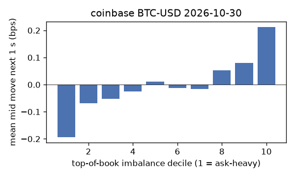
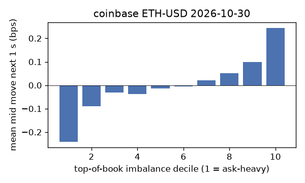
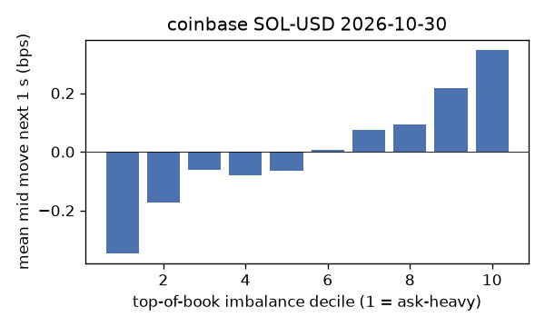
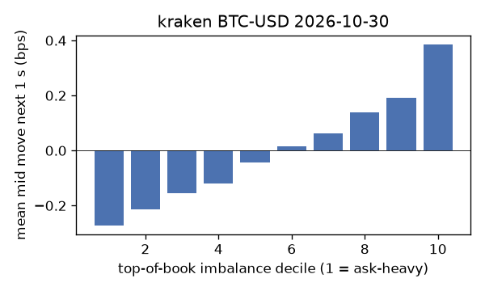
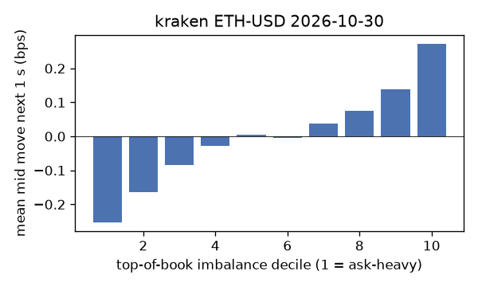
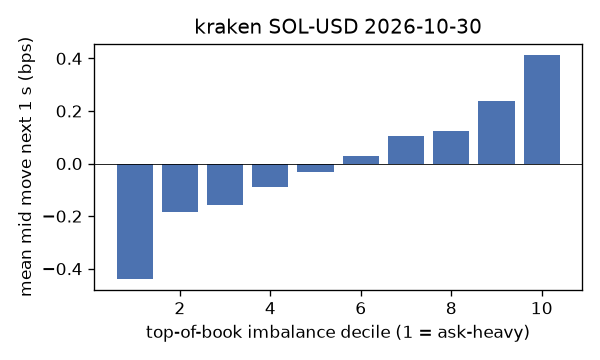

# EDA 2026-10-30

100 ms clock grid; correlations are with the future mid change; nothing measured across a reconnect.

|                       |   ('coinbase', 'BTC-USD') |   ('coinbase', 'ETH-USD') |   ('coinbase', 'SOL-USD') |   ('kraken', 'BTC-USD') |   ('kraken', 'ETH-USD') |   ('kraken', 'SOL-USD') |
|:----------------------|--------------------------:|--------------------------:|--------------------------:|------------------------:|------------------------:|------------------------:|
| hours                 |                   23.9995 |                   23.9996 |                   23.9995 |                 23.9994 |                 23.9995 |                 23.9994 |
| mid                   |                77229.8    |                 2232.01   |                   95.495  |              77210.9    |               2232.31   |                 95.435  |
| tick                  |                    0.01   |                    0.01   |                    0.01   |                  0.1    |                  0.01   |                  0.01   |
| spread_med_bps        |                    0.0013 |                    0.0448 |                    1.0472 |                  0.013  |                  0.0448 |                  1.0478 |
| spread_p90_bps        |                    0.2007 |                    0.8064 |                    2.0944 |                  0.013  |                  1.3887 |                  2.0957 |
| at_1_tick_%           |                   85.2837 |                   51.0493 |                   64.1104 |                 96.3383 |                 76.8189 |                 89.7679 |
| taker_events/min      |                  207.093  |                   76.6211 |                   51.4738 |                 61.5798 |                 26.5132 |                 28.1026 |
| taker_usd_med         |                   16.1255 |                  400.264  |                  159.406  |                 69.3051 |                 83.3301 |                 72.3706 |
| inter_taker_ms_med    |                  201.017  |                  455.942  |                  623.368  |                408.998  |               1050.16   |               1086.18   |
| moved_100ms_%         |                   18.8051 |                   32.9611 |                   13.1736 |                  5.1359 |                 19.9574 |                  9.7381 |
| corr_obi1_100ms       |                    0.0693 |                    0.0792 |                    0.1081 |                  0.12   |                  0.0661 |                  0.1096 |
| corr_obi5_100ms       |                    0.0388 |                    0.041  |                    0.0651 |                  0.1262 |                  0.0588 |                  0.0816 |
| corr_micro_edge_100ms |                    0.0195 |                    0.0328 |                    0.103  |                  0.083  |                  0.0186 |                  0.0769 |
| moved_1s_%            |                   49.8922 |                   73.7227 |                   51.6809 |                 22.8356 |                 49.3997 |                 34.4222 |
| corr_obi1_1s          |                    0.0895 |                    0.0845 |                    0.129  |                  0.251  |                  0.1178 |                  0.1542 |
| corr_obi5_1s          |                    0.0512 |                    0.0424 |                    0.0787 |                  0.2527 |                  0.0969 |                  0.1205 |
| corr_micro_edge_1s    |                    0.0042 |                    0.0192 |                    0.1099 |                  0.1032 |                  0.0229 |                  0.0853 |
| moved_10s_%           |                   91.4165 |                   97.1889 |                   88.1171 |                 75.8888 |                 87.669  |                 78.2032 |
| corr_obi1_10s         |                    0.0507 |                    0.043  |                    0.0609 |                  0.2465 |                  0.0945 |                  0.1058 |
| corr_obi5_10s         |                    0.034  |                    0.0267 |                    0.0389 |                  0.2355 |                  0.0761 |                  0.0936 |
| corr_micro_edge_10s   |                   -0.0033 |                   -0.0047 |                    0.0559 |                  0.0481 |                  0.0146 |                  0.0369 |
| ofi_R2_same_1s        |                    0.1367 |                    0.2707 |                    0.4956 |                  0.2215 |                  0.0825 |                  0.2687 |
| ofi_R2_next_1s        |                    0.0014 |                    0.0016 |                    0.0011 |                  0.0262 |                  0.0023 |                  0.0028 |

