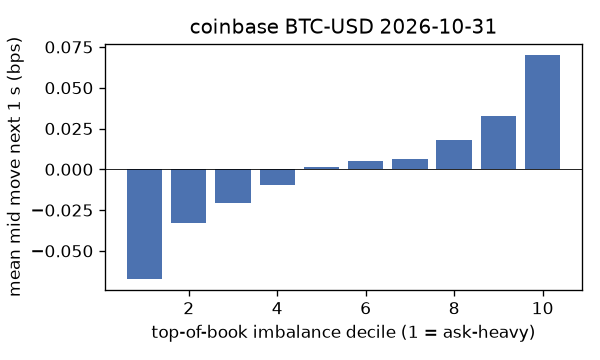
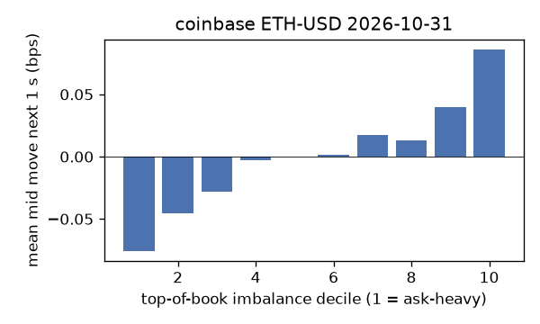
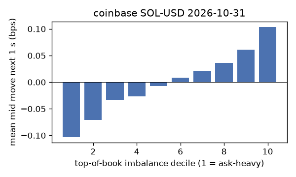
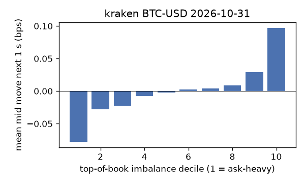
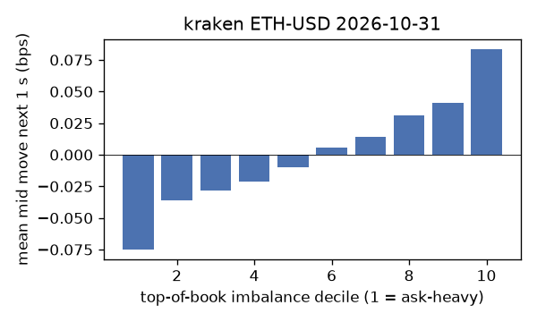
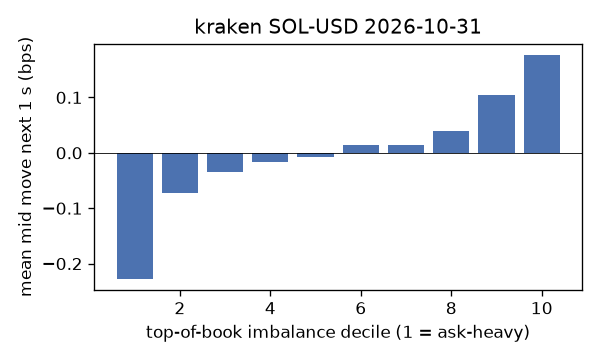

# EDA 2026-10-31

100 ms clock grid; correlations are with the future mid change; nothing measured across a reconnect.

|                       |   ('coinbase', 'BTC-USD') |   ('coinbase', 'ETH-USD') |   ('coinbase', 'SOL-USD') |   ('kraken', 'BTC-USD') |   ('kraken', 'ETH-USD') |   ('kraken', 'SOL-USD') |
|:----------------------|--------------------------:|--------------------------:|--------------------------:|------------------------:|------------------------:|------------------------:|
| hours                 |                   23.9996 |                   23.9996 |                   23.9996 |                 23.9994 |                 23.9994 |                 23.9994 |
| mid                   |                77340.8    |                 2244.93   |                   95.745  |              77351.4    |               2245.09   |                 95.765  |
| tick                  |                    0.01   |                    0.01   |                    0.01   |                  0.1    |                  0.01   |                  0.01   |
| spread_med_bps        |                    0.0013 |                    0.0445 |                    1.0444 |                  0.0129 |                  0.0445 |                  1.0442 |
| spread_p90_bps        |                    0.0013 |                    0.3118 |                    1.0444 |                  0.0129 |                  0.0445 |                  1.0442 |
| at_1_tick_%           |                   98.0022 |                   74.0689 |                   92.1614 |                 99.7581 |                 92.2027 |                 98.0996 |
| taker_events/min      |                  160.866  |                   31.0559 |                   31.1458 |                 25.2269 |                 10.6769 |                 13.5683 |
| taker_usd_med         |                    0.0216 |                   55.2203 |                   47.4359 |                 55.5759 |                 53.6209 |                 51.005  |
| inter_taker_ms_med    |                  299.522  |                 1199.35   |                 1201.97   |               1306.86   |               3527.56   |               2838.8    |
| moved_100ms_%         |                    2.3405 |                    8.9052 |                    2.3024 |                  0.6428 |                  4.6409 |                  1.5854 |
| corr_obi1_100ms       |                    0.0571 |                    0.0674 |                    0.0583 |                  0.0613 |                  0.0654 |                  0.0816 |
| corr_obi5_100ms       |                    0.0427 |                    0.0312 |                    0.035  |                  0.0581 |                  0.0544 |                  0.0536 |
| corr_micro_edge_100ms |                    0.0434 |                    0.0399 |                    0.0576 |                  0.1215 |                  0.047  |                  0.0838 |
| moved_1s_%            |                   10.2758 |                   31.6015 |                   13.7453 |                  4.7567 |                 20.4357 |                  9.02   |
| corr_obi1_1s          |                    0.1082 |                    0.1055 |                    0.1043 |                  0.1611 |                  0.12   |                  0.1697 |
| corr_obi5_1s          |                    0.0865 |                    0.0501 |                    0.066  |                  0.1516 |                  0.1017 |                  0.1162 |
| corr_micro_edge_1s    |                    0.0234 |                    0.0373 |                    0.0983 |                  0.1177 |                  0.0362 |                  0.1691 |
| moved_10s_%           |                   45.1809 |                   72.5524 |                   53.9015 |                 32.0007 |                 64.5601 |                 46.8719 |
| corr_obi1_10s         |                    0.1276 |                    0.1119 |                    0.0932 |                  0.3301 |                  0.1554 |                  0.2358 |
| corr_obi5_10s         |                    0.1118 |                    0.0536 |                    0.0605 |                  0.3104 |                  0.1377 |                  0.1712 |
| corr_micro_edge_10s   |                    0.0094 |                    0.0343 |                    0.0856 |                  0.1628 |                  0.0388 |                  0.2327 |
| ofi_R2_same_1s        |                    0.1934 |                    0.2377 |                    0.4096 |                  0.1913 |                  0.169  |                  0.2059 |
| ofi_R2_next_1s        |                    0.0053 |                    0.0038 |                    0.0019 |                  0.011  |                  0.005  |                  0.007  |

