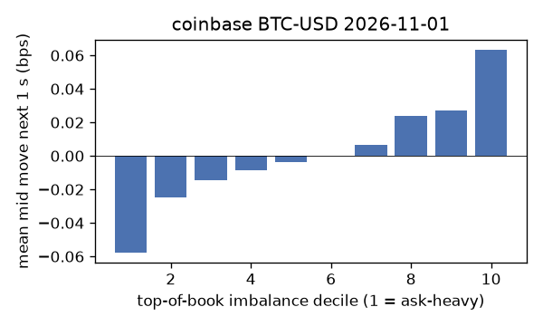
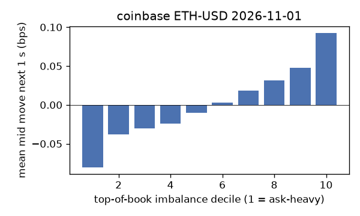
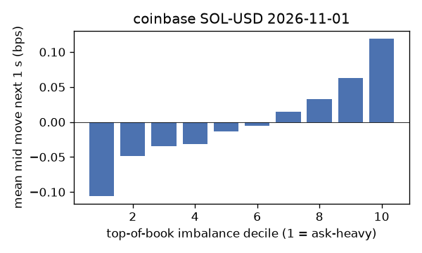
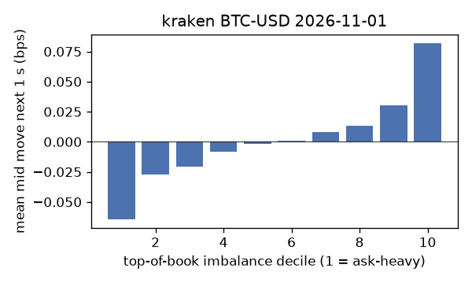
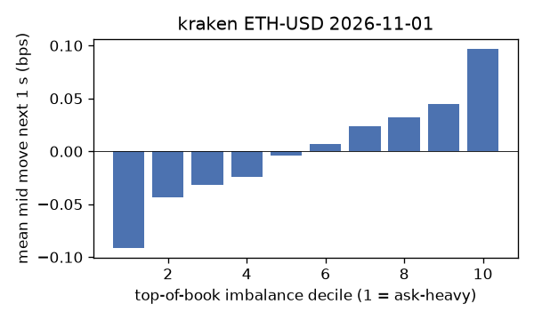
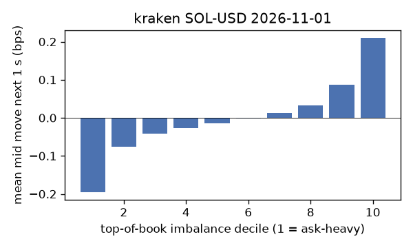

# EDA 2026-11-01

100 ms clock grid; correlations are with the future mid change; nothing measured across a reconnect.

|                       |   ('coinbase', 'BTC-USD') |   ('coinbase', 'ETH-USD') |   ('coinbase', 'SOL-USD') |   ('kraken', 'BTC-USD') |   ('kraken', 'ETH-USD') |   ('kraken', 'SOL-USD') |
|:----------------------|--------------------------:|--------------------------:|--------------------------:|------------------------:|------------------------:|------------------------:|
| hours                 |                   23.9997 |                   23.9997 |                   23.9996 |                 23.9994 |                 23.9995 |                 23.9995 |
| mid                   |                77801.9    |                 2264.66   |                   95.105  |              77817.6    |               2264.68   |                 95.12   |
| tick                  |                    0.01   |                    0.01   |                    0.01   |                  0.1    |                  0.01   |                  0.01   |
| spread_med_bps        |                    0.0013 |                    0.0442 |                    1.0515 |                  0.0129 |                  0.0442 |                  1.0513 |
| spread_p90_bps        |                    0.0013 |                    0.3974 |                    2.1029 |                  0.0129 |                  0.0442 |                  1.0513 |
| at_1_tick_%           |                   96.7375 |                   69.0393 |                   88.3098 |                 99.5096 |                 90.0633 |                 96.3977 |
| taker_events/min      |                  125.273  |                   39.565  |                   30.7199 |                 24.1746 |                 11.5203 |                 13.2764 |
| taker_usd_med         |                    4.752  |                   50.6733 |                   48.5737 |                 46.5615 |                 57.0114 |                 54.9268 |
| inter_taker_ms_med    |                  299.683  |                  800.249  |                 1197.34   |               1311.75   |               3109.73   |               2689.93   |
| moved_100ms_%         |                    3.4087 |                    9.7896 |                    2.3877 |                  0.7452 |                  5.1696 |                  1.5657 |
| corr_obi1_100ms       |                    0.0521 |                    0.0631 |                    0.0596 |                  0.0605 |                  0.0706 |                  0.0776 |
| corr_obi5_100ms       |                    0.0358 |                    0.0394 |                    0.0378 |                  0.0579 |                  0.0618 |                  0.0428 |
| corr_micro_edge_100ms |                    0.0305 |                    0.0311 |                    0.0581 |                  0.0637 |                  0.0455 |                  0.0776 |
| moved_1s_%            |                   14.0655 |                   34.6339 |                   13.4946 |                  5.0464 |                 21.6664 |                  9.0662 |
| corr_obi1_1s          |                    0.0921 |                    0.1058 |                    0.103  |                  0.1437 |                  0.1232 |                  0.16   |
| corr_obi5_1s          |                    0.071  |                    0.0644 |                    0.0713 |                  0.1369 |                  0.112  |                  0.0913 |
| corr_micro_edge_1s    |                    0.0101 |                    0.0358 |                    0.097  |                  0.0574 |                  0.0426 |                  0.1573 |
| moved_10s_%           |                   52.9667 |                   77.3041 |                   52.7203 |                 31.8812 |                 65.8893 |                 45.6153 |
| corr_obi1_10s         |                    0.1231 |                    0.1117 |                    0.1085 |                  0.2779 |                  0.153  |                  0.2241 |
| corr_obi5_10s         |                    0.1066 |                    0.0703 |                    0.0794 |                  0.2609 |                  0.1437 |                  0.137  |
| corr_micro_edge_10s   |                    0.0006 |                    0.0368 |                    0.104  |                  0.06   |                  0.0374 |                  0.2147 |
| ofi_R2_same_1s        |                    0.1862 |                    0.2481 |                    0.3608 |                  0.2256 |                  0.179  |                  0.2857 |
| ofi_R2_next_1s        |                    0.0034 |                    0.0047 |                    0.0013 |                  0.0088 |                  0.0036 |                  0.0027 |

